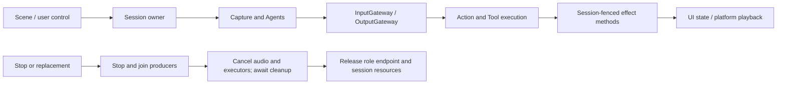

# App Lifecycle

Purpose: coordinate voice and camera runtime scopes. Design goals: preserve admission, sequence fencing and producer-before-executor cleanup while keeping page state separate.

| File | Responsibility |
| --- | --- |
| VoiceSessionCoordinator.swift | Voice Agents, capture/output tasks, session/turn checks, actual playback, the voice-scope PCM cache and cleanup; receives runtime, capabilities, audio service and ConversationState |
| CameraCoordinator.swift | Permission/foreground/user intent, native camera start/stop and one vision task; receives AppleCamera, CameraState and a vision-session factory |
| VisionSession.swift | One VisionPerception Agent incarnation, frame admission and output consumption through Gateways; receives the shared runtime and PoseCapability |

CameraCoordinator has one worker and one latest desired state; newer user intent replaces pending intent. Native frames retain their existing bounded latest-frame stream. VisionSession uses App/Adapters for image conversion, awaits Tool completion and joins each admitted Action before consuming another replaceable output. These files own running scopes, not page layout or dependency registration.

✅ Whole voice/camera endpoints bind through RuntimePresentation, with weak ownership and rejection of an occupied role. State can remain visible independently of the lifetime of a rendered page. Long-running tasks belong to the window/application host.

❌ Multi-window arbitration, non-cooperative handler preemption and autonomous background execution. No new input/event queues are introduced.

## Action runtime stage 2

✅ CameraCoordinator acquires a 60-second camera.capture lease, renews every 10 seconds and fences camera start. Stop/lens/background transitions release the lease through centralized stop acknowledgment. Faults remain blocked until explicit retry/recovery; stale local cleanup cannot stop a newer owner. Latest capture ActivityEvent is host telemetry, not a recording Action or model turn. ❌ No generic activity event stream or real-device takeover acceptance.

## Domain-owned behavior assembly

✅ VoiceSessionCoordinator and VisionSession no longer await prepareTools; the complete Tool registry is validated during ApplicationRuntime construction. Existing voice/camera ownership, join order and physical effects remain unchanged. ❌ This migration does not add device functionality.

## Action implementation audit

✅ VoiceSessionCoordinator implements typed play(audioID:invocation:) and delegates checkout/drain/release to SpeechPlayback. Audio argument decoding belongs to SpeechActions.speak.

✅ Structured Action failures are labeled as action failures rather than generic speech-processing failures. NexArm argument errors provide localized descriptions instead of exposing Swift error type names. Cancellation and input cleanup behavior remain unchanged.

## Action and Tool presentation boundary

✅ Caption append, full transcript replacement, voice phase and gaze endpoints consume ToolInvocation. The existing session/turn acceptance policy remains; expression and audio keep scheduled Action contexts. ❌ No audio/recognition errors are inserted into the Action panel.
