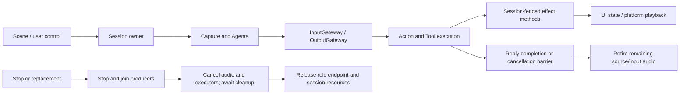

# App Lifecycle

Purpose: coordinate voice and camera runtime scopes. Design goals: preserve admission, sequence fencing and producer-before-executor cleanup while keeping page state separate.

| File | Responsibility |
| --- | --- |
| VoiceSessionCoordinator.swift | Voice Agents, capture/output tasks, session/turn checks, actual playback, the voice-scope PCM cache and cleanup; receives VoiceRuntimeDependencies, capabilities, audio service and ConversationState |
| AudioDetectionSession.swift | Isolated microphone/source-only Agent session, Gateway pumps, native-fact/UI projection and joined shutdown |
| CameraCoordinator.swift | Permission/foreground/user intent, native camera start/stop and one vision task; receives AppleCamera, CameraState and a vision-session factory |
| VisionSession.swift | One VisionPerception Agent incarnation, frame admission and output consumption through Gateways; receives VisionRuntimeDependencies and an injected Agent factory |

✅ VoiceSessionCoordinator enters listening only after AppleAudioIO confirms actual PCM delivery. A failed capture or unexpectedly ended stream clears the microphone spectrum and enters the failed presentation phase, retaining the existing independent Assistant/Synthesis scope. Closing capture admission also rejects in-flight voice-state Tools so they cannot restore listening after failure. Generation checks after asynchronous capture shutdown prevent old failures from changing a replacement session. ❌ Physical microphone restart and spatial/camera/playback coexistence still require device acceptance.

CameraCoordinator has one worker and one latest desired state; newer user intent replaces pending intent. Native frames retain their existing bounded latest-frame stream. VisionSession uses App/Adapters for image conversion, awaits Tool completion and joins each admitted Action before consuming another replaceable output. These files own running scopes, not page layout or dependency registration.

✅ Whole voice/camera endpoints bind through RuntimePresentation, with weak ownership and rejection of an occupied role. State can remain visible independently of the lifetime of a rendered page. Long-running tasks belong to the window/application host.

❌ Multi-window arbitration, non-cooperative handler preemption and autonomous background execution. No new input/event queues are introduced.

## Action runtime stage 2

✅ CameraCoordinator acquires a 60-second camera.capture lease, renews every 10 seconds and fences camera start. Stop/lens/background transitions release the lease through centralized stop acknowledgment. Capture failure requires normal camera retry; resource ownership has no persistent fault/recover state. Cleanup timeout fails its request and retains unfinished work until actual completion automatically unlocks; stale local cleanup cannot stop a newer owner. Latest capture ActivityEvent is host telemetry, not a recording Action or model turn. See [resource ownership](../../Gateway/Output/Resources/README.md). ❌ No generic activity event stream or real-device takeover acceptance.

## Domain-owned behavior assembly

✅ VoiceSessionCoordinator and VisionSession no longer await prepareTools; the complete Tool registry is validated during ApplicationRuntime construction. Existing voice/camera ownership, join order and physical effects remain unchanged. ❌ This migration does not add device functionality.

## Action implementation audit

✅ VoiceSessionCoordinator implements typed play(audioID:invocation:) and delegates checkout/drain/release to SpeechPlayback. Audio argument decoding belongs to SpeechActions.speak.

✅ Structured Action failures are labeled as action failures rather than generic speech-processing failures. NexArm argument errors provide localized descriptions instead of exposing Swift error type names. Cancellation and input cleanup behavior remain unchanged.

## Action and Tool presentation boundary

✅ Caption append, full transcript replacement, voice phase and gaze endpoints consume FunctionInput. The existing session/turn acceptance policy remains; expression and audio keep scheduled Action contexts. ❌ No audio/recognition errors are inserted into the Action panel.

✅ VoiceSessionCoordinator retires source/input audio after successful dispatch of reply completion/error controls, when Gateway has joined the corresponding Actions. Dispatch failure also retires that input; voice interruption still stops the producer before cancelling all audio in that session. Pending/ready PCM has no wall-clock expiry. Consumed frames already leave Storage on read, and each played handle is released after hardware drain; reply cleanup retires only remaining handles. The production store has no PCM read timeout; the synthesis worker owns its 60-second execution deadline, excluding queue time. The voice session spans multiple replies; current voice admission allows one reply through playback at a time, while cache ownership still isolates other sources and inputs. ❌ Generation completion alone is not playback completion, and this does not add barge-in or multi-reply UI.

✅ Voice/camera endpoints consume independent Action/Tool contexts. AppWorkflows owns conversation policy and stored-audio playback adaptation; lifecycle owners retain actual session and device state.

✅ Reply cleanup converts OutputEnvelope.source to its raw string at the StorageAudio boundary, retaining source/input-scoped cancellation.

✅ ADR0098: RuntimeDependencies supplies immutable voice/vision/camera service slices instead of ApplicationRuntime. Composition injects Agent factories; registration, input/output pumps, barriers and cleanup remain owned here.

✅ CameraCoordinator implements explicit setEnabled/flip Tool controls. Foreground and idle-worker admission are required; overlap fails busy, flip while disabled fails. Completion waits for reconciliation and checks revision, permission and capture state. Scene/UI supersession fails cancellation; close joins capture release and vision cleanup. VoiceSessionCoordinator validates Assistant source and active voice session. ❌ Open capture does not prove pose inference readiness; admitted intent is not rolled back on caller cancellation.

✅ VisionSession registers Photographer alongside the injected vision Agent, dispatches both output streams, and removes both during joined session cleanup.

✅ Photographer construction is injected from composition. VisionSession tracks successful registration and cleans up its own Agents after partial activation failure; it never removes a pre-existing Photographer after registration rejection.

✅ VisionSession treats tracking outputs as an independent subscriber. Each failed Tool is retained by the independent OutputGateway failure observer for the home scheduling issue list and does not stop frames, VisionPerception or showPose. Subscriber completion does not end the camera task group; cancellation still joins both producers. ❌ Physical tracking acceptance remains pending.

✅ Voice and vision consumers use nonfatal Gateway execution outcomes. SpeechPerception failure stops only its capture worker and own actor, preserving Assistant/SpeechSynthesis lifetime; session/user cancellation retains full cleanup.

✅ Vision failure updates only visionStatus and stops its frame admission; Photographer remains independently registered until explicit camera session cancellation. Capture/recognition failure does not cancel Assistant or Synthesis.

✅ Assistant terminal failure leaves independently registered perception/synthesis alive; the host lifetime waits for explicit cancellation before full cleanup. Its idle wait has no producer and an explicit capacity1. Recognition resume failure stops only recognition/capture.

✅ Expression adaptation has capacity one override and one continuation, rejecting conflicting activation. SwiftUI transaction IDs acknowledge actual animation completion; cancellation, renderer disappearance, new turn and stop resume the waiter exactly once. Restoration is invocation-fenced and uses the current base. UI.Expression.express composition belongs to Actions; setExpression commits persistent state. ❌ Physical animation acceptance remains pending.

## Conversation Tool execution evidence

✅ VoiceSessionCoordinator consumes OutputGateway.execute's outcome and journals only previously recorded native model calls through StorageChat. It records returning ToolResponse values/errors, completion-only success and cancellation using the original input ID and runtime call UUID. Recording failures are explicitly reported in runtime status; execution is never replayed. Generation status is independent of Tool completion. Internal UI Tools and non-journal inputs do not create records.
❌ Durable native call transcripts from older app versions cannot be reconstructed.

## Local model resources — current contract

✅ CameraCoordinator.pauseVisionForModelMaintenance cancels/joins pose work while retaining native preview. App uses voice settings-change stop/join hooks for explicit removal. Management reserves all referencing resource admission barriers before quiescence and retains them through unload/removal; old capability handles cannot reload inside that interval. Download completion never starts recording or inference automatically.

✅ MobileHarnessApp forwards native ZIP and HF background session events and restores generation-bound task associations independently of page navigation. App composition injects the same ModelKitHub adapter. HF preserves completed files and available system resume data across relaunch; explicit cancel/delete drains before discarding staging. A bounded App preparation window supports metadata/final installation. Phone/server-resume acceptance remains pending; no background robot execution is granted.

❌ OS background scheduling/force quit, full iPhone acceptance and HF durable background recovery remain outstanding. See [Management](../../ModelKit/Management/README.md#local-model-resources--current-contract).

✅ Rejected model calls remain Gateway execution outcomes and do not stop the voice session. Assistant attempts to persist native Tool parse failures before output; recording failure produces a separate nonterminal Gateway outcome, while the original rejection is still emitted. ❌ No automatic model repair is performed.

✅ VisionSession forwards the native monotonic capture instant through ImageInput. CameraCoordinator converts optional Tool pose statistics to shared UI values under the existing session/sequence checks; clearing the skeleton also clears statistics. No additional tasks or direct Agent telemetry callbacks are introduced.

✅ App injects FrameSamplingConfiguration with validated default 0...250ms adaptive bounds and a 100ms initial interval. CameraCoordinator no longer owns percentage threshold state/control or restarts sessions for threshold edits; frame retention and inference cadence remain VisionPerception responsibilities.

✅ CameraCoordinator maps optional detectionIntervalMilliseconds with the existing statistics; UI receives measured values through the same session/sequence-fenced Tool endpoint. Adaptation remains entirely inside VisionPerception.

✅ CameraCoordinator maps imageMotion through the existing whole-camera endpoint; analysis, ROI/noise adaptation, timing-budget feedback and stale-frame/result decisions remain in VisionPerception. No camera-frame preprocessing or scheduling policy is added to App.

✅ Urgent YOLO detection now permits a zero scheduling interval. The single inference worker processes only the newest pending capture after the active call completes. Normal inference duration adds no scheduling floor; compute-dominated freshness pressure can temporarily impose a bounded cost floor. Camera close already clears skeleton and its statistics; no source-stall timer is added.

✅ CameraCoordinator now maps Actions.PoseOverlay into UI/Camera values; Tool and session/sequence semantics remain unchanged.

✅ VoiceSessionCoordinator and VisionSession use MediaInputAdapter for explicit device-source/deadline admission. Published generic messages are extracted as typed business PerceptionMessage only in the App observer; session/turn checks and shutdown joins are preserved.

✅ CameraCoordinator owns captureResource (camera.capture); AgentCore ResourceID remains device-neutral. Composition registers that same host-owned identity. ❌ No additional capture owner.

✅ ADR0119: App transports native camera frames and native-rate microphone samples with session/source/deadline metadata. Calling perception Agents own conversion into ModelKit inputs; composition no longer injects image conversion. SDK inputs/outputs are owned by ModelKit or PlatformKit, without Types dependencies. ❌ No physical-device acceptance is implied.

✅ CameraCoordinator reports out-of-order presentation admission with CommunicationError.outOfOrder; AgentCore ImageInputError is limited to malformed frame values. ❌ No camera or model lifetime changes.

✅ ADR0121 removes the Types module: AgentCore/Input owns generic audio/image transport, UI/Camera owns PoseOverlay, and VisionPerception owns PoseOverlayPayload. App adapts the independent Tool payload into UI values. ❌ Capability SDKs must not import consumer or presentation modules.

✅ VoiceSessionCoordinator requests spatial-capable microphone capture, transports native layout/PTS/monotonic capture time through InputGateway and uses W only for existing spectrum telemetry. Existing reply admission suppresses all sound/ASR inputs. Voice cleanup awaits async microphone shutdown; SpeechDiagnosticWorkflow also joins audio cleanup. ❌ No sound direction is consumed or presented by App; route/coexistence acceptance remains physical-device work.

## Isolated audio detection session

✅ AudioDetectionSession.swift owns the entire diagnostic capture/perception endpoint: a fresh AppleAudioIO, session ID, AgentManager and both Gateways, with only SpeechPerception registered in soundSourceOnly mode. All PCM goes through MediaInputAdapter/InputGateway and direction through the bound publishResult port/OutputGateway observer. App maps SDK facts and observations into UI values; it contains no direction DSP. Native meter snapshots are latest replaceable values, at most 10 Hz; raw PCM admission retains explicit rejection. Route changes and interruptions stop the attempt for explicit retry, rather than silently updating layout/input. No Assistant, Photographer, conversation recording, playback or robot execution is registered.

✅ Composition supplies mutual voice/diagnostic cleanup barriers. Starting diagnostics stops and joins admitted voice work; starting voice cancels and joins diagnostics before microphone setup. A pending voice start is not recursively joined by diagnostic pre-start cleanup. Shutdown closes UI updates, cancels/joins output handling and Agent publication, stops hardware and removes the isolated registration before replacement.

❌ Physical transitions, microphone permission/route behavior and camera coexistence remain device acceptance items.

✅ ADR0131: VisionSession continues processing after ordinary tracking output failure; OutputGateway records those failures for the home scheduling issue list. CameraCoordinator exposes no tracking error banner endpoint. BLE recovery does not stop voice/session scheduling. ❌ Physical coexistence acceptance remains pending.

✅ ADR0141 removes CameraCoordinator's faulted/recover flag and branch. Retry performs normal lease acquisition against current occupancy; late completed cleanup unlocks automatically. Cancelled lifecycle removal and closure during an existing handoff still await bounded coordinator-owned acknowledgment. Camera capture leases retain deadlines, renewals and stale-lease checks. ❌ Software closure does not establish physical device stop.

✅ Voice playback adapts known producer/storage failures to user wording only after SpeechPlayback cleanup; cancellation and unknown errors propagate unchanged. ❌ No new lifecycle owner or Agent intent route is added.

✅ ADR0157: canonical executable definitions and shared outcomes replace duplicate protocol metadata; consumers import Actions/FunctionContracts. Protocol request views remain adapters, and production permission/resource boundaries are preserved.

❌ Physical acceptance and additional business capability exposure are not established by this migration.

✅ ADR0159 — Unified invocation: all business functions, injected capabilities and registered handlers receive FunctionInput with ActionExecutionContext. Native request/result normalization stays in Runtime/Gateway; no protocol-specific implementation signature remains.

✅ ADR0160: callable functions and shared producer failures are independent of call protocols. This directory consumes the appropriate pure function/shared invocation or registration adapter at its existing boundary; host profiles own protocol selection. ❌ Broader feature Signal migration and physical acceptance remain separate.

✅ ADR0161: standard callable inputs use FunctionInput/FunctionContracts; common execution and call protocols belong to independent Gateway targets. This directory retains its existing ownership, resource/permission and lifecycle boundaries. ❌ Remaining feature Signal/continuation and physical acceptance are separate work.

✅ ADR0163: host camera activity events carry an explicit lease-scoped causal root shared across that activity's states. No Agent input exists on the current host camera route; Agent-controlled camera entry migration remains pending. Capture/renewal/cleanup algorithms are unchanged.
