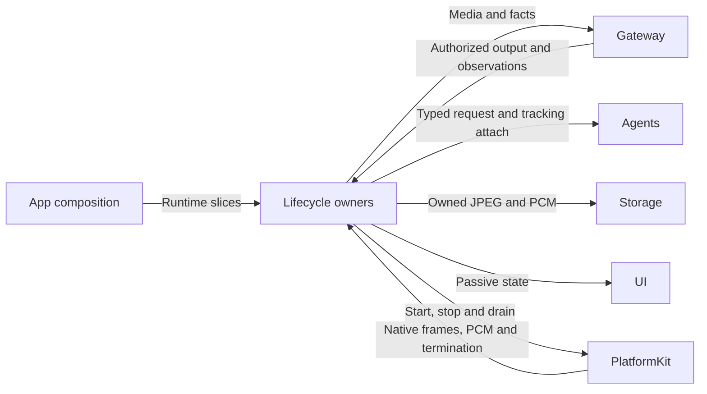
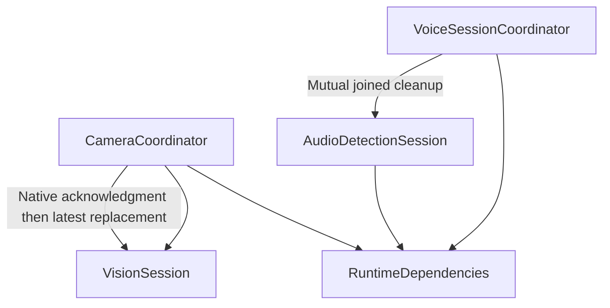

# Native Session Lifecycles

## Summary

Owns voice, camera, vision and isolated audio-diagnostic scopes, including startup, output consumption and joined shutdown.

## Ownership and boundaries

Owners receive role-specific RuntimeDependencies. CameraCoordinator owns capture/photo/export; VoiceSessionCoordinator owns native voice barriers and reply transport; VisionSession owns only VisionPerception and attachment to resident Photographer. Business policy stays in Agents.

## External relationships and data flow

Runtime arrows show data or capability calls; dashed arrows show injection.

## Internal structure

## Owner contracts

| Owner | State and lifecycle |
| --- | --- |
| VoiceSessionCoordinator | Resident SpeechPerception, capture epochs, interaction/reply output consumers, listening revisions, utterance/playback barriers |
| CameraCoordinator | Foreground capture revision, camera.capture lease/renewal, preview, one photo task, displayed photo ownership and one joined export |
| VisionSession | Native frame forwarding, VisionPerception registration/output, one tracking attachment; detach joins tracking without stopping Photographer |
| AudioDetectionSession | Isolated AppleAudioIO, fresh session/manager/Gateways and soundSourceOnly SpeechPerception; no conversational or device execution |
| RuntimeDependencies | Immutable service slices and callback contracts |

## Speech admission and presentation

User-off stops physical capture and cancels the current Assistant reply. Policy pause preserves consent/awake presentation but stops native capture after confirmed utterance completion; commands require the actual SpeechPerception/root session and monotonic revision. New-wake Listening completion joins readiness, feedback and native capture admission; ordinary policy updates retain their separate confirmed-utterance pause worker. Startup and pause workers are separately cancellable and generation-fenced.

A confirmed utterance finishes bounded ASR before playback. Actual playback/audio cleanup is an additional resume barrier; capture resumes immediately once it and the SpeechPerception listening policy permit, with no fixed acoustic delay. App reports revision-fenced speech.captureEnded on native termination; recoverable recognition failures do not terminate capture. Final semantic ASR uses the stable interaction scope; raw/partial media retains capture generation.

ConversationPresentation separates recognition turns, visible reply focus and execution ownership. A newer accepted recognized turn resets captions; rejected/same-turn updates do not. Changing visible producer cannot cancel authorized queued or playing speech. Playback validates real producer, active session/task and cancellation.

## Camera, perception and photo ownership

Camera commands validate the actual Assistant/Photographer execution owner and root or active task scope. Healthy flips atomically replace native input under the retained lease, acknowledge native completion, retire old pose/gaze and replace vision through a latest-intent joined worker. Off/background/model maintenance invalidates and joins replacement; failed switches stop capture for explicit retry.

Photo capture freezes foreground/session/revision and owns one task; photoBusy spans that task and clears on every terminal path. App selects a FIFO JPEG retention policy through composition; exact host limits are owned by [Composition](../Composition/README.md), while [StorageMedia](../../Storage/Media/README.md) owns store defaults and overflow. Actual capture persists even if presentation fails. Display animation completion is distinct from capture. Camera facts are published from committed native/presentation state, without invoking a model.

Save validates the displayed photo ID and original StorageOwner, reads the original JPEG and joins one Photos transaction. Capture/export overlap fails busy. Confirmed import sets savedMediaID; the exact saved ID remains idempotent after departure. Successful save/ignore joins renderer and cue, then clears only the matching current surface; optional receipt feedbackIssues distinguish presentation failure from committed disposition. Permission failure keeps the thumbnail. Ignore hides the current acknowledged thumbnail without deleting album data or private reasoning evidence. Foreground is required; an open camera is not.

## Cleanup and diagnostics

Close admission; cancel/join pumps, model/handler/pause/startup work and native operations; remove matching registrations; release bindings/leases. Resource cleanup uses coordinator-owned joined acknowledgment even when initiated by a cancelled task; it has no default acknowledgment deadline. No cancellation result fabricates physical stop.

Voice and diagnostics use mutual cleanup barriers. AudioDetectionSession owns all capture/perception work; route/interruption ends the attempt for explicit retry. Meter observations are latest values at most 10 Hz; PCM rejection is explicit. Diagnostics never registers Assistant, Photographer, playback or robot execution.

Separate interaction/capture lifetimes, native scope fences, photo disposition and independent lens/vision replacement are implemented.

## Related design

[Parent design](../README.md)

音频完成等待使用原生回调、实际错误及作用域取消，不设置 ASR/TTS 收尾、PCM 首帧或播放 buffer 兜底计时器；完成依赖真实回调，失败保留实际来源。

VoiceSessionCoordinator bounds UI toggle publication to one operation (overlap is rejected), cancels/joins it on shutdown, and keeps activation in its generation-fenced startup worker. Stop invalidates pending expression callbacks and renders closed resting eyes; full startup resets base expression. Native route/interruption restart text uses 按住. Canonical feedback and cancellation contracts are described below.

AudioDetectionSession maps the new generic native busy error to an explicit localized busy result, preserving its isolated capture/diagnostic contract.

VoiceSessionCoordinator uses ListeningCaptureWorkflow to serialize native start/stop, cancels and joins old pumps on pause, preserves monotonic input sequence across physical resumes and fences errors by capture epoch. Confirmed VAD/ASR completion precedes physical pause; both reply-policy pause and playback stop the microphone. Resume joins policy/native readiness, with no new activation chime. UI off immediately invalidates capture/old-turn captions and native playback and starts one root-owned reply cancellation task; new voice startup joins it. RuntimeDependencies adds injected cancelReply, with no global lookup in Lifecycle.

manual off latches local admission closed immediately, publishes explicit disabled consent, and cancels Assistant independently even if consent publication fails. Next hold joins cancellation and native cleanup before publishing explicit enabled consent. Stale enabled policy outputs cannot reopen capture during user-off. Native resume failure terminates the logical capture with an explicit error.

VoiceSessionCoordinator owns NativeHapticFeedback and an error-returning startup worker. Listening update joins startup under cancellation handler, preserving generation fences and native cleanup. ✅ Startup validates capabilities/permission, opens the SpeechPerception capture epoch and starts the microphone before model loading. Native first PCM enables isVoiceActive/listeningAnimationID; canonical cue/native-start-gated haptic then run together. Feedback completion only advances a still-loading presentation, preserving earlier hearing/processing updates. Composed failures stop capture and surface evidence. Cue samples are generated off MainActor. Automatic pause/resume has no activation effects.

cancellation of the parent Listening Action cancels its matching startup worker and invalidates native capture immediately under a startup-ID fence. Cleanup can then join a pending first-frame wait without cancelling a replacement generation.

CameraCoordinator owns one joined photo command, canonical UIModule cue child using a private photo-native capability, and NativeCuePlayback for overlay cues. Save commits Photos before feedback; ignore commits the selected preview decision. PhotoDispositionWorkflow joins visual/audio effects, retains bounded issues and removes only the original ID after completion/cancellation. Save failure retains the thumbnail. Explicit duplicate saved ID returns alreadySaved after departure, without replaying feedback. Foreground shutdown cancels/joins command and stops its cue without resetting voice capture or speech.

Native first-frame readiness publishes isVoiceActive and the current generation as listeningAnimationID. Stop clears both immediately; model readiness does not gate the animation. Photo archive bound reflects explicit composition policy.

VoiceSessionCoordinator owns one context-fenced ListeningFeedbackStart gate for a fresh activation. activation playCue releases it from NativeCuePlayback successful native play callback and fails it on actual errors; vibrate prewarms its requested native generator, waits only for the matching activation context, revalidates after await, and ordinary feedback remains independent. Startup cleanup cancels any outstanding gate and clears only the matching owner. Prompt PCM generation stays off MainActor; native onset latency remains hardware/route controlled.

voicePressChanged owns one coalesced cue-PCM preparation Task and a cached default wake PCM. It joins diagnostics/cleanup before preparing samples, without starting an output graph or recording before consent. End before activation and shutdown cancel preparation. Accepted hold latches pending-activation ownership until the Listening Action arrives, fails or stops. Activation cue playback uses an independent NativeCuePlayback under the existing recording session; stopVoice stops it immediately and joins startup cleanup. Ordinary nonactivation feedback keeps its existing AppleAudioIO clip path. The cue is not muted out of captured PCM, preserving simultaneous user speech; acoustic self-trigger/volume acceptance is outstanding.

根生命周期负责停止 HomeEffectsWorkflow 并加入其到期任务清理；展示策略与状态归 [Presentation](../Workflows/Presentation/README.md)。

mask bottom ASR and reply/status immediately while a notice is visible, restore retained text after dismissal, and preserve pinned Task/promoted ASR layout. Consent-off clears both captions; root HomeEffectsWorkflow owns one ID/text-fenced350ms reply fade/removal task, cancelled by new text/turn/off/shutdown, scheduled only after reply-policy/playback/native-resume barriers. Agent errors stay in factual root failure notices, not persistent voiceStatus copies. Durable configuration documents retain explicit file protection. Agent runtime state uses memory; business records use SQLite. This does not infer the cause of historical lock-boundary failures.

## Streaming TTS latency

Playback is counted from admission through audio cleanup, then immediate listening restoration is joined if consent/session/policy permit. The joined restoration task does not inherit a cancelled playback caller; original playback failure is preserved, additional restoration failure is logged, and a standalone restoration failure is propagated. No idle acoustic task or fixed post-playback delay remains.

## Isolated audio-detection communication

AudioDetectionScope restricts the loaded SpeechPerception declaration to media.audio and sound.source before constructing its single-Agent CommunicationPolicy. Only phone.microphone PCM is subscribed; conversational consent, reply occupancy and speech outputs are excluded. The same projected configuration constructs the Agent. This scope has no Assistant publication dependency. Cancellation, bounds and joined cleanup apply to the scope owner.

## SQLite records and runtime identity

CameraCoordinator consumes Media-owned JPEG store; File/SQLite creation remains in App composition. Preserve capture/save ownership and truthful cancellation outcomes.

Isolated AudioDetectionSession uses a fresh process-memory context. It does not load or save diagnostic JSON.

AudioDetectionSession uses a fresh process-memory SpeechPerception context; it neither loads nor writes diagnostic context JSON.

## 待实现

- Video recording and photo-gallery lifecycle are not implemented.
