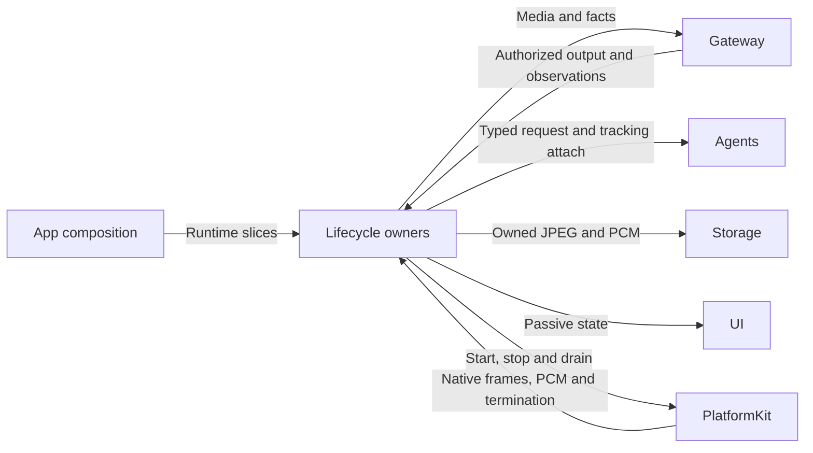
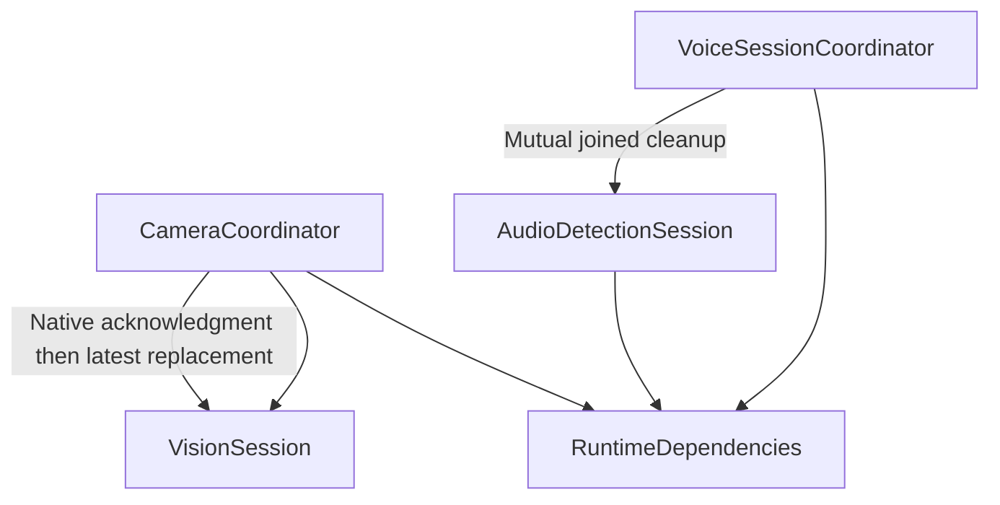

# Native Session Lifecycles

## Summary

Owns voice, camera, vision and isolated audio-diagnostic scopes, including startup, output consumption and joined shutdown.

## Ownership and boundaries

Owners receive role-specific RuntimeDependencies. CameraCoordinator owns capture/photo/export; VoiceSessionCoordinator owns native voice barriers and reply transport; VisionSession owns only VisionPerception and attachment to resident Photographer. Business policy stays in Agents.

## External relationships and data flow

Runtime arrows show data or capability calls; dashed arrows show injection.

## Internal structure

## Owner contracts

| Owner | State and lifecycle |
| --- | --- |
| VoiceSessionCoordinator | Resident SpeechPerception, capture epochs, interaction/reply output consumers, listening revisions, utterance/playback/tail barriers |
| CameraCoordinator | Foreground capture revision, camera.capture lease/renewal, preview, one photo task, displayed photo ownership and one joined export |
| VisionSession | Native frame forwarding, VisionPerception registration/output, one tracking attachment; detach joins tracking without stopping Photographer |
| AudioDetectionSession | Isolated AppleAudioIO, fresh session/manager/Gateways and soundSourceOnly SpeechPerception; no conversational or device execution |
| RuntimeDependencies | Immutable service slices and callback contracts |

## Speech admission and presentation

User-off stops physical capture. Policy pause retains capture but suppresses recognition admission; commands require the actual SpeechPerception/root session and monotonic revision. Listening completion acknowledges policy, not an utterance or model startup. Startup and pause workers are separately cancellable and generation-fenced.

A confirmed utterance finishes bounded ASR before playback. Actual playback plus a 350 ms tail is an additional resume barrier. App reports revision-fenced speech.captureEnded on native termination; recoverable recognition failures do not terminate capture. Final semantic ASR uses the stable interaction scope; raw/partial media retains capture generation.

ConversationPresentation separates recognition turns, visible reply focus and execution ownership. A newer accepted recognized turn resets captions; rejected/same-turn updates do not. Changing visible producer cannot cancel authorized queued or playing speech. Playback validates real producer, active session/task and cancellation.

## Camera, perception and photo ownership

Camera commands execute for actual Photographer in its root or active task scope. Healthy flips atomically replace native input under the retained lease, acknowledge native completion, retire old pose/gaze and replace vision through a latest-intent joined worker. Off/background/model maintenance invalidates and joins replacement; failed switches stop capture for explicit retry.

Photo capture freezes foreground/session/revision and owns one task; photoBusy spans that task and clears on every terminal path. JPEG storage is bounded to 32 files/128 MiB; actual capture persists even if presentation fails. Display animation completion is distinct from capture. Camera facts are published from committed native/presentation state, without invoking a model.

Save validates the displayed photo ID and original StorageOwner, reads the original JPEG and joins one Photos transaction. Capture/export overlap fails busy. Confirmed import sets savedPhotoID; repeated save is alreadySaved. Permission failure keeps the thumbnail. Ignore hides the current acknowledged thumbnail without deleting album data or private reasoning evidence. Foreground is required; an open camera is not.

## Cleanup and diagnostics

Close admission; cancel/join pumps, model/handler/pause/startup work and native operations; remove matching registrations; release bindings/leases. Resource cleanup uses coordinator-owned bounded acknowledgment even when initiated by a cancelled task. No cancellation result fabricates physical stop.

Voice and diagnostics use mutual cleanup barriers. AudioDetectionSession owns all capture/perception work; route/interruption ends the attempt for explicit retry. Meter observations are latest values at most 10 Hz; PCM rejection is explicit. Diagnostics never registers Assistant, Photographer, playback or robot execution.

✅ Separate interaction/capture lifetimes, native scope fences, photo disposition and independent lens/vision replacement are implemented.

❌ Video recording and photo-gallery lifecycle are not implemented.

## Related design

[Parent design](../README.md)
