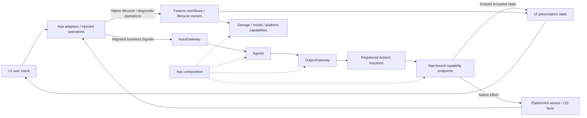
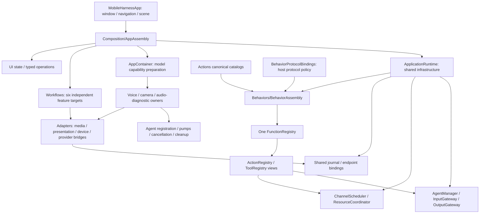
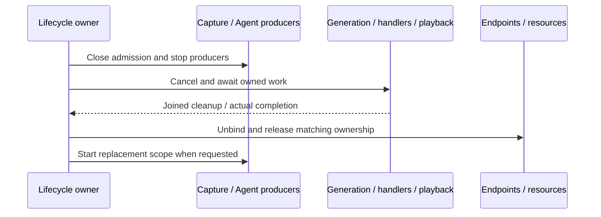

# App — Host, Composition and Lifecycle

App hosts the application, assembles modules, adapts external inputs and owns application/session lifetimes. It injects state and operation interfaces into UI and capabilities into Agents and Actions. Business decisions move to Agents; App remains responsible for platform eligibility, resource replacement and cleanup.

Design goals: explicit role-specific dependencies, one process-wide model manager, shared services across sessions, acyclic assembly and long-lived work independent of page lifetime.

## Upstream and downstream

Arrows show runtime input/effects; dashed arrows show construction or injection. Native lifecycle and diagnostic workflows retain explicit host ownership.

Agent-selected business effects always cross OutputGateway; input adaptation and runtime observations are not alternative permission paths. Local UI drafts remain in UI. Settings and manual-device commands are Agent-routed; native diagnostics and immediate safety fences remain host mechanisms.

## Internal structure

Arrows show assembly and ownership; service slices are injected rather than discovered through a global application container.

## Design principles and core mechanisms

**Composition is explicit and finite.** The root constructs services once, freezes one canonical function store, installs protocol views and validates Agent implementation coverage before producers start. Consumers receive narrow interfaces, not a service locator. Model defaults/registration remain in ModelKitDefaults; App supplies roots and adapters and injects acquired capabilities.

**Lifetime follows the operation, not the page.** Application infrastructure, voice/camera sessions, feature operations and page drafts have different owners. Long-running work retains its owner across navigation. RuntimePresentation binds whole voice/camera endpoints, and session/turn/frame fences prevent obsolete output from mutating a newer presentation.

The diagram describes a replacement barrier, not a promise of physical stop. A cancellation request alone does not release an endpoint or resource. Retryable terminal UI state is published after cleanup and operation-slot release. Settings/model changes retain rollback semantics where implemented; durable journal mutations remain committed.

**Adapters translate; Agents decide.** Native values become AgentInput at the host boundary; perception Agents build SDK requests, and model-specific preprocessing stays in model adapters. Host workflows still own documented migration exceptions; they must not become a new general business coordinator.

## Ownership and compilation

- [Composition](Composition/README.md) constructs shared runtime and models. `Composition/Behaviors` compiles independently as BehaviorAssembly, using Actions and the three function/execution/call SDKs, with no AgentCore dependency.
- [Lifecycle](Lifecycle/README.md) owns voice, camera and audio-diagnostic scopes. Owners receive role-specific runtime slices, not ApplicationRuntime.
- [Workflows](Workflows/README.md) is a state-free export facade over Settings, History, Bluetooth, Speech, Presentation and Diagnostics targets. Each owns its current effects and dependencies.
- [Adapters](Adapters/README.md) converts native/SDK/domain values and implements injected endpoints. RuntimePresentation binds whole voice/camera roles weakly and rejects missing, overlapping or stale owners.
- UI is a separate sibling target; App owns no page layout or editable form drafts. Shared runtime/journal services outlive individual voice sessions and pages.

## Lifetime and completion

Close producers, cancel and join generation/handlers, drain or cancel owned audio, then release bindings/resources. Replacing a camera/model session joins old work first. Settings changes use cleanup and rollback barriers; diagnostic terminal UI phases are published only after cleanup and operation-slot release.

Speech completion waits for playback drain. UI function completion means current session/turn state acceptance; animation completion is separate. Camera presentation checks frame/session ordering. Foreground/background and audio interruption policies are host-owned; no physical safety guarantee relies on background execution.

Native download background handling is separate from voice/device lifetime. App supplies resource roots, storage adapters and the Hub backend; ModelKit owns model registration, resource admission and management algorithms.

## Implementation status

✅ Root assembly, one frozen function store with explicit protocol bindings, role-specific lifecycle injection, six workflow targets and root-owned runtime observations. History refresh/confirmed deletion uses Memory through both Gateways.

✅ Voice/camera and Bluetooth observation lifetimes survive page navigation as specified. Home keep-awake is foreground/page-scoped; model switches preserve the shared journal. Debug preview/diagnostic behavior is labeled and gated.

❌ Remaining settings/provider, resource host error presentation and device business routes still need Agent/typed-Signal migration. Independent multi-window namespaces, background supervision and forced interruption of non-cooperative handlers are not implemented. Device/model acceptance is separate from build results.

See [Agent-driven architecture](../README.md), [Behavior assembly](Composition/Behaviors/README.md) and the owning lifecycle/workflow READMEs for detailed limits and platform policies.

✅ Implemented: voice lifecycle cancellation emits typed AssistantControl through the existing InputGateway path; App retains immediate capture shutdown and session cleanup ownership.

✅ Implemented: history facade delegates all mutation operations to typed root Agent transport. Composition injects shared journal and lazy title-only computation; no App archival/title persistence policy remains.

✅ Implemented: composition creates root ApplicationControl/ApplicationControlIntentRuntime and injects command operations into the existing settings workflow. Lifecycle/native maintenance remains host-owned; admitted operations survive page cancellation.

✅ ADR0167: actual speech model binding is Agent-routed; App supplies lifecycle/native endpoints. Source persistence and installation validation remain staged Settings policy. Committed preference application failures are visible and retryable through explicit restore.

✅ ADR0168: App constructs the preference service and supplies the trusted store URL, SDK validator and installed-ID snapshot. It translates Agent results into view drafts/notices; no source transaction or binding sequence remains in composition.

✅ ADR0169: resource refresh now sends Agent intent; composition injects raw native inventory capability. App converts canonical inventory to view values and localized text. Registered refresh snapshot/query-failure effects are implemented in ADR0170; remaining preference/transport error presentation is outstanding.

✅ ADR0170: inject resource presentation into canonical catalog and root runtime. Production refresh binding requests Agent-selected presentation; interaction no longer assigns queried items/groups or duplicates already-presented refresh errors. Remaining host failure projection is explicitly staged.

✅ ADR0171: root ownership adds a bounded resource observation worker independent of page lifetime. Input facts use a declared external source and sequenced typed Signal; background suspends samples without cancelling native transfers.

✅ ADR0172: Root operation-error endpoint validates session and mutates passive error state. Interaction suppresses local duplicate only after successful registered presentation; native algorithms and cancellation ordering remain unchanged.

✅ ADR0173: Root adapter localizes Agent-selected preference reason into existing notice/error state. Workflow rollback still restores confirmed flags; acknowledged presentation prevents duplicate local assignment. Legacy text classification remains unavailable-transport fallback only.

## Resource host-failure Signal — ADR0174

✅ Root-owned ApplicationControlIntentRuntime joins a failed original request before submitting one fresh host-failure Signal. ApplicationControl selects the registered error function; acknowledgment marks the original failure as presented, preserving its cause. One diagnostic slot has no queue and uses the existing request budget. Startup/closed/cancellation/capacity failure, occupied diagnostic/error-presentation slots and unavailable infrastructure retain explicit local fallback. No original effect retry or runtime restart. Detailed cleanup/call limits belong to Workflows/Settings/README.md.

## Provider discovery

✅ Implemented: ApplicationRuntime stages provider discovery in the injected Actions request store, submits the opaque intent to its existing resource root transport and discards unclaimed staging on success/failure. UI model selection and late-result revision handling stay in the existing form. Provider restore/save/rollback now belongs to Actions and Agent-selected functions; the workflow is a form facade.

## Provider configuration transactions

✅ Implemented: Provider business transactions/schema move from SettingsWorkflow/CloudSettingsStore to Actions/System/Support. App injects native credential/SDK/lifecycle primitives, stages private drafts and adapts acknowledged results. SettingsWorkflow becomes a bounded injected form facade; it has no Storage or provider prepare/apply call. Native credential primitives remain App-owned adaptation, not business policy.

## Completion batch — provider presentation and capability policy

✅ Implemented: provider discovery model-family eligibility belongs to Actions ProviderModelList; ModelKit validates/decodes raw IDs only. Preserve filtering/dedup/order and bounds at the app boundary. SettingsState becomes a passive editable snapshot, with no tasks or injected execution; SettingsInteractionWorkflow in the existing Settings directory owns bounded form admission, revision and page-independent saves. UI forwards edits/discovery/cancellation/save through SettingsControlling.

✅ Implemented: presentation-enabled provider intents select a second registered UI.ResourcePresentation.showProviderResult call after the business call, on success or failure. Headless requests retain one call. Private result lookup and revision/session fences prevent credentials in protocol payloads and stale form updates. One attempt only, no recursive presentation/replay; producer and presentation failure chains remain distinct. App injects the native UI endpoint; business functions remain independent of UI and call protocols.

## Typed device, navigation and environment entry points

✅ Implemented: app.interaction/1 maps explicit device commands and navigation destinations to fixed registered functions through ApplicationControl and the shared root transport. This Agent now coordinates native resource interactions as well as model resources; it performs no native I/O. UI controls emit typed intent through a root-owned BluetoothInteractionWorkflow; native BluetoothWorkflow remains the injected connection/recovery/manual worker host. Existing arrival tolerance, timeouts, pacing and takeover algorithms stay unchanged.

✅ Implemented: System.Device.control validates bounded string arguments and invokes neutral DeviceControlCapability; successful submission reports acceptance, not physical arrival. Read-only status and selected connection commands are explicitly model-granted. UI.Navigation.open commits native route state; manual taps and model requests share that function. A bounded latest motor-intent worker sends only changed values, with reset/stop priority and explicit failure display. No queued motion replay.

✅ Implemented: app.environment/1 stores latest sequenced scene/device/capability facts in the root Agent, with finite categories and bounded data. App still performs synchronous background/native safety fencing before reporting facts; physical safety cannot wait on Agent admission or iOS background execution. Native back navigation remains platform-owned and reports a fact, rather than replaying navigation effects. Photo-library creation and physical acceptance are feature/acceptance boundaries, not implied by navigation support.

✅ ADR0181: root PhotographerIntentRuntime owns lazy Photographer registration, one output consumer, one camera request and independent tracking dispatch. CameraInteractionWorkflow emits typed Photographer operations. VisionSession attaches/detaches tracking rather than constructing/removing Photographer. Native camera scopes remain unchanged.

✅ Interaction refinement: Camera target-facing passes through existing root delegation and native capture lifecycle. Accepted caption updates retain finalized user text above the eyes until the next turn, preserving stale-output fences.

## Action/Tool generation rounds — ADR0183

✅ Implemented: text/XML resolves to ActionCall; Assistant maps natural text to Speech playback and Display caption Actions. Only Actions enter Channel/wait. Native ToolCalls execute directly, with at most four concurrent calls and sixteen total per Assistant input. Registration declares recordOnly/observation independently of return values. Separate ActionResult/ToolResult feedback is correlated by call and round, merged in emission order after all calls settle, and only observation enables another model request. Four requests,120 generated calls,64 KiB feedback/transcript and a30-second joined input deadline bound the loop.

✅ BehaviorAssembly projects immutable host feedback policies. IndependentOutputWorkflow admits Actions in order while executing up to four Tools concurrently; VoiceSessionCoordinator owns, cancels and joins all dispatch tasks independently of page lifetime.

❌ Live-model, native UI and physical-device acceptance remain pending; local native Tools and generic Agent request/reply are not implemented. See [ADR0183](../../docs/adr/0183-generation-round-observations.md).

## Assistant photo observation — ADR0184

✅ Implemented: Direct Assistant camera capture endpoint plus owner-scoped image resolver; existing root Photographer operations unchanged.

❌ Real camera/shutter/animation and configured-model vision acceptance remain pending; video recording remains outside this iteration; system Photos export is implemented by ADR0185.

## Photo save and ignore — ADR0185

✅ Root camera intent transport now covers photo save/ignore. UI forwards only typed intent; RuntimePresentation validates root Photographer or active Assistant delegation. CameraCoordinator owns one displayed photo/owner and one joined native export; album success and per-image duplicate prevention are native completion facts. Existing voice/ReAct ownership remains independent.

## Independent protocol consumers — 2026-10-08

✅ Implemented: Generation output transport splits Tool calls and Action/scheduling events into independent bounded consumers; VoiceSessionCoordinator retains ownership and the existing maximum five dispatch tasks. Round sealing joins both before Gateway acknowledgment.

## Lens switch latency correction

✅ Implemented: split native lens-switch acknowledgment from independent perception replacement while retaining foreground/revision/resource fences and fully joined off/background cleanup.

❌ Physical-device switch latency, repeated flips during inference and camera/voice coexistence remain unverified.

## History image thumbnails

✅ Implemented: Composition shares one bounded photo store with CameraCoordinator and the history reader. History performs read-only adaptation/loads; camera lifetime and native effects are unchanged.

❌ Native image/layout and live-model acceptance remain separate from automated verification.
