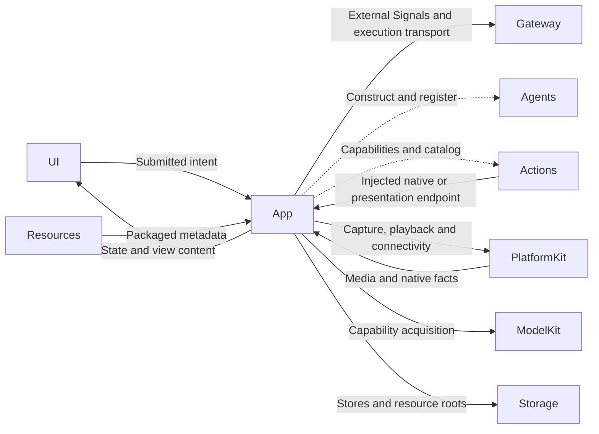
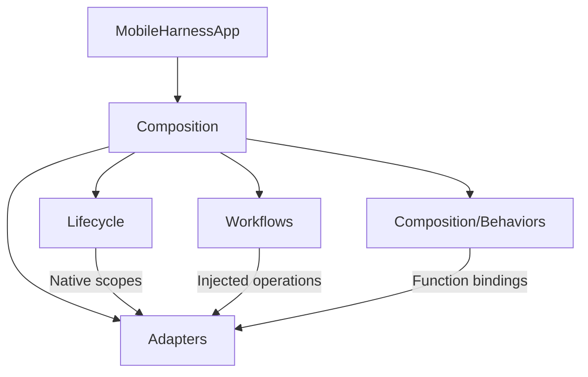

# App — Composition and Native Lifecycle

## Summary

Application host, explicit service assembly, native lifecycle ownership and adaptation between independent modules.

## Ownership and boundaries

App owns registration, operation lifetimes, permissions, safety fences and UI/native adapters. Agents own business decisions; UI owns local presentation. ModelKitDefaults owns model assembly. Root services outlive page navigation.

## External relationships and data flow

Runtime arrows show data or capability calls; dashed arrows show injection.

## Internal structure

## Interfaces and routing

| Operation | Owner and route | Completion |
| --- | --- | --- |
| Navigation, dialogs, drafts and selection | UI-local injected methods | State accepted |
| Page visibility, system settings and immediate stop | App lifecycle endpoint | Native cleanup according to endpoint |
| Camera, history, provider, resource and device requests | External publish to the exact business Agent; registered function execution | Correlated business result |
| Text and final ASR | Assistant; explicit specialist delegation where selected | Reply or task result |
| Agent-selected presentation | Gateway → Actions → authorized App endpoint | Current scope accepted |

Publication has no subscriber receipt. UI request waiters observe business completion independently, with owned 120-second watchdogs. Every output consumer is bound to the actual registered Agent incarnation.

## Lifecycle and failure semantics

Close admission, stop producers, cancel and join owned work, then release matching bindings and resources. A cancellation request is not physical stop. Native background fences run immediately; inference never supplies device safety. Captions, microphone capture, business tasks and playback have separate lifetimes.

Healthy camera flips retain the native session/lease and acknowledge input replacement before independently joined vision replacement. Full close/background joins all owners. Bluetooth recovery does not cancel unrelated Agent queues. Download scheduling is independent of voice/device work.

✅ Stable interaction runtime, resident SpeechPerception, independent feature targets, typed owner subscriptions and frozen function registration are implemented.

❌ Independent multi-window execution namespaces and forced interruption of non-cooperative native handlers are not implemented.

## Related design

[Parent design](../README.md) · [Adapters](Adapters/README.md) · [Composition](Composition/README.md) · [Lifecycle](Lifecycle/README.md) · [Workflows](Workflows/README.md)
