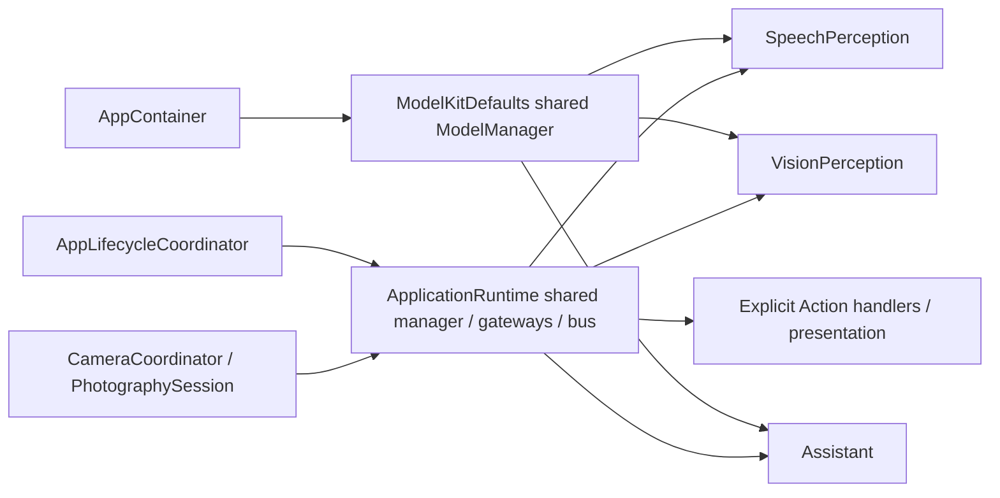

# App composition and lifecycle

Purpose: assemble capabilities, device services, Agents and presentation. MainActor owns SwiftUI-facing state; actors own model, Agent and transport state. No business registrations are duplicated from Agent JSON.

## Shared communication assembly

✅ ApplicationRuntime in AgentBootstrap.swift constructs one process-local AgentManager, validated JSON v4 policy, InputGateway, InternalSignalBus, OutputGateway and explicit Action/Tool handlers. It is available before asynchronous voice model preparation, so camera startup remains independent. RuntimePresentation contains one endpoint per presentation role with weak coordinator captures.

Three Agent configurations are loaded and cross-validated together. Each recording/camera session registers new perception instances with a fresh incarnation; camera owns VisionPerception only. Assistant persists across recording turns and its history is cleared on explicit session cancellation. Existing instance collisions fail explicitly; there is no silent replacement or duplicate registration fallback.

## Voice path

✅ AppContainer obtains stable capability handles from ModelManager, warms recognition/chat and loads VAD/system TTS before enabling conversation. It supplies resources to ModelKitDefaults, does not register concrete providers, and forwards coalesced memory warnings. Diagnostics for Kokoro/Qwen remain explicit separate screens.

✅ AppLifecycleCoordinator owns microphone permission/capture, platform resampling, playback and UI state. It publishes bounded PCM through InputGateway. SpeechPerception owns VAD/ASR/session segmentation; OutputGateway reports partial/final/phase observations to the App. Assistant subscribes to final speech for chat and speech.phase for its own onset UI Actions; no final-text resubmission exists in App. ✅ Recognition captions are updated only by SpeechPerception UI.setTranscript Actions through OutputGateway and the Action runtime. UI.finishTranscript clears and closes the caption after recognition finishes. The App handler checks cancellation and active session before replacing liveTranscript; Signal observation retains final logging and capture admission only; it never edits UI state. SpeechPerception sends UI.setVoiceState, while Assistant sends UI.beginReplyTurn on speech onset. Stop clears transient UI state and rejects late Actions.

The capture task preserves audio level UI and suppresses new utterances during recognition/reply. Assistant finish waits for all admitted speech/display Actions, then the existing 350 ms delay precedes speech resume. Runtime resume is independent of the audio inbox. Startup and stop are serialized through a cleanup task; no new recording begins until old cleanup completes.

Stop masks UI state and closes capture immediately, invalidates/stops the perception producer, joins its tasks and session deliveries, then cancels Assistant and the session's Actions. This ordering prevents a late final from entering Assistant after cancellation. Models remain resident according to ModelManager policy.

## Camera path

✅ CameraCoordinator retains existing front/back, enable/disable, foreground and permission intent. One reconciliation worker stops capture and joins the old analysis session before replacement. Camera error and voice error state remain independent; preview does not wait for inference.

PhotographySession bridges native frames with a bounded opaque attachment, publishes through InputGateway, binds VisionPerception and drains its Tool/control stream. VisionPerception filters, infers, publishes observations and emits UI.showPose. Cleanup invalidates vision, joins the camera Tool consumer, closes only the camera session and cancels any session Actions. It never shuts down the shared runtime or voice Agents.

✅ Camera presentation verifies session and sequence before updating the overlay. Native attachment conversion validates dimensions/rotation. All concrete device/UI effects enter through explicit registered Actions.

❌ Full multi-window independent Agent namespaces, persistent background supervision, robot motion and device acceptance of this migration are not implemented. Repeated competing role registrations fail rather than silently hijacking another scene.

✅ Runtime completion resumes speech processing; the SpeechPerception Agent emits the listening UI Action. App no longer clears expressions/replies or changes orb/status text from speech.phase observations. Local user/OS startup/stop and device-level telemetry remain App-owned, separate from Agent commands.

✅ PhotographySession prepares the shared Tool registry before camera processing. UI.showPose is a completion-only Tool handler; its callback carries OutputEnvelope directly for camera session validation. The visual stream is consumed sequentially, with no Channel or result-input round trip.

✅ UI handlers combine active-session validation with ConversationPresentation. beginReplyTurn clears old reply/expression atomically without clearing new recognition text. Captions and expression persist after normal reply completion; stop/background/failure resets the state. UI.print never sets speaking status. The orb projects actual audio.play activity as speaking over the Action-controlled recognition phase; playback-level telemetry remains device-owned. This avoids declaring playback merely because text arrived.

✅ CameraCoordinator configures the existing 3% frame-change threshold with a 100 ms maximum refresh interval. The next captured frame is admitted when refresh is due; this does not guarantee processing FPS. Tool consumption stays sequential while VisionPerception coalesces pending display state.
