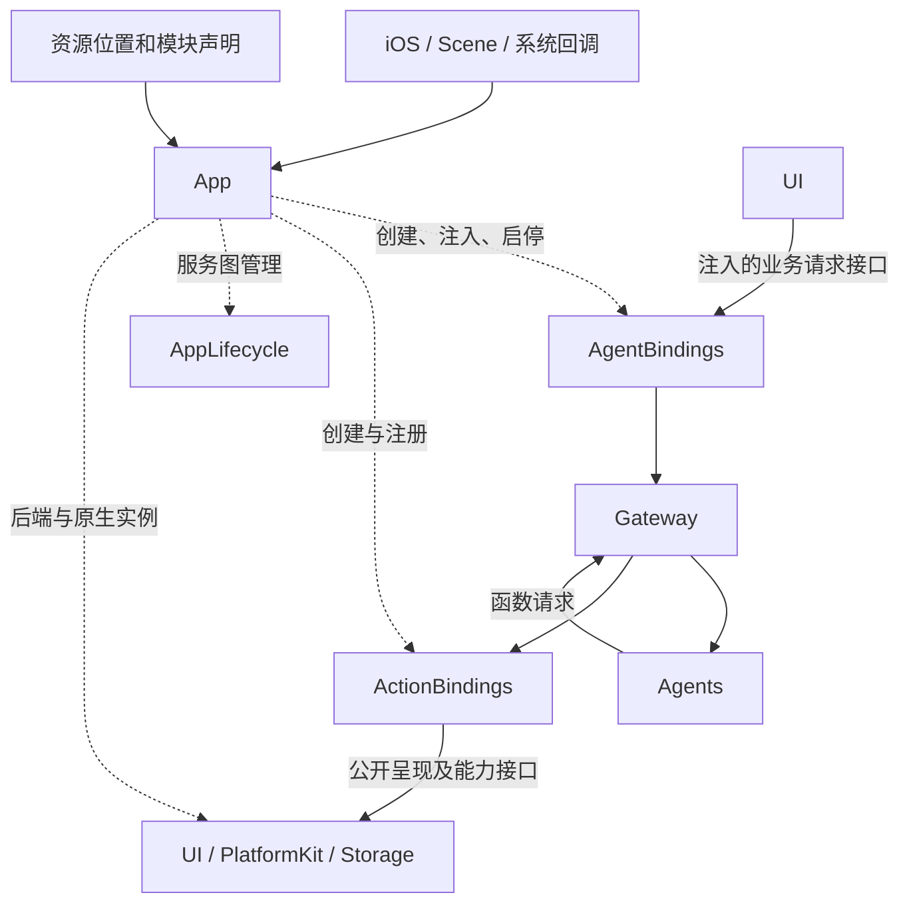
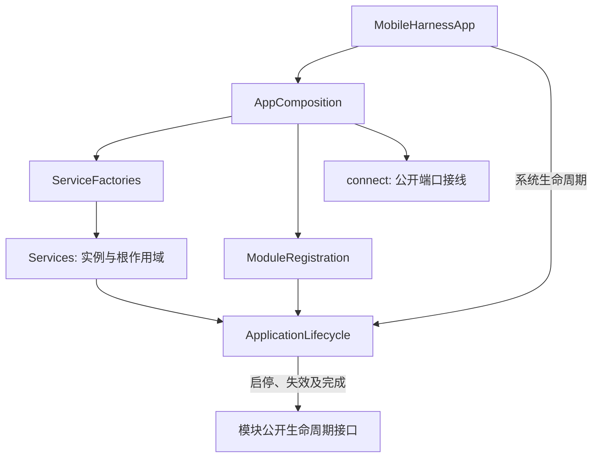

# App — 应用入口与组合根

✅ 快速 inactive → active 也保留一次必须执行的非前台清理，已启动服务全部完成暂停后再恢复前台接纳；页面覆盖不发送 Scene 生命周期。

## 职责与边界

App 只负责入口、创建、注册、组合、连接及应用级生命周期。业务流程、数据转换、领域状态、用户错误文案、页面树和功能工作者由所属模块拥有；注入闭包只连接公开接口。

## 直接上下游

App 不位于运行期业务请求、数据转换或 UI 呈现链路中。Agents 核心拥有决策；Gateway 拥有传输和执行；ActionBindings/AgentBindings 是各自模块内的外层集成目标，不是新增一级模块。

## 内部结构与数据流

- MobileHarnessApp 挂载 UI.ApplicationRootView，转交 Scene 活动状态；导航、设置/历史目的地及诊断页面由 UI 实现。
- [Composition](Composition/README.md) 创建实例并安装静态服务图；重试先加入旧图停止，再创建新作用域。消费者不查询 App 容器。
- [Lifecycle](Lifecycle/README.md) 管理通用顺序、启动回滚、前台状态与停止加入，并转交 OS URL-session 回调。

## 接口与失败

根图为 storage → agents → native。具体服务内部的 Agent 注册、配置事务、采集/播放、相机处置、蓝牙恢复和展示由模块实现。App 只调用公开方法，错误原样交给 UI 请求适配器的启动失败端口。

AppLifecycle 验证有限静态依赖图，保留原始启动错误及全部服务清理错误。后台先同步失效，再等待异步暂停/清理；取消和物理停止分别确认。停止失败阻止新图替换。模块根任务独立于页面；物理安全不依赖后台任务额度。

✅ 前台启动：初始 inactive 只等待 active；启动中失活引起的取消在成功回滚后由下一次 active 重建作用域。业务与清理错误不被隐藏。

## 当前实现

✅ 代码已迁移至上述边界，静态边界、专项回归及未签名 iOS 设备目标编译通过。❌ 全量回归和 Simulator 构建仍有单独记录的失败/限制，不作为通过。实现与验收记录见 [实施计划](../../docs/requirements/technical/App-Host-Boundaries-Plan.md) 和 [验证记录](../../docs/validation/Validation-History.md)。

## Storage 生命周期收敛

✅ ServiceFactories 只调用 ApplicationContainer 创建未启动的 StorageContainer，注入延迟领域仓库接口。ModuleRegistration 注册 storage → agents → native，绑定 start/stop；不再创建数据库目录、执行恢复或注册空停止。重试等待旧 Storage 关闭成功，业务终态写入先于存储停止。Scene 非活跃不关闭存储。

## 待实现

- 多窗口独立运行命名空间、非合作原生 handler 的强制中断，以及独立的真实模型/原生 UI/物理设备验收。

## Storage 依赖

✅ 存储访问使用独立的 State、Cache、Database 和 Files 接口；App 注册根实例，消费者通过构造器获得所需能力。存储容器不接管本目录的业务验证、执行和完成语义。

AppStorage 目标只编译 Composition/ApplicationContainer.swift，使用 FactoryKit 实例内缓存；业务目标不导入 IoC。Services 持有注册容器和 StorageContainer，连接所需子接口。模型后台事件只转交 ArtifactServices；存储停止前先加入其制品清理。

## 公开 State 边界

✅ App 只创建并注入 Storage 根及子能力、调度生命周期。公开 State 声明、事实转换与会话投影由业务模块/集成拥有者安装；App 不维护 Camera/Robot/Task 业务字段。

[公开 State 契约](../Storage/State/README.md)
