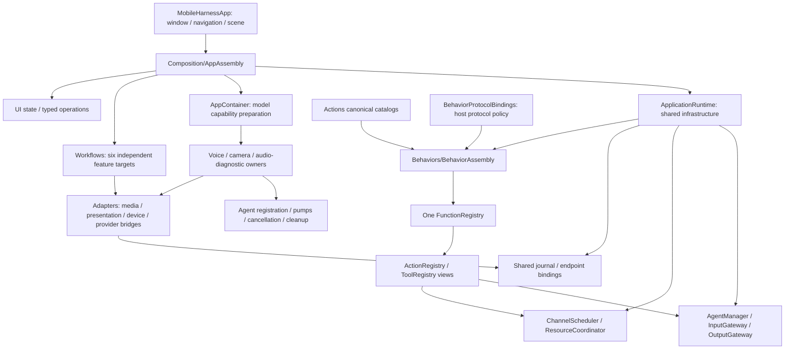
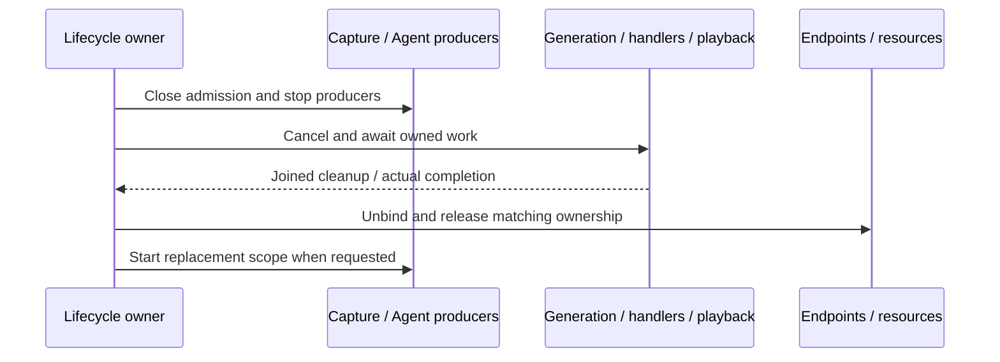

# App — Host, Composition and Lifecycle

App hosts the application, assembles modules, adapts external inputs and owns application/session lifetimes. It injects state and operation interfaces into UI and capabilities into Agents and Actions. Business decisions move to Agents; App remains responsible for platform eligibility, resource replacement and cleanup.

Design goals: explicit role-specific dependencies, one process-wide model manager, shared services across sessions, acyclic assembly and long-lived work independent of page lifetime.

## Upstream and downstream

Arrows show runtime input/effects; dashed arrows show construction or injection. Remaining feature workflows are explicitly staged paths, not completed Agent routing.

Agent-selected business effects always cross OutputGateway; input adaptation and runtime observations are not alternative permission paths. Local UI drafts remain in UI. Settings, archive/title, manual-device and diagnostic routes retain documented host ownership until migrated.

## Internal structure

Arrows show assembly and ownership; service slices are injected rather than discovered through a global application container.

## Design principles and core mechanisms

**Composition is explicit and finite.** The root constructs services once, freezes one canonical function store, installs protocol views and validates Agent implementation coverage before producers start. Consumers receive narrow interfaces, not a service locator. Model defaults/registration remain in ModelKitDefaults; App supplies roots and adapters and injects acquired capabilities.

**Lifetime follows the operation, not the page.** Application infrastructure, voice/camera sessions, feature operations and page drafts have different owners. Long-running work retains its owner across navigation. RuntimePresentation binds whole voice/camera endpoints, and session/turn/frame fences prevent obsolete output from mutating a newer presentation.

The diagram describes a replacement barrier, not a promise of physical stop. A cancellation request alone does not release an endpoint or resource. Retryable terminal UI state is published after cleanup and operation-slot release. Settings/model changes retain rollback semantics where implemented; durable journal mutations remain committed.

**Adapters translate; Agents decide.** Native values become AgentInput at the host boundary; perception Agents build SDK requests, and model-specific preprocessing stays in model adapters. Host workflows still own documented migration exceptions; they must not become a new general business coordinator.

## Ownership and compilation

- [Composition](Composition/README.md) constructs shared runtime and models. `Composition/Behaviors` compiles independently as BehaviorAssembly, using Actions and the three function/execution/call SDKs, with no AgentCore dependency.
- [Lifecycle](Lifecycle/README.md) owns voice, camera and audio-diagnostic scopes. Owners receive role-specific runtime slices, not ApplicationRuntime.
- [Workflows](Workflows/README.md) is a state-free export facade over Settings, History, Bluetooth, Speech, Presentation and Diagnostics targets. Each owns its current effects and dependencies.
- [Adapters](Adapters/README.md) converts native/SDK/domain values and implements injected endpoints. RuntimePresentation binds whole voice/camera roles weakly and rejects missing, overlapping or stale owners.
- UI is a separate sibling target; App owns no page layout or editable form drafts. Shared runtime/journal services outlive individual voice sessions and pages.

## Lifetime and completion

Close producers, cancel and join generation/handlers, drain or cancel owned audio, then release bindings/resources. Replacing a camera/model session joins old work first. Settings changes use cleanup and rollback barriers; diagnostic terminal UI phases are published only after cleanup and operation-slot release.

Speech completion waits for playback drain. UI function completion means current session/turn state acceptance; animation completion is separate. Camera presentation checks frame/session ordering. Foreground/background and audio interruption policies are host-owned; no physical safety guarantee relies on background execution.

Native download background handling is separate from voice/device lifetime. App supplies resource roots, storage adapters and the Hub backend; ModelKit owns model registration, resource admission and management algorithms.

## Implementation status

✅ Root assembly, one frozen function store with explicit protocol bindings, role-specific lifecycle injection, six workflow targets and root-owned runtime observations. History refresh/confirmed deletion uses ConversationMemory through both Gateways.

✅ Voice/camera and Bluetooth observation lifetimes survive page navigation as specified. Home keep-awake is foreground/page-scoped; model switches preserve the shared journal. Debug preview/diagnostic behavior is labeled and gated.

❌ Remaining settings, archive/title, resource and device business routes still need Agent/typed-Signal migration. Independent multi-window namespaces, background supervision and forced interruption of non-cooperative handlers are not implemented. Device/model acceptance is separate from build results.

See [Agent-driven architecture](../Agent-Driven-App.md), [Behavior assembly](Composition/Behaviors/README.md) and the owning lifecycle/workflow READMEs for detailed limits and platform policies.
