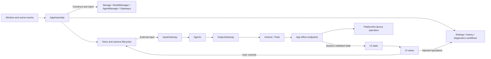
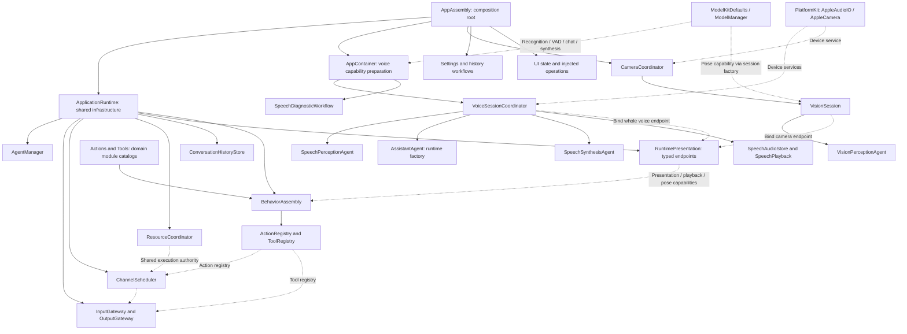

# App — Application Host and Composition

Purpose: host the application, assemble dependencies and coordinate application/session lifetimes. Design goals: explicit ownership, acyclic compilation, one shared model manager, bounded work and cleanup before resource replacement. UI is a separate sibling target; App does not own page layout or editable form state.

## Directory structure

```text
App/
├── MobileHarnessApp.swift   # Window host, navigation and scene events
├── Composition/             # AppAssembly, model preparation, runtime assembly
│   ├── Behaviors/           # Independently compiled BehaviorAssembly
│   ├── AppAssembly.swift
│   ├── AppContainer.swift
│   └── ApplicationRuntime.swift
├── Lifecycle/               # Voice and camera sessions, input/output pumps and cleanup
│   ├── VoiceSessionCoordinator.swift
│   ├── CameraCoordinator.swift
│   ├── VisionSession.swift
│   └── RuntimeDependencies.swift
├── Workflows/               # AppWorkflows export facade + independent feature targets
│   ├── Settings/           # Persistence and injected provider transactions
│   ├── History/            # Journal operations and injected title/preview
│   ├── Bluetooth/          # Connection/manual/action lifecycle and presentation
│   ├── Speech/             # Stored-audio playback adaptation
│   ├── Presentation/       # Conversation acceptance and execution observation
│   └── Diagnostics/        # Explicit speech/chat diagnostics
├── Adapters/                # Typed effect endpoints, native preview and value conversion
│   ├── RuntimePresentation.swift
│   ├── CurrentChatCapability.swift
│   ├── MediaInputAdapter.swift
│   ├── CameraPreviewAdapter.swift
│   ├── EyeExpression.swift
│   ├── NexArmBehaviorAdapter.swift
│   ├── HistoryAgentAdapter.swift
│   └── SettingsProviderAdapter.swift
└── README.md
```

## Upstream and downstream

The following arrows describe runtime flow. App imports UI; UI has no App dependency. Workflows compile in separate feature targets exposed by the state-free AppWorkflows facade, with dependencies declared independently of the executable. Composition/Behaviors compiles in the separate BehaviorAssembly target; the remaining App sources compile once in each Xcode application target.



## Internal composition

App composes the running system; Agents compose task behavior. Solid arrows below mean construction or assembly, and dashed arrows mean capability injection or binding, not Swift imports. Runtime facilities are shared across sessions; voice/camera owners receive role-specific service slices and create and clean up their own running scopes. UI receives state and operations rather than owning those scopes.



[ApplicationRuntime](Composition/ApplicationRuntime.swift) builds communication policy, shared storage and runtime services. [BehaviorAssembly](Composition/Behaviors/README.md) combines domain-owned Action/Tool modules with typed App capabilities; Gateway.BehaviorCoverage validates Agent implementation coverage before producers start. Agent declarations authorize calls; the registries bind their implementations. [AppContainer](Composition/AppContainer.swift) obtains model capabilities from the shared manager, while [Lifecycle](Lifecycle/README.md) owns Agent registration, pumps, cancellation and cleanup. Detailed lifetimes and completion boundaries remain below.

## Responsibilities and injection

| Owner | Creates or receives | Lifetime / consumer |
| --- | --- | --- |
| AppAssembly | ApplicationRuntime, settings/history workflows, camera coordinator and prepared AppContainer | One root-owned assembly; consumers never call ApplicationRuntime.shared |
| ApplicationRuntime | ConversationHistoryStore, AgentManager, immutable communication policy, Gateways, ActionRegistry/ChannelScheduler, ToolRegistry | Shared by voice, camera and history; created lazily even before voice readiness |
| AppContainer | AppAssembly's resource root; shared capability handles from ModelManager; audio service; conversation state and diagnostic dependencies | Prepares capabilities and forwards memory pressure; registration/default selection stays in ModelKitDefaults |
| Voice lifecycle | Injected role-specific runtime services, capabilities, audio service, model-label query and ConversationState | Registers Agents, owns output/input consumers, shared PCM store, playback and cleanup for its running scope |
| Camera lifecycle | Injected AppleCamera, CameraState and vision-session factory | Owns foreground intent, permission/start/stop work and one vision session |
| Settings/history workflows | Injected change barriers, shared journal loader, title-generation and preview operations | Coordinate application operations; UI retains only UI state and controls |
| RuntimePresentation | One weak typed voice endpoint and one weak typed camera endpoint | Whole-role binding rejects overlap; the same owner unbinds only after cleanup |

App supplies each consumer only the dependencies it needs. Storage owns consistency, bounds and expiry; Agents own inboxes and generation; Gateway owns Channel/wait scheduling; ModelKit owns model resource admission. The App coordinates these owners rather than duplicating their algorithms. State classes in UI are MainActor-isolated; shared runtime queues and model/storage state remain in their existing actors.

## Lifecycle and completion

Window-root tasks own voice runtime and camera observation, so navigation does not recreate the Agent system. Entering Settings stops voice and suspends the camera; returning restores camera intent. Background transitions, audio interruptions and route changes stop voice. A settings transaction joins old work before updating the model binding. ApplicationRuntime and the journal outlive individual voice sessions; a model switch never erases conversation history.

✅ The MainActor window host disables the system idle timer only while the foreground home conversation/eyes surface is visible, including its startup state. Opening Settings, running diagnostics or visual previews, or making the scene inactive/background restores automatic screen locking and dimming. Returning to the active home surface enables keep-awake again. Initial state and subsequent navigation/scene transitions apply the same policy; this presentation policy does not extend background runtime or device control.

Cancellation order remains: close/stop producers, cancel and join generation, cancel audio handles and scheduled work, wait for handler cleanup, then release bindings. The synthesis Agent and shared PCM store are stopped at voice-runtime teardown. Camera replacement stops native capture and joins the previous vision task before admitting another session. No observer signal can invoke an unregistered UI/device effect.

Speech completes only after actual playback drains. UI Actions complete when the current session/turn accepts state; animation completion is separate. Vision presentation uses awaited completion-only Tools with session/frame ordering checks. Late sessions/sequences cannot overwrite current output. RuntimePresentation is an endpoint holder with no queue; a missing/occupied role explicitly fails.

## Application workflows

- SettingsWorkflow coordinates restore/discovery/save through injected provider operations; CloudSettingsStore owns device-only Keychain credentials and Storage-backed settings documents. SettingsState owns form edits and loading/error presentation. Save stays alive across page navigation, joins voice cleanup and preserves rollback on model-binding failure. CurrentChatCapability resolves the current binding on each request.
- ConversationHistoryWorkflow loads the shared durable journal, archives/reset atomically, requests metadata-only titles and non-executing previews through injected operations, and saves errors. It has one operation slot, no backlog; cancellation retains that slot until cleanup. The shared journal retains raw user/model data and provides the latest ten completed context rounds.
- SpeechDiagnosticWorkflow owns the explicit MOSS synthesis/player/session and stop/unload sequence. Diagnostic pages receive state and controls; no player or inference session is constructed in a view. Diagnostics remain separate from the production Agent Action path.
- ChatDiagnosticWorkflow runs the Debug synthetic ASR/chat check using injected preparation and the configured ChatCapability. Its page task owns cancellation; the workflow closes the inference session, while ModelManager retains model residency policy. Debug launch flags select explicit diagnostics.

Detailed contracts: [Composition](Composition/README.md), [Lifecycle](Lifecycle/README.md), [Workflows](Workflows/README.md), [Adapters](Adapters/README.md), [UI](../UI/README.md), [Storage](../Storage/README.md), [scheduling](../Gateway/Output/Scheduling/README.md).

## Host observation and previews

The root observes Bluetooth state independently of the settings page and forwards foreground changes. One workflow supplies connection controls/status and robot Action callbacks. Discovery/connection requests drive BLE permission checks; no Bluetooth background mode is configured.

ActionActivityState is root-owned and injected into the conversation screen alongside conversation and connection state. App projects Channel execution snapshots; UI owns wording/layout and Settings owns manual-operation presentation.

Debug-only `-actions-preview` uses the real conversation/status components with labeled synthetic records and bypasses model/device startup. Release ignores the flag.

## Implemented scope

✅ Root composition, role-specific lifecycle dependencies, typed endpoints, six feature workflow targets and root-owned observations.

❌ Independent multi-window namespaces, background supervision and forced interruption of non-cooperative handlers are not implemented.

✅ Camera.open/close/flip Tool bindings reuse the root-owned CameraCoordinator through RuntimePresentation after active Assistant session validation. Permission, foreground and camera lease policy stay in App lifecycle; closing confirms native stop and joins vision cleanup. ❌ Capture readiness does not imply pose-model readiness.

## Local model resources — current contract

✅ Root now composes sandbox model resources and the Settings management facade, supplies Storage adapters and coordinates explicit stop-and-delete. Model weights are acquired independently of App packaging; startup no longer requires installed voice models.

❌ Full device/background acceptance and remaining enhancement items are tracked in [Management](../ModelKit/Management/README.md). HF foreground requests restart after process relaunch; ZIP background recovery remains OS-controlled. Both AppAssembly and the background delegate inject ModelKitHub when configuring the shared manager.


✅ HF model transfers now use native background sessions through ModelKitHub. ModelDownloadsAppDelegate handles stable session events and grants a bounded 25-second metadata/finalization window when backgrounding. System tasks own continued transport; voice still stops on background. ❌ Physical-phone lock-screen acceptance remains pending.


✅ Downloaded speech is optional: Defaults selects installed available local speech or Apple/energy providers. App restores the saved preference before composing voice and stops current voice when changing it; the next start uses the selected mode. Gemma 4 E2B chat or explicitly configured cloud chat is still required for conversation.


✅ Settings now routes model management through 音频识别、语音合成、大模型、视觉识别. Recognition/synthesis policy is independent and validated before apply; deleting prerequisites turns off only the owning choice. Native Apple ASR adds internal SpeechDetector, while Energy supplies business silence timing.

✅ Local chat configuration now targets Gemma 4 E2B CoreAI; Qwen/MLX production bindings are removed. ❌ Real-model/device acceptance is separate from compilation and contract tests.

✅ ADR0119: App transports native camera frames and native-rate microphone samples with session/source/deadline metadata. Calling perception Agents own conversion into ModelKit inputs; composition no longer injects image conversion. SDK inputs/outputs are owned by ModelKit or PlatformKit, without Types dependencies. ❌ No physical-device acceptance is implied.

✅ ADR0121 removes the Types module: AgentCore/Input owns generic audio/image transport, UI/Camera owns PoseOverlay, and VisionPerception owns PoseOverlayPayload. App adapts the independent Tool payload into UI values. ❌ Capability SDKs must not import consumer or presentation modules.
