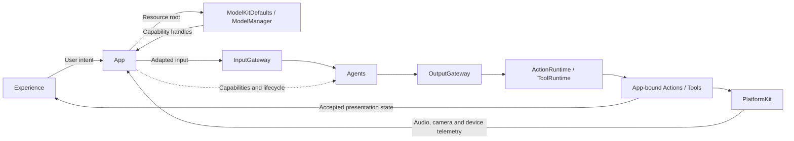
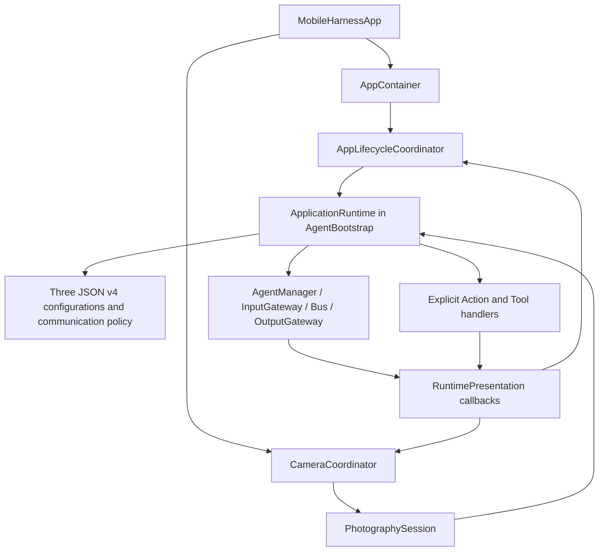

# App — Composition and Lifecycle

Assembles model capabilities, device services, Agents and presentation. The goal is one shared runtime with independent voice and camera sessions. MainActor owns presentation and coordination; actors own Agent, transport and model state.

## Directory structure

```text
App/
├── MobileHarnessApp.swift         # SwiftUI entry and startup/diagnostic selection
├── AppContainer.swift             # Model capability preparation and platform services
├── AgentBootstrap.swift           # Shared ApplicationRuntime and explicit handlers
├── AppLifecycleCoordinator.swift  # Voice session, playback and presentation state
├── CameraCoordinator.swift        # Camera intent, permissions and scene lifecycle
├── PhotographySession.swift       # Camera-frame adaptation and vision session
└── README.md                      # Composition and lifecycle contract
```

## Upstream and downstream

Arrows show requests and data, not every Swift import.



## Internal structure and data flow



ApplicationRuntime is available before voice model preparation. App supplies the resource root to ModelKitDefaults and gets interfaces from the process-wide ModelManager; it does not register model providers. Voice prepares recognition, chat, VAD and system TTS before opening the microphone. Camera preview and its vision session start independently.

Voice PCM enters InputGateway, then SpeechPerception. Assistant subscribes to final speech and speech onset; App does not resubmit final text. Agent-selected UI changes use registered Actions or Tools. Runtime observations control admission, completion and failure supervision, never caption or expression commands. Device telemetry and local user/OS lifecycle changes remain App-owned.

Camera frames enter InputGateway through PhotographySession. VisionPerception filters frames, requests pose inference, publishes observations and emits the completion-only UI.showPose Tool. App checks camera session and frame order before updating the overlay. The default filter is 3% change with a 100 ms maximum refresh interval; this is an admission rule, not a processing-FPS guarantee.

## Concurrency and cleanup

| Work | Owner, bound and completion |
| --- | --- |
| Startup / voice stop | One serialized cleanup chain; new capture waits for old cleanup |
| Voice input and output | One capture consumer and sequential output consumers; bounded PCM/output queues belong to PlatformKit and SpeechPerception |
| Reply completion | Join admitted speech/display Actions, then wait 350 ms before resuming speech input |
| Camera changes | One reconciliation worker uses current intent; stop capture and join old analysis before replacement |
| Camera output | One sequential Tool consumer; latest-frame and display replacement belong to VisionPerception |
| Memory warnings | Capacity-one latest notification stream; one consumer forwards pressure to ModelManager |
| Audio telemetry | Capture keeps 2048 latest samples, at most 4096 during append; 32-band analysis and playback cursor polling run at most every 33 ms |

Stop closes capture and perception admission, cancels and joins producer/transport work, then cancels the session's consumers and Actions. Voice and camera close only their own sessions. Models follow ModelManager residency policy. Late UI work must pass active-session and turn/sequence checks. Failures propagate; already completed effects are not rolled back.

See [SpeechPerception](../Agents/SpeechPerception/README.md), [VisionPerception](../Agents/VisionPerception/README.md), [audio I/O](../PlatformKit/Audio/README.md) and [scheduling](../Gateway/Output/Scheduling/README.md) for queue contracts.

## Feature status

- ✅ Shared communication assembly, JSON v4 validation, explicit handlers and separate camera/voice sessions.
- ✅ Turn-scoped captions, semantic emotions, actual playback state and frequency telemetry.
- ✅ Explicit diagnostics and a labeled Debug-only conversation preview; the preview uses simulated state.
- ❌ Independent multi-window Agent namespaces, persistent background supervision and robot control.

## Issue record

| Status | Issue / next step |
| --- | --- |
| Open | Competing scene-role registrations fail; multi-window ownership is not implemented. |
| Open | Validate sustained camera/voice operation, startup latency and memory/thermal behavior on iPhone. |
| Resolved — 2026-09-27 audit | Consolidated repeated presentation updates and corrected skeleton execution from Action to completion-only Tool. |
