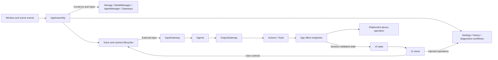
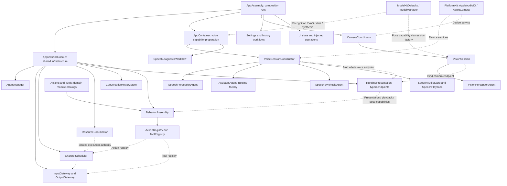

# App — Application Host and Composition

> Current status (2026-09-29): the user identified desktop simulator screen sharing as the cause of missing iPhone camera/microphone input. BLE settings and conversation binding are restored; receipt-admission and robot-only disconnect fixes remain. iPhone BLE acceptance without screen sharing is still pending; no causal claim is made about the earlier BLE failure.


Purpose: host the application, assemble dependencies and coordinate application/session lifetimes. Design goals: explicit ownership, acyclic compilation, one shared model manager, bounded work and cleanup before resource replacement. UI is a separate sibling target; App does not own page layout or editable form state.

## Directory structure

```text
App/
├── MobileHarnessApp.swift   # Window host, navigation and scene events
├── Composition/             # AppAssembly, model preparation, runtime assembly
│   ├── Behaviors/           # Independently compiled BehaviorAssembly
│   ├── AppAssembly.swift
│   ├── AppContainer.swift
│   └── ApplicationRuntime.swift
├── Lifecycle/               # Voice and camera sessions, input/output pumps and cleanup
│   ├── VoiceSessionCoordinator.swift
│   ├── CameraCoordinator.swift
│   ├── VisionSession.swift
│   └── RuntimeDependencies.swift
├── Workflows/               # AppWorkflows export facade + independent feature targets
│   ├── Settings/           # Persistence and injected provider transactions
│   ├── History/            # Journal operations and injected title/preview
│   ├── Bluetooth/          # Connection/manual/action lifecycle and presentation
│   ├── Speech/             # Stored-audio playback adaptation
│   ├── Presentation/       # Conversation acceptance and execution observation
│   └── Diagnostics/        # Explicit speech/chat diagnostics
├── Adapters/                # Typed effect endpoints, native preview and value conversion
│   ├── RuntimePresentation.swift
│   ├── CurrentChatCapability.swift
│   ├── CameraImageAttachment.swift
│   ├── CameraPreviewAdapter.swift
│   ├── EyeExpression.swift
│   ├── NexArmBehaviorAdapter.swift
│   ├── HistoryAgentAdapter.swift
│   └── SettingsProviderAdapter.swift
└── README.md
```

## Upstream and downstream

The following arrows describe runtime flow. App imports UI; UI has no App dependency. Workflows compile in separate feature targets exposed by the state-free AppWorkflows facade, allowing their behavior to be tested without the executable. Composition/Behaviors compiles in the separate BehaviorAssembly target; the remaining App sources compile once in each Xcode application target.



## Internal composition

App composes the running system; Agents compose task behavior. Solid arrows below mean construction or assembly, and dashed arrows mean capability injection or binding, not Swift imports. Runtime facilities are shared across sessions; voice/camera owners receive role-specific service slices and create and clean up their own running scopes. UI receives state and operations rather than owning those scopes.



[ApplicationRuntime](Composition/ApplicationRuntime.swift) builds communication policy, shared storage and runtime services. [BehaviorAssembly](Composition/Behaviors/README.md) combines domain-owned Action/Tool modules with typed App capabilities; Gateway.BehaviorCoverage validates Agent implementation coverage before producers start. Agent declarations authorize calls; the registries bind their implementations. [AppContainer](Composition/AppContainer.swift) obtains model capabilities from the shared manager, while [Lifecycle](Lifecycle/README.md) owns Agent registration, pumps, cancellation and cleanup. Detailed lifetimes and completion boundaries remain below.

## Responsibilities and injection

| Owner | Creates or receives | Lifetime / consumer |
| --- | --- | --- |
| AppAssembly | ApplicationRuntime, settings/history workflows, camera coordinator and prepared AppContainer | One root-owned assembly; consumers never call ApplicationRuntime.shared |
| ApplicationRuntime | ConversationHistoryStore, AgentManager, immutable communication policy, Gateways, ActionRegistry/ChannelScheduler, ToolRegistry | Shared by voice, camera and history; created lazily even before voice readiness |
| AppContainer | AppAssembly's resource root; shared capability handles from ModelManager; audio service; conversation state and diagnostic dependencies | Prepares capabilities and forwards memory pressure; registration/default selection stays in ModelKitDefaults |
| Voice lifecycle | Injected runtime, capabilities, audio service, model-label query and ConversationState | Registers Agents, owns output/input consumers, shared PCM store, playback and cleanup for its running scope |
| Camera lifecycle | Injected AppleCamera, CameraState and vision-session factory | Owns foreground intent, permission/start/stop work and one vision session |
| Settings/history workflows | Injected change barriers, shared journal loader and managed chat factory | Coordinate application operations; UI retains only UI state and controls |
| RuntimePresentation | One weak typed voice endpoint and one weak typed camera endpoint | Whole-role binding rejects overlap; the same owner unbinds only after cleanup |

App supplies each consumer only the dependencies it needs. Storage owns consistency, bounds and expiry; Agents own inboxes and generation; Gateway owns Channel/wait scheduling; ModelKit owns model resource admission. The App coordinates these owners rather than duplicating their algorithms. State classes in UI are MainActor-isolated; shared runtime queues and model/storage state remain in their existing actors.

## Lifecycle and completion

Window-root tasks own voice runtime and camera observation, so navigation does not recreate the Agent system. Entering Settings stops voice and suspends the camera; returning restores camera intent. Background transitions, audio interruptions and route changes stop voice. A settings transaction joins old work before updating the model binding. ApplicationRuntime and the journal outlive individual voice sessions; a model switch never erases conversation history.

Cancellation order remains: close/stop producers, cancel and join generation, cancel audio handles and scheduled work, wait for handler cleanup, then release bindings. The synthesis Agent and shared PCM store are stopped at voice-runtime teardown. Camera replacement stops native capture and joins the previous vision task before admitting another session. No observer signal can invoke an unregistered UI/device effect.

Speech completes only after actual playback drains. UI Actions complete when the current session/turn accepts state; animation completion is separate. Each accepted vision Action is joined/retired before consuming the next replaceable presentation state. Late sessions/sequences cannot overwrite current output. RuntimePresentation is an endpoint holder with no queue; a missing/occupied role explicitly fails.

## Application workflows

- SettingsWorkflow owns restore/discovery/save, device-only Keychain credentials and Storage-backed settings documents. SettingsState owns form edits and loading/error presentation. Save stays alive across page navigation, joins voice cleanup and preserves rollback on model-binding failure. CurrentChatCapability resolves the current binding on each request.
- ConversationHistoryWorkflow loads the shared durable journal, archives/reset atomically, requests metadata-only titles, saves errors and produces non-executing parser previews. It has one operation slot, no backlog; cancellation retains that slot until cleanup. Raw user/model data and the latest ten completed context rounds are unchanged.
- SpeechDiagnosticWorkflow owns the explicit MOSS synthesis/player/session and stop/unload sequence. Diagnostic pages receive state and controls; no player or inference session is constructed in a view. Diagnostics remain separate from the production Agent Action path.
- ChatDiagnosticWorkflow runs the Debug synthetic ASR/chat check using injected preparation and the configured ChatCapability. Its page task owns cancellation; the workflow closes the inference session, while ModelManager retains model residency policy. The historical diagnostic launch flag remains supported.

Detailed contracts: [Composition](Composition/README.md), [Lifecycle](Lifecycle/README.md), [Workflows](Workflows/README.md), [Adapters](Adapters/README.md), [UI](../UI/README.md), [Storage](../Storage/README.md), [scheduling](../Gateway/Output/Scheduling/README.md).

✅ Explicit application composition, shared journal/model services, typed role bindings, independent presentation compilation and preserved Gateway/Action authorization.

❌ Independent multi-window namespaces, background supervision, automatic recovery of non-cooperative handlers and physical-device acceptance of this refactor. Simulator/build success does not establish device interaction quality.

## Action runtime stage 2

✅ Composition and Lifecycle now share concrete camera resource ownership. Runtime feedback and resource cleanup remain independent of page lifetime. ❌ Physical-device takeover acceptance and audio/robot resource migration remain pending.

## Domain-owned behavior assembly

✅ The host binds capabilities through BehaviorAssembly instead of registering each Action/Tool. The pure assembly target lives at Composition/Behaviors; domain catalogs live in Actions/Tools. ❌ New device primitives or lifecycle changes still require host work.

✅ App root now runs a Bluetooth state observer independently of settings-page lifetime, propagates foreground changes, and injects settings controls/status plus the Action callback from one workflow. BLE permission is requested only when the user opens discovery/connects. ❌ No Bluetooth background execution mode or physical-stop promise is added.

✅ The home screen receives root-owned ActionActivityState alongside conversation and connection state. Channel execution summaries/history replace the robot-only motion-status label; Settings continues to own its manual-test presentation. ❌ Runtime observation is process-local and does not establish physical device completion beyond each Action's contract.

✅ Debug-only `-actions-preview` renders the actual conversation/status components with explicitly labeled synthetic records for parallel, queued, cancelling and failed states; it bypasses models, camera, audio and Bluetooth startup. Release ignores the flag. ❌ Preview data is not execution acceptance.
