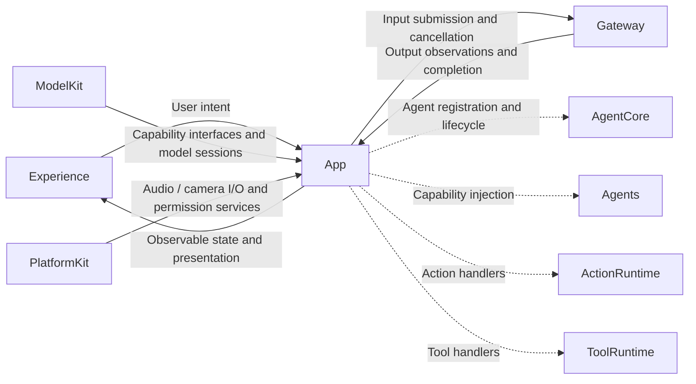
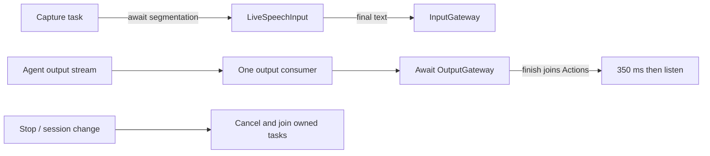
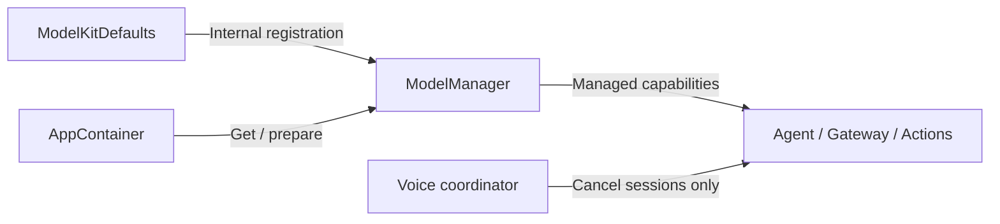

# App — Application Entry and Composition

App assembles the system described in architecture sections 37–40. It obtains the internal model defaults and selects platform adapters, injects capability protocols, registers executable handlers, and connects Experience to Gateway. Business decisions belong to Agents.

## Responsibilities and boundaries

- Own the SwiftUI entry point and dependency composition in `AppContainer`.
- Register Agents and concrete Action/Tool handlers through `AgentBootstrap`. Agent permissions remain in each Agent's JSON configuration, independently of implementation registration.
- Coordinate foreground voice sessions, model preparation, output consumption, playback, and cancellation through `AppLifecycleCoordinator`.
- Report configuration or capability failures explicitly. A simulator configuration must not masquerade as a working model.

## Direct relationships

This is a composition and coordination diagram. Dashed edges carry injected dependencies; solid edges carry user intent or runtime state.

## Implementation status

- ✅ `MobileHarnessApp.swift`: conversation entry, explicit Kokoro validation entry, and Debug-only `-qwen35-validation` ASR/chat coexistence entry.
- ✅ `AppContainer.swift`: Nemotron ASR, Silero VAD, Qwen3.5-2B MLX chat, Apple TTS, audio IO, and optional Kokoro validation composition.
- ✅ `AgentBootstrap.swift`: throwing Assistant initialization, runtime registration, and ChannelScheduler assembly.
- ✅ `AppLifecycleCoordinator.swift`: foreground voice loop, playback, error presentation, and session cleanup. Listening resumes 350 ms after generation and accepted actions complete.
- ✅ Stop cancels input and actions and waits for old-session cleanup without unloading weights. Invalid configuration leaves the application unready.
- ❌ Complete separation of page subscriptions from long-lived Agent execution, background execution, and global resource supervision.

The device configuration requires iOS 27 and matching h18p artifacts. Models load and warm up before recording. The simulator is for UI debugging and reports unavailable chat explicitly. Kokoro remains a separate English-language validation path.

## Maintenance

Keep this README synchronized with changes to responsibilities, files, interfaces, and implementation status. ✅ means implemented; ❌ means planned or incomplete. Do not create unused placeholder modules. The [technical architecture](../README.md) defines the target; the [layout audit](../../docs/Repository-Structure.md) records implementation exceptions.

✅ The voice interface exposes start/stop controls and captions; diagnostic messages use private OSLog output.

✅ Bootstrap binds UI.express and routes express to a separate session-checked expression callback. The coordinator holds one current expression and a presentation identity for repeated expressions; new speech and session stop clear it. Successful presentation means state acceptance, not animation completion.

✅ Only UI.express is registered for facial expressions; smile is an emotion parameter, not a separate handler.

✅ Qwen35Chat is selected only at the composition root; ASR, TTS, Agent registration and Actions continue using the existing capability contracts. Simulator chat remains explicitly unavailable.

## Queue and asynchronous processing contract

`AppLifecycleCoordinator` owns the capture, Agent-output and dispatch tasks on MainActor; it does not introduce another work FIFO. The capture task sequentially resamples microphone frames, awaits VAD processing and enqueues committed events into LiveSpeechInput. That bridge consumes audio independently. Final text enters InputGateway once.

The output task consumes one Agent envelope at a time and awaits OutputGateway dispatch. Function dispatch waits for admission, while `assistant.finished` waits for accepted Actions (including playback) to complete; only then does the coordinator wait 350 ms and resume listening. Tool dispatch also suspends this output consumer until execution/result delivery finishes. Slow downstream work can therefore fill the bounded Agent output stream.

Session/generation identity checks prevent stale audio or presentation callbacks affecting a newer session. Stop cancels input/generation/dispatch and joins cleanup and Action cancellation before reuse. No global task-priority scheduler or background voice execution is implemented.

✅ The algorithm above describes the current implementation.

Maintenance: update this contract when changing producers, consumers, limits, ordering, cancellation or completion semantics.

✅ The output consumer dispatches AgentOutput.actionCall payloads as resolved ActionCalls; ToolCalls retain their separate execution route.

## Failed reply recovery

- ✅ `assistant.error` cancels the voice session and pending Actions, shows a retryable error, and retains prepared model providers. Retry waits for cleanup and uses fresh generation/parser state without reloading the weights.
- ✅ Explicit user stop and voice failures cancel sessions only; model residency belongs to the shared ModelManager.
- ❌ Physical-device recovery after malformed model output still requires acceptance testing; an ordinary Swift parsing error is not evidence of a process crash.

## Model composition

✅ AppContainer creates its manager through ModelKitDefaults and obtains typed default capabilities using deferred get. The initial UI waits for asynchronous composition and displays configuration errors without fallback. Before presenting the conversation page, AppContainer sequentially warms recognition/chat and loads VAD/system TTS. Subsequent recording turns reuse resident weights and reload only evicted resources. Kokoro diagnostic load/unload also goes through this manager.

❌ Automatic resource eviction and physical-device stability acceptance remain outstanding.

✅ Production resolves one ASR and one chat provider from the shared manager: Nemotron and Qwen3.5-2B. Simulator ASR/chat explicitly report unavailable; local model paths are flat directories without runtime manifests.

✅ ModelKitDefaults configures the MLX cache to 64 MiB before model registration; App forwards memory warnings to ModelManager.handleMemoryPressure. The notification stream has capacity one with newest-warning coalescing; no inference is cancelled. The observer is removed on stream termination and the task is cancelled when AppContainer is released.

✅ AppContainer supplies the resource directory to ModelKitDefaults.manager and injects returned protocols. It contains no concrete provider factories, model directory selection or cache configuration. OS warnings and UI lifecycle remain here.

✅ ModelKitDefaults.manager(resources:) returns the process-wide manager. Concurrent calls share assembly and provider instances; conflicting resource roots fail. Construction/registration are assembly SPI. Each model admits one active operation, rejects overlap with inputBusy, and releases admission only after cleanup. Cross-model scheduling is not implemented.

## Startup readiness

AppContainer reports loading stages to MobileHarnessApp. The startup ring has no input action. Required conversation models are prepared sequentially (Nemotron, Qwen, Silero, system TTS) before publishing the container; Agent registration then enables the conversation ring. Microphone permission/capture waits for a user tap. Kokoro is diagnostic-only and loads through its explicit benchmark path.

Failure keeps the container unpublished and offers reload using the same process-wide manager. Cancellation cannot publish a partially prepared container. There is one scene startup task per attempt; retry is available only after failure, so there is no queued startup work. A simulator without supported models shows an explicit failure rather than a ready conversation.

- ✅ Staged loading, disabled startup interaction, retry and sequential model preparation.
- ❌ Numerical download/loading percentages and physical-device startup acceptance.

✅ CameraCoordinator owns scene-local preview intent independently of model startup. Normal launch requests the front camera; permission denial offers Settings. A single reconciliation worker applies the latest enabled/facing/foreground state, checks revision after permissions, masks stale preview immediately, and joins stop on scene exit. Inactive/background pauses capture; foreground resumes only if enabled. Diagnostic launches do not start camera. Camera frames now enter the PhotographySession composition described below.

✅ PhotographySession composes Photographer, InputGateway, OutputGateway and the explicit UI.showPose handler independently of voice model readiness. Both flows acquire models from the same process-wide defaults manager. CameraCoordinator owns one capture/analysis incarnation, cancels and joins it before replacement, stops capture before joining inference, and rejects old-session/old-sequence presentation callbacks. Camera errors and pose errors are separate UI states; pose failure requires explicit retry.

✅ PhotographySession wraps retained native camera images in a composition-only CameraImageAttachment and injects its resolver into PhotographerAgent. Only gray samples and opaque attachments traverse AgentCore/Gateway; resolved ModelKit ImageFrame reaches the capability without a full-frame RGB copy.

## Data I/O and processing composition

PlatformKit owns capture/playback and device lifecycles; ModelKit owns model data processing. App converts platform data into model or Gateway contracts and injects services without either Kit depending on the other. PhotographySession retains a native frame in a ModelKit ImageFrame and supplies an opaque AgentCore attachment/resolver. Speech handlers receive ModelKit synthesis and a separate PlatformKit playback callback. Experience owns presentation; Gateway and Agents retain admission/routing and business policy respectively.
