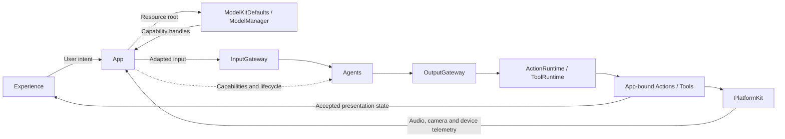
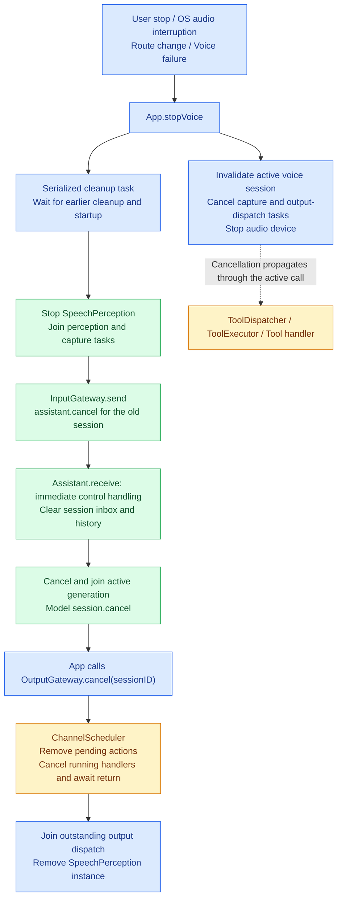

# App — Composition and Lifecycle

Assembles model capabilities, device services, Agents and presentation. The goal is one shared runtime with independent voice and camera sessions. MainActor owns presentation and coordination; actors own Agent, transport and model state.

## Directory structure

```text
App/
├── MobileHarnessApp.swift         # SwiftUI entry and startup/diagnostic selection
├── AppSettings.swift              # Model selection and application of saved configuration
├── CloudSettingsStore.swift       # Storage-backed settings and Keychain credentials
├── AppContainer.swift             # Model capability preparation and platform services
├── AgentBootstrap.swift           # Shared ApplicationRuntime and explicit handlers
├── AppLifecycleCoordinator.swift  # Voice session, playback and presentation state
├── CameraCoordinator.swift        # Camera intent, permissions and scene lifecycle
├── PhotographySession.swift       # Camera-frame adaptation and vision session
└── README.md                      # Composition and lifecycle contract
```

## Upstream and downstream

Arrows show requests and data, not every Swift import.



## Internal structure and data flow


ApplicationRuntime is available before voice model preparation. App supplies the resource root to ModelKitDefaults and gets interfaces from the process-wide ModelManager; it does not register model providers. Voice prepares recognition, chat, VAD and MOSS-TTS-Nano TTS before opening the microphone. Camera preview and its vision session start independently.

Voice PCM enters InputGateway, then SpeechPerception. Assistant subscribes to final speech and speech onset; App does not resubmit final text. Agent-selected UI changes use registered Actions or Tools. Runtime observations control admission, completion and failure supervision, never caption or expression commands. Device telemetry and local user/OS lifecycle changes remain App-owned.

Camera frames enter InputGateway through PhotographySession. VisionPerception filters frames, requests pose inference, publishes observations and emits the completion-only UI.showPose Tool. App checks camera session and frame order before updating the overlay. The default filter is 3% change with a 100 ms maximum refresh interval; this is an admission rule, not a processing-FPS guarantee.

## Concurrency and cleanup

| Work | Owner, bound and completion |
| --- | --- |
| Startup / voice stop | One serialized cleanup chain; new capture waits for old cleanup |
| Voice input and output | One capture consumer and sequential output consumers; bounded PCM/output queues belong to PlatformKit and SpeechPerception |
| Reply completion | Join admitted speech/display Actions, then wait 350 ms before resuming speech input |
| Camera changes | One reconciliation worker uses current intent; stop capture and join old analysis before replacement |
| Camera output | One sequential Tool consumer; latest-frame and display replacement belong to VisionPerception |
| Memory warnings | Capacity-one latest notification stream; one consumer forwards pressure to ModelManager |
| Audio telemetry | Capture keeps 2048 latest samples, at most 4096 during append; 32-band analysis and playback cursor polling run at most every 33 ms |

Stop closes capture and perception admission, cancels and joins producer/transport work, then cancels the session's consumers and Actions. Voice and camera close only their own sessions. Models follow ModelManager residency policy. Late UI work must pass active-session and turn/sequence checks. Failures propagate; already completed effects are not rolled back.

See [SpeechPerception](../Agents/SpeechPerception/README.md), [VisionPerception](../Agents/VisionPerception/README.md), [audio I/O](../PlatformKit/Audio/README.md) and [scheduling](../Gateway/Output/Scheduling/README.md) for queue contracts.

## Voice interruption and cancellation

✅ App coordinates session-level stopping. User stop, system audio interruption, audio route changes and voice failures enter `AppLifecycleCoordinator.stopVoice`. This is the current implementation; it does not add Agent-initiated turn cancellation.



The immediate stop actions and the serialized cleanup chain are distinct: audio and current tasks are stopped promptly, while cleanup awaits earlier work before completing the session teardown. The generation branch applies when Assistant has an active input from that session.

`assistant.cancel` bypasses Assistant's ordinary inbox, including when it is full or the Agent is paused. It removes queued inputs and history for that session, cancels the matching generation task and awaits its return. Generation cancellation calls the model session's cancellation API. It does not retract Actions already admitted to ChannelScheduler.

App therefore also calls `OutputGateway.cancel(sessionID)`. The scheduler removes pending Actions, signals cancellation to running handlers and waits for them to return before completing cleanup. Cancellation is cooperative; a handler that does not cooperate can delay the barrier. Completed device effects are not rolled back. Producers must stop first so that they cannot submit more work after cancellation.

| Scope | Current cancellation path |
| --- | --- |
| Assistant work for one session | InputGateway.send → assistant.cancel → clear matching inbox/history and cancel/join generation |
| Actions for one Agent/input | OutputGateway routes assistant.error or agent.error controls → ChannelScheduler.cancel(source, inputID) |
| Actions for one session | App → OutputGateway.cancel(sessionID) → ChannelScheduler |
| All Action scheduling | OutputGateway.shutdown → ChannelScheduler.shutdown; closes future admission and joins current work |
| Tool execution | Cancel the task awaiting OutputGateway.dispatch; cancellation propagates through ToolExecutor to its handler |
| Signal admission | Caller cancellation propagates through InputGateway's structured target tasks; already accepted work remains Agent-owned |

`OutputGateway.cancel(sessionID)` currently targets Actions only; it is not a session-wide Tool cancellation registry. App separately cancels the active output-dispatch task. A cancelled Tool call throws cancellation rather than returning a cancellation ToolResult, and its handler must cooperate. Normal Tool results still return through InputGateway.send.

App owns this coordination because stopping a voice session spans capture, perception, generation and device execution. Assistant owns its internal work; it currently emits no explicit cancellation output when handling assistant.cancel. ❌ Agent-initiated cancellation of its own turn/output and automatic user-speech interruption of an ongoing reply are not implemented. Reply processing currently suspends microphone data admission. If those behaviors are added, the Agent can initiate cancellation of its own output while App retains session-level teardown responsibility.

Implementation: [stopVoice](AppLifecycleCoordinator.swift), [Assistant control handling](../Agents/Assistant/AssistantAgent.swift), [output routing](../Gateway/Output/Routing/ExecutionRouter.swift), [Action cancellation](../Gateway/Output/Scheduling/ChannelScheduler.swift) and [Tool execution](../ToolRuntime/ToolExecutor.swift).

## Feature status

- ✅ Shared communication assembly, JSON v4 validation, explicit handlers and separate camera/voice sessions.
- ✅ Turn-scoped captions, semantic emotions, actual playback state and frequency telemetry.
- ✅ Explicit diagnostics and a labeled Debug-only conversation preview; the preview uses simulated state.
- ❌ Independent multi-window Agent namespaces, persistent background supervision and robot control.

## Issue record

| Status | Issue / next step |
| --- | --- |
| Open | Competing scene-role registrations fail; multi-window ownership is not implemented. |
| Open | Validate sustained camera/voice operation, startup latency and memory/thermal behavior on iPhone. |

✅ InternalSignalBus is removed. App assembles shared policy and gateways, stops producers and coordinates Agent/runtime cancellation and cleanup; Agent inboxes own pending messages. No communication session registry remains. Action completion barriers and independent camera/voice cleanup remain. See [ADR 0048](../../docs/adr/0048-direct-signal-admission.md).

✅ Camera gaze is owned by CameraCoordinator, independent of voice readiness. PhotographySession injects mirroring and a session-fenced moveEyes callback. ApplicationRuntime explicitly binds UI.moveEyes. Each camera Action is joined/retired via the existing ChannelScheduler after OutputGateway dispatch, before consuming the next bounded UI state; this prevents per-frame input bookkeeping leaks. The completion barrier cannot be coalesced. Off/interruption/error/session change centers gaze; old-session and non-increasing Action sequences cannot overwrite it. ❌ No face identity guarantee or no-frame timeout.

✅ Default synthesis now resolves to local MossTTSNano resources (beta). App keeps its existing ModelManager load/unload, PCM playback and diagnostics injection; no concrete TTS engine enters Agent code.

✅ AppSettings owns URL/key/model editing, bounded model-list loading and Storage-backed local persistence and device-only Keychain credentials. Save stops and joins current voice work, updates only the chat registration and writes settings with rollback on update failure. CurrentChatCapability resolves the manager binding on each operation; voice/vision providers remain shared. Startup restores settings before voice warmup. ❌ Live cloud compatibility/device settings acceptance remain pending.

✅ Window-root tasks now own conversation runtime and camera event observation across navigation. Entering settings stops voice and suspends camera; returning restores camera intent without recreating the Agent. Cloud enabled state persists with credentials; pre-switch records decode as enabled. Disabled cloud configuration remains stored and is not validated/loaded at startup.

✅ The home navigation item supplies the 首页 title for native back navigation while keeping its toolbar hidden. Settings uses system back items and edge-swipe behavior.

✅ RuntimePresentation binds one SpeechPlayback and a stream playback callback when the voice runtime starts, keeps the audio store in the voice lifecycle owner, and closes that store on runtime teardown. Assistant JSON declares directed synthesis and hidden audioID playback; App also registers the synthesis Agent. App consumes PCM only inside the scheduled handler, fences session/turn before and after each awaited read, and measures the actual mixer output for spectrum. Existing startup and voice-start model preparation loads synthesis before the first reply. ❌ Physical-device playback acceptance remains pending.


✅ App composes StorageAudio, registers SpeechSynthesisAgent, binds Assistant messaging before start, and binds scheduled Speech playback by audioID. Teardown stops/joins the synthesis Agent and closes its cache. ❌ This migration has not been accepted on a physical phone.

✅ The ordered Assistant output consumer cancels source/input audio on dispatch failure. stopVoice first cancels/joins Assistant generation, then cancels the session cache and Channel work; scheduled playback owns per-ID failure cleanup. ❌ No generic Action preparation hook is part of this lifecycle.


### Durable user settings

✅ `CloudSettingsStore` owns payload version 1 at `Application Support/MobileHarness/Settings/settings.json` in the application sandbox. Storage caches and atomically persists the nonsecret cloud switch, URL, model and opaque credential reference. API keys remain in Keychain with `WhenUnlockedThisDeviceOnly` protection. The settings directory is excluded from backup because its credential references are device-local. Runtime files are outside Git; optional repository-local development data belongs under ignored `.local/`.

✅ Saving stages a new credential, commits the document using its expected revision, then removes the previous credential. A failed file commit removes the staged credential and preserves the previous document. Runtime reconfiguration failure attempts to persist the previous configuration again; rollback failure is surfaced. Turning cloud off retains URL, key and model. Startup refreshes disk before selecting the runtime capability.

✅ Existing whole-configuration Keychain records migrate on the first successful load. The original is deleted only after the new document and referenced key can be read back. Malformed files, unsupported schemas, missing credentials and version conflicts are surfaced rather than reset. An explicit empty cloud record prevents legacy resurrection after rollback.

❌ Keychain and file storage cannot form a single atomic transaction. A crash or cleanup failure can leave an unreferenced credential; automatic orphan collection is not implemented. Cross-device sync and live-device migration acceptance remain pending.

✅ Startup/diagnostics now perform real in-memory synthesis warmup before conversation admission or measured speech. It exercises lazy kernels using synthetic Chinese text, drains PCM without playback and propagates failures. The first device run took 10.63 s to first PCM without warmup; startup must absorb that compilation cost instead of extending StorageAudio timeouts. ❌ Warmup does not prove sustained runtime stability.

✅ Cloud settings initially show the official OpenAI base URL; a saved blank URL resolves to the same endpoint. Empty Key is valid and sends no Authorization. Before model discovery, gpt-4o-mini is the visible default, allowing cloud mode to be saved without successful authentication/discovery. Successful discovery still requires an explicit selection when the default is absent. Server failures remain visible. ❌ Live provider acceptance is pending.

✅ Settings exposes an independent LLM raw-output diagnostic. App restores saved settings, joins voice cleanup, then injects a capability backed by the same process-wide manager/current binding. It can acquire chat without successful ASR/TTS startup. AppSettings displays the saved model identity rather than unsaved form edits. The diagnostic owns cancellation and never resumes recording automatically. ❌ Live-device diagnostic acceptance remains pending; see [Diagnostics](../Experience/Diagnostics/README.md).

✅ The ordered output pump forwards typed wait boundaries through OutputGateway alongside Actions. The observation sink ignores these runtime coordination events; it does not trigger UI/device effects or claim group completion. Existing dispatch-failure audio cleanup and session stop remain responsible for unused prefetched handles. ❌ Wait does not extend audio-cache lifetime or provide physical-device timeout guarantees.
