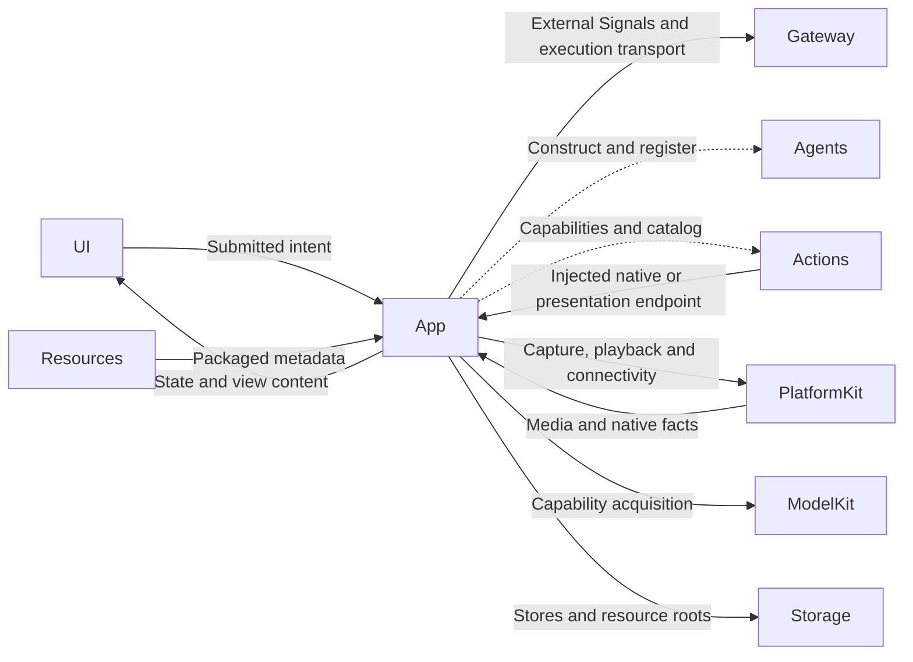
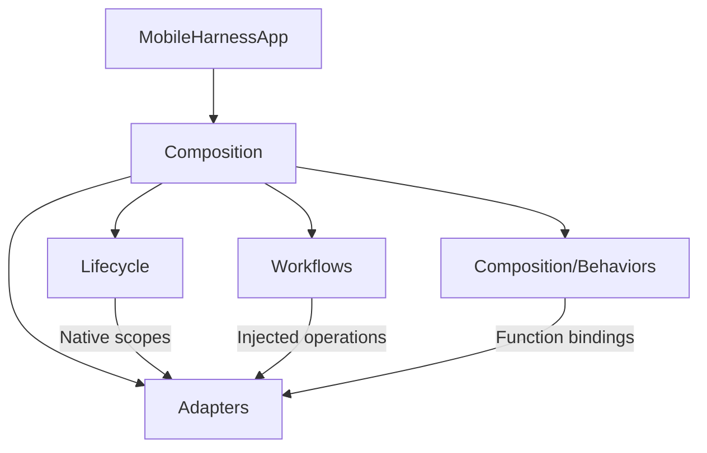

# App — Composition and Native Lifecycle

## Summary

Application host, explicit service assembly, native lifecycle ownership and adaptation between independent modules.

## Ownership and boundaries

App owns registration, operation lifetimes, permissions, safety fences and UI/native adapters. Agents own business decisions; UI owns local presentation. ModelKitDefaults owns model assembly. Root services outlive page navigation.

## External relationships and data flow

Runtime arrows show data or capability calls; dashed arrows show injection.

## Internal structure

## Interfaces and routing

| Operation | Owner and route | Completion |
| --- | --- | --- |
| Navigation, dialogs, drafts and selection | UI-local injected methods | State accepted |
| Page visibility, system settings and immediate stop | App lifecycle endpoint | Native cleanup according to endpoint |
| Camera, history, provider, resource and device requests | External publish to the exact business Agent; registered function execution | Correlated business result |
| Text and final ASR | Assistant; explicit specialist delegation where selected | Reply or task result |
| Agent-selected presentation | Gateway → Actions → authorized App endpoint | Current scope accepted |

Publication has no subscriber receipt. UI request waiters observe business completion independently, with owned 120-second watchdogs. Every output consumer is bound to the actual registered Agent incarnation.

## Lifecycle and failure semantics

Close admission, stop producers, cancel and join owned work, then release matching bindings and resources. A cancellation request is not physical stop. Native background fences run immediately; inference never supplies device safety. Captions, microphone capture, business tasks and playback have separate lifetimes.

Healthy camera flips retain the native session/lease and acknowledge input replacement before independently joined vision replacement. Full close/background joins all owners. Bluetooth recovery does not cancel unrelated Agent queues. Download scheduling is independent of voice/device work.

✅ Stable interaction runtime, resident SpeechPerception, independent feature targets, typed owner subscriptions and frozen function registration are implemented.

❌ Independent multi-window execution namespaces and forced interruption of non-cooperative native handlers are not implemented.

## Related design

[Parent design](../README.md) · [Adapters](Adapters/README.md) · [Composition](Composition/README.md) · [Lifecycle](Lifecycle/README.md) · [Workflows](Workflows/README.md)

## Skill/task-mode contract

✅ App binds real Agent.Task control functions to Assistant and projects current task/Skill state. Photography model results return to Assistant. Assistant conversations include all persisted inputs; task history additionally groups foreground/background tasks from Assistant state. UI navigation remains local; conversation-requested UI changes remain Actions.

✅ Implemented: home hold intents remain routed to resident SpeechPerception. Lifecycle owns a bounded toggle publication and activation feedback before capture; Speech owns canonical feedback composition; Actions/UI owns bounded original PCM synthesis, and PlatformKit owns generic clip playback and native impact requests.

✅ Implemented: Lifecycle owns native half-duplex capture and immediate interruption; Composition injects trusted current-conversation cancellation. Presentation owns a single native-transition worker and bounded stale-turn fencing. Native I/O owns stopPlayback and distinct PCM continuity failure facts.

✅ Implemented: App forwards reusable feedback capabilities to its root voice owner. Listening activation joins parallel readiness/cue/native-start-gated haptic, then the acoustic tail and capture. Lifecycle owns the single context-fenced waiter; PlatformKit reports first-buffer/player-start admission, without owning listening policy. Output-independent native capture ownership and manual interruption remain intact.

✅ Implemented: Camera save/ignore shares the same native disposition path from UI and Agents. Successful import gates feedback; one root-owned task joins animation/cue and removes the matching photo. Feedback issues never fabricate a failed album transaction.

✅ Host keeps archive policy and physical voice ownership; wake presentation receives the actual generation. Graphics lifecycle remains independent of native input/model preparation.

✅ Implemented validation aid: the DEBUG-only `-companion-cycle-preview` launch argument opens the isolated visual surface and automatically exercises six 1.3-second wakes / 0.8-second sleeps. It creates no camera, microphone or model runtime; physical Animation Hitches evidence must be labeled synthetic UI acceptance.

✅ Home failure contract: failures remain in root execution snapshots; only Agent/App/system failures project a fresh toast independent of voicePhase. Action failures remain panel-only. Photo storage selects FIFO cache retention; decision continuation has no four-round/16-native host limit.

## 历史记录收敛（2026-10-13）

✅ 已实现：历史记录页面仅保留 Assistant 聊天记录与任务记录。Assistant context 是聊天持久化事实源，任务按持久化身份关联；页面板块重新设计另行开展。

❌ 历史记录页面板块重新设计及原生 UI/真机验收。

✅ Implemented: root VoiceSessionCoordinator warms the default cue/haptic on touch-down through an injected UI callback, retires aborted/background preparation, and reuses warm native resources for canonical activation. No second cue/haptic playback path is added.

✅ Implemented (2026-10-13): UI.Notice.showNotice/dismissNotice and UI.Light.updateLight are canonical presentation Actions for trusted business calls, currently registered by no Skill. Neutral Actions values cross RuntimePresentation into root-owned HomeEffectsWorkflow, which retains one replaceable notice expiry and one light expiry, UUID-fenced cleanup, and explicit stop. Notices remain separate from factual ExecutionIssue history; actual upper-layer errors have display priority and Action failures remain panel-only. Decorative light accepts normalized origin, initial opacity/intensity and duration; it never changes consent, microphone or eyes. Native renderer separates light generations from listening eye generations and preserves existing exit fade. RuntimePresentation adapts Action requests into UI-owned values; AppPresentationWorkflow keeps its existing UI/AgentCore/FunctionContracts boundary. No UI project dependencies or new directories.

✅ ActionActivityWorkflow 在日志→展示边界为 speechPerception 的 recognition 错误设置用户文案“我没听清”；原始消息、来源、输入关联仍原样保存在日志。recordFailure 和 startFailures 快照使用同一映射，其他错误不改文案。

## Streaming TTS latency

✅ VoiceSessionCoordinator joins playback/lease cleanup and immediate policy-permitted listening restoration. There is no post-playback timer; failures remain explicit and user-off/session fences prevent reopening capture.
