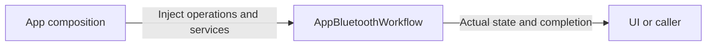

# AppBluetoothWorkflow

Purpose: own bluetooth application operations in an independent compilation boundary. Design goals: explicit injected effects and unchanged business lifetimes. Direct dependencies: UI, AgentCore, Storage, Actions, ActionRuntime and PlatformKit.

✅ Connection, foreground recovery, Settings/manual admission and presentation remain in one root-owned workflow. This is a source/target move only; existing bounded latest-intent policies, resource fences, fixed plans and feedback completion are unchanged. The full algorithm is documented in the parent workflow README.

❌ Physical safety still requires device-side support and sustained real-device acceptance.

✅ Tracking aim uses the verified foreground NexArmActionController and the existing motors 1–5 resource fence. Return means transport acceptance, not arrival.

✅ Connection verification shows separate position-read and action-mapping preparation stages. Query timeout errors include native command and received-notification byte count; this diagnostic does not claim a transport/firmware cause.

✅ Failed control verification preserves a still-connected BLE link and its controller while marking control unready. The notice directs explicit disconnect/reconnect after a query timeout. A notification-health update alone cannot grant complete control validation.

✅ Explicit 刷新状态 / 验证控制 is available while connected but unready; it performs read-only recovery and control verification before granting control. Notification health alone does not restore readiness. Query quarantine still requires reconnect.
