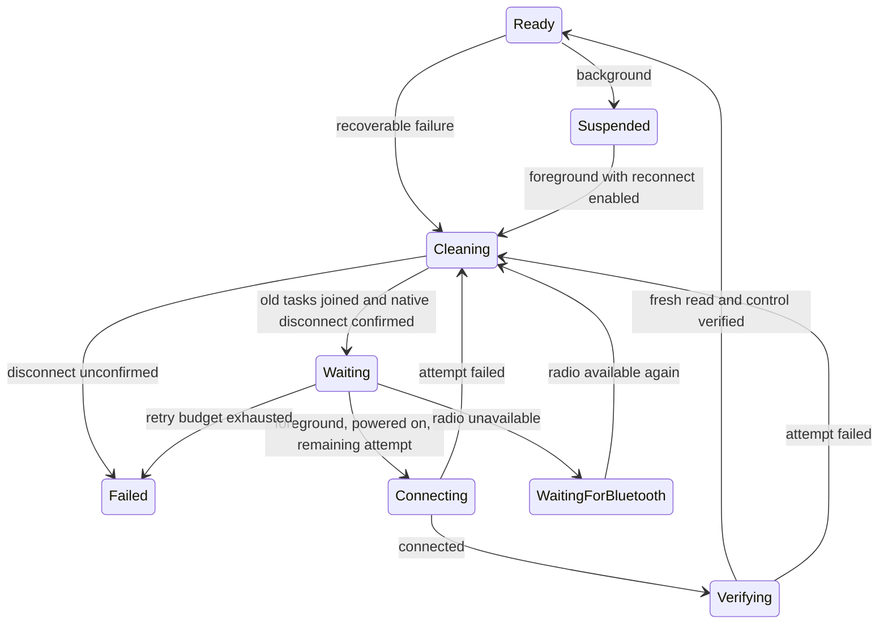
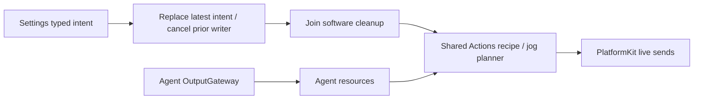

# AppBluetoothWorkflow

Purpose: own Bluetooth selection, foreground lifetime, control admission, bounded recovery and per-device diagnostics. Design goals: one connection owner, no stale writes or motion replay, explicit cleanup and errors, and recovery independent of page lifetime. Dependencies: UI, AgentCore, Storage, Actions, ActionRuntime and PlatformKit.

## Ownership and implemented behavior

✅ `BluetoothWorkflow` composes one Actions-owned NexArmActionController per connection. Actions owns gesture/home/motion/completion policy; PlatformKit owns device packets, links, flow control and native facts. Workflow owns selection, persistence, Agent resource bindings, manual takeover, recovery and mapping those facts to UI values. Runtime reports retain producer-owned failure identifiers (ADR0122).

✅ Manual first connection validates position/protocol and prepares the bounded Action IK mapping. Its optional connection indication remains separate from protocol verification. Automatic recovery and explicit 重新连接 never replay that indication or physical reset. All control verification has a cooperative 20-second overall deadline. A final read, connected status, healthy feedback and current session identity are required before admitting control.

✅ Tracking preserves one latest aim over motors1–4; the Tool permission boundary remains motors1–5. Manual/aim planning uses 30 ms ticks, a fixed round-robin start per pass and Actions-owned trajectories. PlatformKit spaces actual BLE writes by at least 30 ms (ADR0123). Accepted transport is not physical arrival. Finite Action failures retain reports; reset/jog preemption and resource fences remain explicit.

## Recovery state machine — ADR0125

✅ `BluetoothRecovery.swift` defines App-owned fault categories, retry classification and budgets. Physical loss, two-second feedback silence, sustained send blockage, native communication failures and quarantined read-only queries enter one recovery worker. Overlapping snapshots are coalesced; monotonic PlatformKit snapshot revisions reject already-obsolete notifications. Position/protocol, firmware/service compatibility and storage/configuration failures stop automatic retries. Ordinary parameter/target-arrival failures are not transport-recovery triggers.

✅ Recovery immediately fences generation/control identity and denies control, clears pending Settings actions, motor inputs and aim goals, cancels connection/query/motion/live/Settings owners, closes native admission, joins cleanup, then discards controller, IK, planner and stale telemetry. Unconfirmed native close stops recovery; a second connection is never opened over it. Host cancellation/timeout does not establish a physical stop.

✅ Up to three attempts per episode use 1/2/4-second backoff. A cooperative two-minute active-worker deadline cancels owned work; cleanup still joins rather than forcing a stale owner through. Successful short connections do not refill attempts; 30 seconds of verified readiness before another fault allows a fresh budget. Time in background/radio-unavailable states is excluded by starting a fresh active window, without refilling attempts. Exhaustion/terminal failure requires manual retry. Manual reconnect starts a fresh budget; it waits for the same cleanup and builds a new controller.

✅ Powered-off/resetting radio waits without a polling reconnect loop; powered-on events resume pending recovery. Denied/unsupported radio stops with an error. Background cancels recovery and native work, preserving reconnect preference; foreground resumes eligible devices. Manual disconnect/forget disables automatic recovery and persists that preference. Page exit stops page-owned motor intent but not recovery. Restored devices use the same recovery path. No interrupted physical command, old target, gesture or reset is replayed.

## Diagnostics and UI

✅ Root-lifetime memory cache retains at most four device IDs and 32 newest events per device (128 total), evicting the oldest device/events. UI receives `BluetoothIncident` presentation values only. Each event includes time, recovery episode, original category, stage/message, attempt count, elapsed time, native failure/quarantine facts and bounded traffic/feedback/pose details. Messages are at most 512 characters; details are at most ten strings of 256 characters. No command payload/media or disk history is retained.

✅ The device detail page remains accessible after disconnection. Below 当前状态 it displays recovery stage/attempts and 异常与恢复记录 with expandable details, 重新连接, cancellation and 清空记录. Admission errors explain when control was not validated or recovery was active. Opening/refreshing the page cannot query during recovery or grant readiness from one healthy notification. Clearing records does not change the recovery policy or radio state.

❌ Physical BLE endurance, optimal rate/MTU packing, actual firmware recovery and native iOS layout acceptance remain pending. Device-side emergency-stop/watchdog behavior is not implemented by this host recovery path. Diagnostics are process-local and disappear at relaunch.

## Tracking resource lifetime — ADR0126

✅ Robot.aim is a latest-target publication through OutputGateway. On first input, App waits for resource/session admission of its one continuous worker; later inputs replace the target. The worker holds motors1–4 through the shared injected ResourceCoordinator for its complete native-writing lifetime, inheriting the Gateway-bound Agent/session owner so session closure cancels and joins it. Settings motor sliders and presets bypass this Agent guard and use explicit cancellation/takeover (ADR0127). The aim worker releases its old guard before publishing idle or starting a replacement worker. A closing/failed owner cannot accept a target that will be silently lost.

✅ Resource conflicts/unavailability remain control-admission errors, with App-localized reasons and cached 控制启动失败 / 动作资源被拒绝 events. They do not lower healthy BLE readiness or trigger transport reconnect. Successful fresh admission clears the old error; stale/cancelled workers do not publish it. Startup acknowledgment has a one-element stream with oldest-one overflow and is finished/cancelled with the owner.

❌ Physical tracking endurance and fairness/preemption between different resource owners remain unaccepted.

## Settings manual takeover — ADR0127

✅ UI calls `BluetoothControlling` directly into this App workflow; it never creates an Agent invocation or crosses InputGateway/OutputGateway. Settings keeps a capacity-one latest preset/reset slot and six latest velocity slots. A newer click/reset/jog explicitly cancels the prior playback/motion/aim and joins software session cleanup, not physical arrival. Presets/reset call Actions `manualPlan` and `submit`; no Gateway resource acquisition or completion feedback is used. Manual jog similarly bypasses `withMotorResources`. Native connection readiness, hardware limits, PlatformKit pacing and ADR0125 cleanup remain mandatory.

✅ Preset playback has one child task and one supervisor; replacement cancels the child's frame delay/send retry immediately. A manual-intent revision also fences a preset still joining old cleanup, so a later slider cannot be overwritten by that stale preset. Last-frame admission reports 已发送…指令, never 已完成. A pending query is retired through native live admission before its owner is cancelled/joined; cancelled refresh is not a recovery failure, and refresh cannot overlap manual playback. Command estimates seed jog takeover but never replace measured UI telemetry. Page exit/background/disconnect cancels unsent preset/reset frames and motor intent.

✅ `trackingAvailable` suppresses new Photographer targets during manual control; direct Agent aim/finite entry guards also reject the race. Resource/session cleanup calls `stopAgentActions`, which cancels Agent motion/aim only and cannot stop Settings playback/jog. Old targets are cleared; only fresh later input may start tracking.

❌ Native iOS touch/gesture and physical takeover/endurance acceptance remain pending; software cancellation is not a physical-stop acknowledgment.
