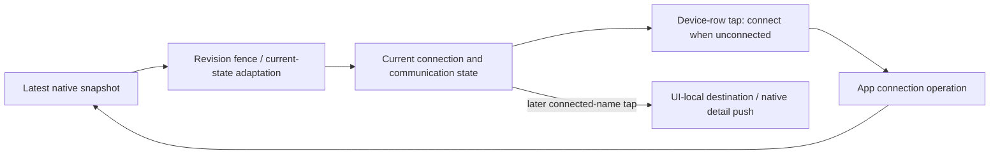
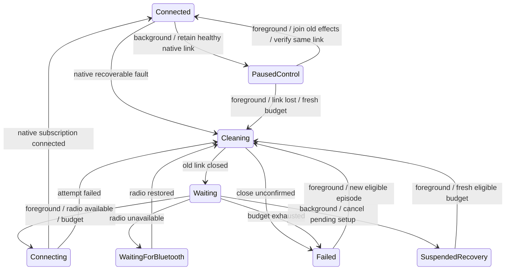
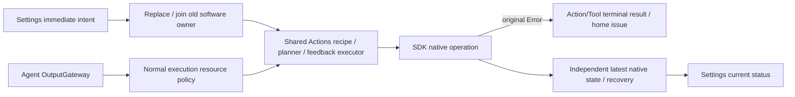

# AppBluetoothWorkflow

Purpose: own Bluetooth discovery, selection, foreground lifetime, manual control and bounded native recovery. Design goals: one connection owner, latest current status, no stale writes or motion replay, and independent Action/Tool execution results. Dependencies: UI, AgentCore, Storage, Actions, FunctionContracts and PlatformKit.

## Current connection and presentation — ADR0134 / ADR0138

✅ `BluetoothWorkflow` observes the latest SDK snapshot, rejects obsolete revisions and adapts current power, connection, native failure and passive feedback health into UI values. There is no exception history, event ring, device cache, sequence cursor, overflow marker or clear-history operation. Successful explicit connection sets reconnectEnabled before saving the device, so the saved default is true and cold start can reconnect; manual disconnect/forget persists false. Previously explicit false values remain respected. A fresh healthy snapshot replaces the previous communication issue; a new connection resets native failure state. Action/Tool errors do not become Bluetooth state.

✅ A compact device-row tap connects while disconnected and opens detail only when already connected. Successful connection stays on the list; a subsequent tap owns the UI-local destination. Only connected rows have a Disconnect row below, and remembered devices remain forgettable while disconnected. Busy connection/recovery exposes toolbar cancellation; there are no duplicate per-device Connect rows. Failed new selections remain nearby and cannot borrow the saved device’s current-error presentation. App never owns a navigation intent. An already-open detail page remains visible after loss with disabled actions/motor gestures and truthful current state. UI owns navigation; App owns connection/recovery.

✅ SDK subscription completion creates one connection-local Actions controller immediately, without version/pose/IK probes or indication movement. Passive samples alone update measured positions and timestamps. Missing feedback appears as a current communication issue while the native link remains connected; it does not disable manual takeover or independently reconnect. A healthy sample clears the issue. Refresh reads cached passive samples only. Configured planning references are not measured telemetry.

## Recovery and scene lifetime — ADR0125 / ADR0129 / ADR0142

✅ Physical loss, native transport/protocol failure, sustained two-second send blockage and quarantined queries enter the existing bounded recovery worker. Recovery closes and confirms the old native session, clears connection-local manual/live intents/controller/planner/telemetry, and reconnects without replaying old commands. A current native fault and current recovery phase/attempt are retained; historical stages are not stored. Recovery success confirms connectivity only, not physical motion.

✅ Recovery never cancels finite Agent Actions, removes Channel queues, changes Agent/session admission or stops Assistant/speech. Old native I/O returns its dependency error and follows the existing Action/Tool terminal-result policy. Generation/session fences reject stale writes and UI mutations. Explicit user/session cancellation and resource revocation retain separate execution policy.

✅ One recovery worker, three actual connection attempts per episode, 1/2/4-second backoff and a cooperative two-minute active deadline. Waiting cancellation consumes no attempt. Successful connection immediately clears attempts/exhaustion; every actual background-to-foreground transition starts a fresh eligible budget, including after previous exhaustion. Repeated same-phase notifications do not refill it. Radio-off/reset waits on native events without consuming attempts; denied/unsupported stops. Cleanup joins native closure; unconfirmed disconnect prevents a second connection. Manual disconnect/forget persists disabled reconnection. Unknown/configuration/storage/service-policy errors are not blindly retried. No connection-flapping counter shares this retry budget.

✅ App forwards actual background status; transient inactive does not disconnect or renew retry budgets. Background cancels/joins finite motion, Settings playback/jog and tracking, clears latest motor/aim intents and stops discovery, while retaining a healthy controller/native connection. One control-suspension Task gates new effects until old writers/report owners retire, even after a rapid foreground return. Pending connection/recovery still closes normally; background native loss is deferred until foreground. Foreground joins suspension/native cleanup and reads current SDK status before reusing or reconnecting. A genuine in-flight query cancellation can close/quarantine the native link under its existing isolation contract. No old command resumes.

❌ No bluetooth-central background execution mode, state restoration, guarantee of continuous connection, background Action execution or perpetual recovery is introduced. OS-suspended events may arrive only on foreground return; physical scene/native-I/O acceptance remains outstanding.

## Shared Actions and manual takeover

✅ Actions owns gestures, configured home, motion shaping and segment feedback completion; SDK owns packet encoding, hardware limits, pacing and transport facts. Passive simple/reset recipes do not query IK. Cartesian presets resolve only requested missing poses plus home; explicit diagnostic full-catalog preparation remains separate.

✅ Settings calls App directly, bypassing InputGateway/OutputGateway and Agent resource locks. One latest preset/reset slot, six latest velocity slots and a cancellable child/supervisor bound manual work. Submit returns immediately. Replacement cancels and joins old software cleanup without waiting for physical arrival, then runs the shared Actions recipe/feedback executor. A manual-intent revision prevents an older queued replacement from overwriting a newer slider. Manual errors end only the current child and are ignored for UI/result publication; the next intent remains admissible. Native faults independently update current transport state.

✅ Agent finite actions use invocation-private report sinks. Stored child results cannot replace final failures/root descriptions. Business rejection cannot borrow another invocation's motor report or request Bluetooth recovery. Background/device cleanup and manual takeover remain explicit, distinct lifetime policies.

✅ NexArm.Tracking.aim publishes one latest target after Gateway authorization. The continuous worker holds motors1–4 through the injected resource coordinator; startup is acknowledged after admission. WorkerID and initiating call origin belong to App execution observation only. Late worker failures reach home, including after native recovery changes generation; completed Tool results are not rewritten. Settings takeover bypasses the guard, suppresses new Photographer targets and clears old aims; fresh later input can resume. Gateway's Agent cleanup cannot stop Settings playback.

❌ No physical stop guarantee, automatic Action replay, durable Bluetooth history, hardware endurance acceptance or native iOS touch/layout acceptance. Current snapshots and simulated recovery do not prove device-side recovery or obstacle clearance.

## Tracking freshness and takeover — ADR0139

✅ Composition binds trackingInputAvailable to the current Photographer's monotonic usable-pose freshness. The worker checks it before native startup and at every 30ms tick; a one-second production gap or stopped Agent exits through joined live-session cleanup and releases resources. Old targets are cleared. Expected interruption creates neither a device fault nor an execution warning. Camera close also removes/joins its session through existing ownership.

✅ Assistant takeover cancels and joins the old writer before executing the Action, including motor5/6 through the common writer group. Subsequent Channel Actions remain queued. Settings takeover continues bypassing Agent fences. ❌ Cooperative cleanup does not guarantee immediate physical stop.

✅ ADR0141: Agent finite-motion entry and each tracking native startup/write validate the inherited ResourceExecutionPermit. Held IDs alone cannot bypass arbitration; ended/revoked execution is rejected before a new effect. App maps generic validation failure into Actions-owned resourceUnavailable, while expected task cancellation remains cancellation. Settings presets/sliders remain outside these Agent checks; SDK session fencing and connection recovery remain independent. ❌ This introduces no forced release of an unfinished native writer or physical stop guarantee.

✅ ADR0161: standard callable inputs use FunctionInput/FunctionContracts; common execution and call protocols belong to independent Gateway targets. This directory retains its existing ownership, resource/permission and lifecycle boundaries. ❌ Remaining feature Signal/continuation and physical acceptance are separate work.

## Typed device, navigation and environment entry points

✅ Implemented: app.interaction/1 maps explicit device commands and navigation destinations to fixed registered functions through ApplicationControl and the shared root transport. This Agent now coordinates native resource interactions as well as model resources; it performs no native I/O. UI controls emit typed intent through a root-owned BluetoothInteractionWorkflow; native BluetoothWorkflow remains the injected connection/recovery/manual worker host. Existing arrival tolerance, timeouts, pacing and takeover algorithms stay unchanged.

✅ Implemented: System.Device.control validates bounded string arguments and invokes neutral DeviceControlCapability; successful submission reports acceptance, not physical arrival. Read-only status and selected connection commands are explicitly model-granted. UI.Navigation.open commits native route state; manual taps and model requests share that function. A bounded latest motor-intent worker sends only changed values, with reset/stop priority and explicit failure display. No queued motion replay.

✅ Implemented: app.environment/1 stores latest sequenced scene/device/capability facts in the root Agent, with finite categories and bounded data. App still performs synchronous background/native safety fencing before reporting facts; physical safety cannot wait on Agent admission or iOS background execution. Native back navigation remains platform-owned and reports a fact, rather than replaying navigation effects. Photo-library creation and physical acceptance are feature/acceptance boundaries, not implied by navigation support.

## Manual worker terminal feedback

✅ Implemented: accepted device-control calls acknowledge submission only. Preset/jog native workers capture their own origin and report sink, retain one latest structured terminal failure, publish independent home issues and deliver a trusted ActionResult through InputGateway after non-cancellation failure. Root ApplicationControl accepts runtime-owned Action results into a bounded128-result inbox; environment context exposes the latest result summary. No accepted Tool receipt is rewritten, no movement replay, and no tolerance/arrival/timeout algorithm changes. Ordinary failure stops only its worker and keeps subsequent intents admissible. Diagnostic delivery rejection is reported separately.

✅ Implemented admission hardening: the native device endpoint validates its existing foreground, connection and worker admission conditions before accepting scan/connect/reconnect/preset/jog. Rejected void UI commands must become explicit call errors, without changing native recovery/motion algorithms. Device facts include the current native issue. Motor arguments reject unrelated preset fields.

✅ Frontend/backend separation: Native page visibility/system-settings and stop fencing use immediate lifecycle callbacks. Explicit connect/disconnect/scan/preset/motor data commands retain bounded direct ApplicationControl transport. Device-row/detail navigation stays UI-local.
