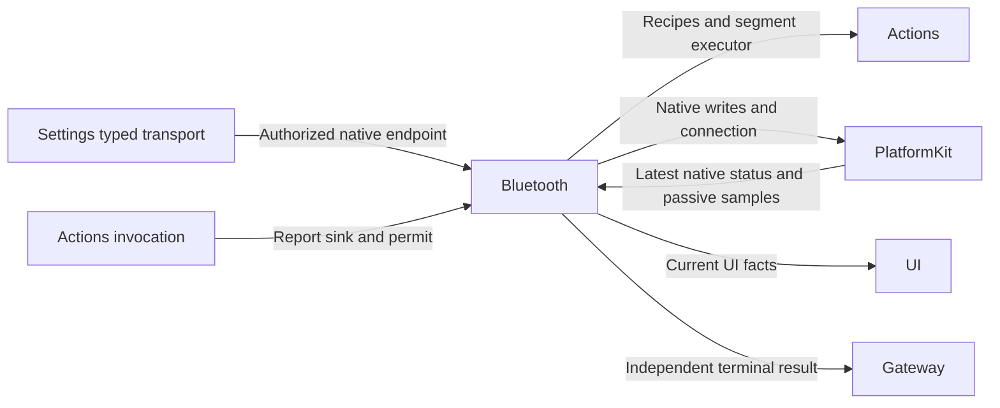

# Bluetooth Lifecycle and Manual Execution

## Summary

Hosts one native Bluetooth connection, passive feedback, bounded recovery and manual/Agent execution endpoints.

## Ownership and boundaries

ApplicationControl selects explicit device operations; Settings transport publishes them through its owner. BluetoothWorkflow owns native lifecycle and takeover; Actions owns recipes/planning/arrival algorithms; PlatformKit owns packet/pacing/session isolation. Device-row navigation remains UI-local.

## External relationships and data flow

Runtime arrows show data or capability calls; dashed arrows show injection.

## Passive connection and recovery

Subscription completion enables the connection-local Actions controller without version/pose/IK probes or indication movement. Only received packets become measured telemetry. Missing feedback is visible but does not disable manual commands or alone cause reconnection. Refresh reads cached samples. Configured planning references are not measurements.

Latest SDK revision controls UI state; healthy snapshots/new connections replace old faults. Explicit connection persists reconnectEnabled=true; disconnect/forget persists false. Selection errors cannot borrow another device's error. Successful connect stays on the list; UI opens detail on a later connected-row tap.

Recoverable loss, native protocol/transport failure, sustained two-second send blockage and quarantined query enter one recovery worker. Close/confirm the old session before replacement; clear controller/planner/intents/telemetry and never replay motion. Unconfirmed closure blocks a second connection.

Recovery permits three actual connection attempts per episode, 1/2/4-second backoff and a cooperative two-minute active deadline. Radio waits/cancelled waiting consume no attempt. Success resets the budget; an actual background-to-foreground transition starts a fresh eligible episode. Repeated same-phase notifications do not reset it. Denied/unsupported/configuration/storage failures are not blindly retried.

## Foreground and manual ownership

Background stops discovery and cancels/joins finite motion, jog and tracking while retaining a healthy native connection. A suspension task gates new writes until old owners retire. Foreground joins cleanup and checks the same native link before reuse/reconnect. Inactive alone does not disconnect. There is no background robot execution or guaranteed continuous BLE connection.

Manual work retains one latest preset/reset intent and six latest velocities. Submission acknowledges admission, not arrival. Replacement joins old software work without waiting for arrival; native worker failures publish independent home issues and a trusted ActionResult to ApplicationControl. Completed receipts are never rewritten. Page close/system settings/immediate stop bypass the backend command queue as lifecycle fences.

Agent finite actions use inherited ResourceExecutionPermit and invocation-private report sinks. Tracking retains latest aim, holds motors 1–4 through the coordinator, checks availability each 30 ms tick and exits on a one-second usable-pose gap. Expected cancellation clears targets and joins release without creating a Bluetooth fault. Settings takeover is an explicit native bypass; Assistant takeover joins the previous writer group before execution. Cooperative cleanup is not physical stop.

✅ Passive connection, bounded native recovery, fenced manual execution and independent late terminal reporting are implemented.

❌ Bluetooth state restoration and background execution are not implemented.

## Related design

[Parent design](../README.md)

## SQLite records and runtime identity

✅ Implemented: technical identities are opaque UUID strings; committed business entities use dialog/message/task/media/device SQLite IDs. Consumers use Storage repositories while preserving ownership, cancellation and independent foundation boundaries. Complete messages, including each ReACT message, persist at termination; delta fragments do not persist. The custom allocator and replaced file/index implementation are removed. See the project SQLite business-record plan.

✅ devices rows now own native/business mapping, selected-device and reconnect facts. App maps system UUID strings to device_N and passes native identities only to PlatformKit. The selected-device JSON and counter associations are removed. Lifecycle/recovery/manual execution contracts above remain the same.

✅ Storage repository refactor: BluetoothWorkflow receives a DeviceRepository factory rather than a database. Native/business mapping, selected device, reconnect state and all link lifecycle policy retain their contracts.
