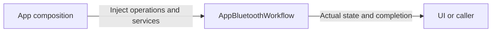

# AppBluetoothWorkflow

Purpose: own bluetooth application operations in an independent compilation boundary. Design goals: explicit injected effects and unchanged business lifetimes. Direct dependencies: UI, AgentCore, Storage, Actions, ActionRuntime and PlatformKit.

✅ Connection, foreground recovery, Settings/manual admission and presentation remain in one root-owned workflow. This is a source/target move only; existing bounded latest-intent policies, resource fences, fixed plans and feedback completion are unchanged. The full algorithm is documented in the parent workflow README.

❌ Physical safety still requires device-side support and sustained real-device acceptance.

✅ Tracking aim uses the verified foreground NexArmActionController for the tracking start pose and holds motors 1–4 (base, shoulder lift, elbow, wrist pitch) on the live loop; the Tool boundary still declares motors 1–5. The four motors are considered in turn within one 30 ms planning tick; PlatformKit admits at most one packet per shared 30 ms interval. Return means transport acceptance, not arrival.

✅ Connection verification shows separate position-read and action-mapping preparation stages. Query timeout errors include native command and received-notification byte count; this diagnostic does not claim a transport/firmware cause.

✅ Failed control verification preserves a still-connected BLE link and its controller while marking control unready. The notice directs explicit disconnect/reconnect after a query timeout. A notification-health update alone cannot grant complete control validation.

✅ Explicit 刷新状态 / 验证控制 is available while connected but unready; it performs read-only recovery and control verification before granting control. Notification health alone does not restore readiness. Query quarantine still requires reconnect.

✅ The merged aim-follow restart branch follows repository Swift formatting; this formatting change preserves restart and manual-control behavior.

✅ BluetoothWorkflow translates NexArm motor results into producer-owned report details (motor/target/observed strings); generic runtimes preserve them without device fields. Execution behavior and position feedback policy are unchanged. ❌ No hardware validation is implied by this transport change.

✅ ADR0122: Runtime resource values contain no camera constants. ActionFailure and ActionReport.Entry.Code are bounded opaque identifiers (1–64 UTF-8 bytes); Runtime provides generic execution codes only. NexArm owns its result vocabulary, BluetoothWorkflowError owns its failure-to-report mapping, and Gateway preserves producer identifiers. Existing device failure/report identifiers and presentation are unchanged.

❌ Runtime must not classify pose, foreground, control-readiness or device-feedback failures. Producers provide actionReportCode through ActionExecutionFailureProviding; the generic default handles invalid arguments/resource unavailability and otherwise reports handlerFailed. CancellationError remains cancellation.

✅ Connection failures distinguish position/protocol validation from preset IK mapping; position failures include the latest device-reported Cartesian values. Diagnostics preserve the original rejection and keep control disabled.

✅ ADR0123: streaming owners keep latest intents and only commit admitted proposals under the shared PlatformKit BLE budget. Aim snapshots the round-robin start index before iterating so updating the next motor cannot skip/repeat motors in the same pass. Transport budgets and counters stay in PlatformKit; Workflow retains foreground lifetime, resource fences and explicit recovery. ❌ Physical multi-motor response under the initial ceiling remains to be measured.
