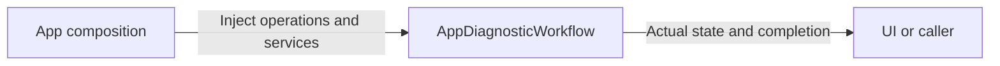
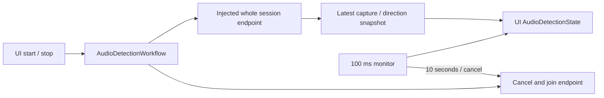

# AppDiagnosticWorkflow

Purpose: own diagnostics application operations in an independent compilation boundary. Design goals: explicit injected effects and unchanged business lifetimes. Direct dependencies: UI, ModelKit and PlatformKit.

✅ Existing explicit chat and synthesis diagnostics retain their one-operation/cancellation/cleanup policies. Debug/provider and iOS availability gates are unchanged. Diagnostic model/capture effects are explicit; whole Agent sessions are injected from App Lifecycle.

❌ Physical-device diagnostic acceptance is separate.

✅ Speech diagnostics now await AppleAudioIO shutdown inside their owned start/stop tasks, joining capture/playback cleanup before unload or replacement. Direction DSP stays with SpeechPerception and sound-source UI stays in UI/Settings; this workflow owns their diagnostic operation lifetime only.

## Audio detection operation

✅ AudioDetectionWorkflow.swift owns one running endpoint task, one 100 ms freshness/deadline monitor and no pending queue. The 10-second duration starts at the first received PCM snapshot. Stop cancels, clears valid angles immediately and awaits endpoint cleanup before restart/voice takeover. Generation checks reject callbacks from stopped/replaced sessions. Failure retains permission/capture facts for review and allows retry. App injects AudioDetectionRunning; the feature target does not construct Agents, Gateways, audio devices or direction DSP.

❌ Real microphone routing, FOA axes and native interaction acceptance remain separate from workflow fixtures.
