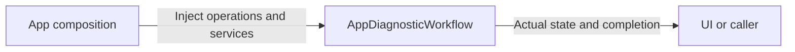

# AppDiagnosticWorkflow

Purpose: own diagnostics application operations in an independent compilation boundary. Design goals: explicit injected effects and unchanged business lifetimes. Direct dependencies: UI, ModelKit and PlatformKit.

✅ Existing explicit chat and synthesis diagnostics retain their one-operation/cancellation/cleanup policies. Debug/provider and iOS availability gates are unchanged. Diagnostics stay separate from Agent output execution.

❌ Physical-device diagnostic acceptance is separate.
