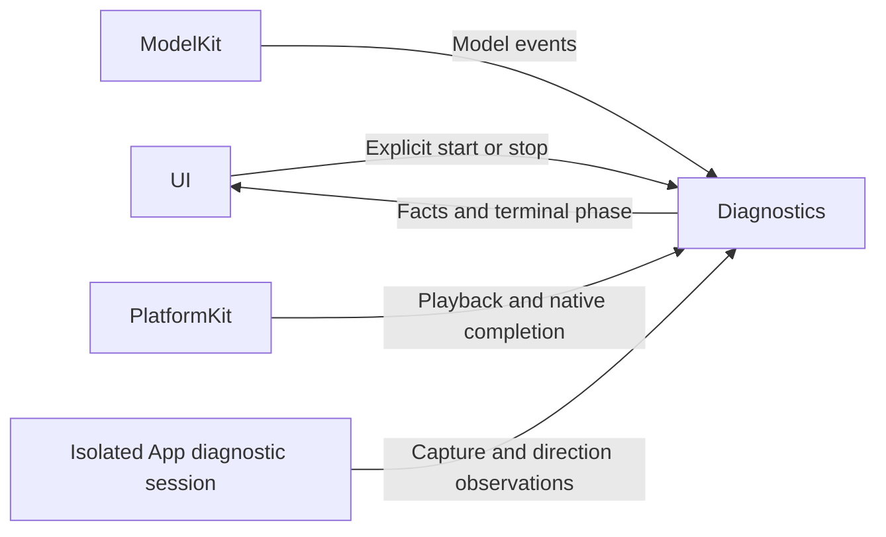

# Explicit Diagnostic Operations

## Summary

Owns user-started chat, speech and sound-source diagnostic attempts with injected capabilities and explicit completion.

## Ownership and boundaries

AppDiagnosticWorkflow depends on UI, ModelKit and PlatformKit. Composition injects complete AudioDetectionRunning endpoints; this directory does not construct Agents/Gateways or implement direction DSP. Diagnostic controls are gated by native availability and configured providers.

## External relationships and data flow

Runtime arrows show data or capability calls; dashed arrows show injection.

## Sound-source operation

AudioDetectionWorkflow owns one endpoint task, one 100 ms freshness/deadline monitor and no pending queue. The ten-second duration starts on first PCM. Generation fencing rejects callbacks from stopped/replaced sessions. Stop clears valid angles immediately, cancels and awaits endpoint cleanup before restart or voice takeover. Failure keeps permission/capture facts visible and permits explicit retry.

## Chat and speech attempts

ChatDiagnosticWorkflow validates an explicitly selected provider with a bounded request. SpeechDiagnosticWorkflow retains its operation, injected synthesis and real playback; shutdown awaits AppleAudioIO before unloading/replacing resources. Reports are diagnostic evidence, not production conversation success. Terminal phases follow cleanup and slot release; cancellation never fabricates successful model/device output.

✅ Explicit diagnostic ownership, bounded capture monitoring and joined native cleanup are implemented.

## Related design

[Parent design](../README.md)

## SQLite records and runtime identity

✅ Implemented: technical identities are opaque UUID strings; committed business entities use dialog/message/task/media/device SQLite IDs. Consumers use Storage repositories while preserving ownership, cancellation and independent foundation boundaries. Complete messages, including each ReACT message, persist at termination; delta fragments do not persist. The custom allocator and replaced file/index implementation are removed. See the project SQLite business-record plan.
