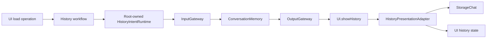

# AppHistoryWorkflow

Purpose: connect history intents and presentation while retaining staged legacy mutations. Design goals: page-independent Agent lifetime, explicit injected effects, bounded admission and joined cancellation.

✅ `ConversationHistoryWorkflow.load` obtains the shared journal through existing preparation, then invokes an injected refresh operation. `HistoryIntentRuntime` owns one active operation with no backlog; overlap fails explicitly. It lazily registers/starts ConversationMemory, sends its typed input through InputGateway and executes the correlated envelope through OutputGateway. No voice session or model inference is required.

✅ The admitted Agent synchronously buffers its output. A joined cancellation-independent reader consumes that envelope even if the caller cancels, preserving the shared stream for retry; cancelled requests cannot apply presentation. Execution retains the operation slot until Tool cleanup joins. `HistoryPresentationAdapter` validates root session/source, reads the raw snapshot and updates MainActor state. Completion means accepted state, not rendering or navigation.

✅ Independent target dependencies: UI, StorageChat, AgentCore, Agents, Gateway, Tools and ToolRuntime. App composes the root session, Agent and adapter; UI imports none of these services. The AppWorkflows facade retains no state. Archive/reset commits before title inference; cancellation retains archived data and retry state.

❌ Archive/delete/title and preview remain existing feature operations. This dependency exception is transitional: moving mutation policy into ConversationMemory and exposing navigation/model intent remains pending. No durable execution, background retry or new journal instance is added.
