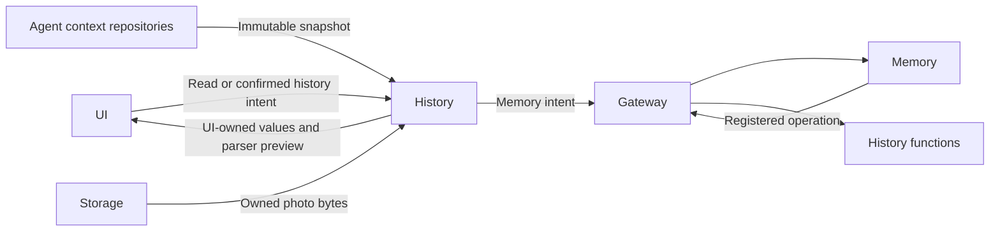

# Conversation and Task History Adaptation

## Summary

Reads each conversational Agent repository, adapts immutable UI values and transports Assistant-history operations directly to Memory.

## Ownership and boundaries

Assistant, Photographer, Memory and ApplicationControl own distinct contexts. History never copies a writable archive or starts a model for reads. Specialist histories are read-only task projections; Assistant archive/delete/title uses Memory with trusted confirmation.

## External relationships and data flow

Runtime arrows show data or capability calls; dashed arrows show injection.

## Interfaces and projection

ConversationHistoryWorkflow owns one load/operation task per destination. HistoryPresentationAdapter copies the bounded Codable snapshot into UI-owned HistorySnapshot values and projects task membership from task state plus durable Signal evidence. The original request supplies the title; ReACT and later task inputs stay together across archives. Missing associations remain separate; missing dates remain empty. Terminal/recovered status takes precedence over stale waiting-user reports.

HistoryIntentRuntime admits one Memory operation, consumes bound outputs and awaits correlated business completion with a 120-second watchdog. Cancellation joins dispatch and retirement; loading/mutation does not create an Assistant delegation task. Producer execution and later delivery failures remain distinct.

## Images and parser previews

Image references contain ID/MIME/byte count, not bytes. Reads validate selected Agent/archive/turn association and the exact producing input/owner before accessing CapturedPhotoStore. At most four image reads run; oversized or unassociated references fail. Missing photos do not become synthetic images.

HistoryAgentAdapter uses the selected producing role's effective functions, communication catalog and shared segmentation. Parsing preview reports valid/rejected calls and wait boundaries without executing them. Model request rows preserve input, output, timing, usage and metadata-only context; observation continuations are presented as ReACT.

✅ Independent role histories, read-only specialist task projection, scoped image loading and Memory mutation transport are implemented.

## Related design

[Parent design](../README.md)
