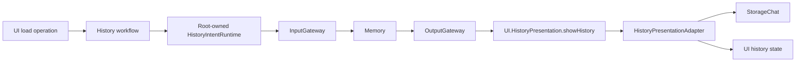

# AppHistoryWorkflow

Purpose: connect history intents and presentation through Agent-selected effects. Design goals: page-independent Agent lifetime, explicit injected effects, bounded admission and joined cancellation.

✅ `ConversationHistoryWorkflow.load` prepares the shared root runtime, then invokes an injected refresh operation. `HistoryIntentRuntime` owns one active operation with no backlog; overlap fails explicitly. It lazily registers/starts Memory, sends its typed input through InputGateway and executes the correlated envelope through OutputGateway. No voice session or model inference is required.

✅ The admitted Agent synchronously buffers its output. A joined cancellation-independent reader consumes that envelope even if the caller cancels, preserving the shared stream for retry; cancelled requests cannot apply presentation. Execution retains the operation slot until Tool cleanup joins. `HistoryPresentationAdapter` validates root session/source, reads the raw snapshot and updates MainActor state. Completion means accepted state, not rendering or navigation.

✅ Independent target dependencies: UI, StorageChat, AgentCore, Agents, Gateway, Actions, FunctionContracts, ExecutionRuntime and CallRuntime. App composes the root session, Agent and adapter; UI imports none of these services. The AppWorkflows facade retains no state. Registered archive/reset commits before title inference; cancellation retains archived data and retry state.

✅ Archive/title effects are selected by Memory; the facade holds no journal or inference callbacks. Preview remains a read-only feature adapter. ❌ Navigation/model mutation intent and registered failure wording remain pending. No durable execution, background retry or new journal instance is added.

✅ Confirmed deletion now invokes the required typed deleteArchive operation; the feature facade performs no journal deletion or snapshot refresh itself. Root transport executes at most two Agent-selected business calls for deletion, accepting the follow-up only after successful correlated Tool feedback. On failure/cancellation it sends a fresh cancel intent through InputGateway, joins cleanup and drains at most8 envelopes until the non-business acknowledgment crosses OutputGateway. Cancelled UI calls are explicitly retired; no device calls use this transport. Committed data is never rolled back.

❌ This is deterministic continuation only; no model replanning, deletion retry or navigation is added. The facade retains StorageChat only for preview/UI record values.

✅ ADR0157: canonical executable definitions and shared outcomes replace duplicate protocol metadata; consumers import Actions/FunctionContracts. Protocol request views remain adapters, and production permission/resource boundaries are preserved.

❌ Physical acceptance and additional business capability exposure are not established by this migration.

✅ ADR0159 — Unified invocation: all business functions, injected capabilities and registered handlers receive FunctionInput with ActionExecutionContext. Native request/result normalization stays in Runtime/Gateway; no protocol-specific implementation signature remains.

✅ ADR0160: callable functions and shared producer failures are independent of call protocols. This directory consumes the appropriate pure function/shared invocation or registration adapter at its existing boundary; host profiles own protocol selection. ❌ Broader feature Signal migration and physical acceptance remain separate.

✅ ADR0161: standard callable inputs use FunctionInput/FunctionContracts; common execution and call protocols belong to independent Gateway targets. This directory retains its existing ownership, resource/permission and lifecycle boundaries. ❌ Remaining feature Signal/continuation and physical acceptance are separate work.

✅ HistoryIntentRuntime now supplies typed history.intent/1 payloads for refresh/delete and joined cancellation cleanup. Request IDs, one-active-request admission, output drain bounds and success-only follow-up remain unchanged.

✅ Implemented: replace facade loadStore/summarizeTitle with prepare/startNew/summarize operations; retain one busy task and no fallback store. HistoryIntentRuntime adds bounded terminal-control sequences for new intents (six outputs), while legacy refresh/delete stay one/two calls. Handler failures with successfully delivered feedback proceed to Agent-selected failure presentation; dispatch/delivery failures abort and joined cancellation drains at most8 outputs.

## Independent history presentation values

✅ Implemented: UI has no project dependencies, including StorageChat. History rendering receives UI-owned immutable HistorySnapshot/HistoryConversation/HistoryTurn values with matching data fields, not Storage types or stores. App HistoryPresentationAdapter copies the bounded stored snapshot through an explicit Codable boundary and propagates adaptation failure; Agent history mutations/queries are unchanged. Preview receives only fragments/finish reason from the view value. Per-request model evidence is presented as peer history rows; legacy continuation records remain readable and missing values stay empty. UI target has zero project dependencies.

✅ ADR0180: Memory / memory identity and MemoryHistoryIntent are used consistently in configuration, host transport, presentation source guards and regression fixtures; preserve history.intent/1 and runtime behavior. Enforce the two reorganized roles’ directory/actor/configuration naming and isolated business components.

## Per-request conversation history

✅ Implemented: The existing bounded Codable adapter carries optional modelRequests into UI-owned snapshots and preserves per-request timing, native context, output and identities. No model, mutation or Agent ownership moved to presentation. Compatibility with legacy optional fields is retained.

❌ Native UI, live-provider and physical-device acceptance remain separate from automated validation.

## History image thumbnails

✅ Implemented: ConversationHistoryWorkflow gains a required injected photo reader and imageData(photoID,turnID) control. It resolves the turn from the current UI archive, validates its referenced image and producing input, rejects forged references and more than four concurrent reads, checks cancellation before/after I/O and releases admission on every exit. A missing persisted image is nil; read/validation errors propagate. No photo cache or background task is added.

❌ Native image/layout and live-model acceptance remain separate from automated verification.
