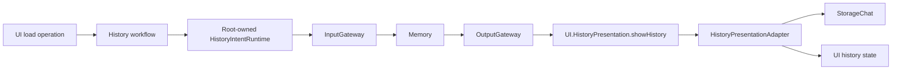

# AppHistoryWorkflow

Purpose: connect history intents and presentation through Agent-selected effects. Design goals: page-independent Agent lifetime, explicit injected effects, bounded admission and joined cancellation.

✅ `ConversationHistoryWorkflow.load` prepares the shared root runtime, then invokes an injected refresh operation. `HistoryIntentRuntime` owns one active operation with no backlog; overlap fails explicitly. It lazily registers/starts Memory; production typed input publishes directly to Memory through InputGateway and executes the correlated envelope through OutputGateway. No voice session or model inference is required.

✅ A permanent owned output pump uses existing AppPresentationWorkflow to demultiplex model/task output from the bounded fixed-operation reader. A joined cancellation-independent reader consumes each fixed envelope even if the caller cancels, preserving the shared stream for retry; cancelled requests cannot apply presentation. Execution retains the operation slot until Tool cleanup joins. `HistoryPresentationAdapter` validates root session/source, reads the raw snapshot and updates MainActor state. Completion means accepted state, not rendering or navigation.

✅ Independent target dependencies: UI, StorageChat, AgentCore, Agents, Gateway, Actions, FunctionContracts, ExecutionRuntime and CallRuntime. App composes the root session, Agent and adapter; UI imports none of these services. The AppWorkflows facade retains no state. Registered archive/reset commits before title inference; cancellation retains archived data and retry state.

✅ Archive/title effects are selected by Memory; the facade holds no journal or inference callbacks. Preview remains a read-only feature adapter. ❌ Navigation/model mutation intent and registered failure wording remain pending. No durable execution, background retry or new journal instance is added.

✅ Confirmed deletion now invokes the required typed deleteArchive operation; the feature facade performs no journal deletion or snapshot refresh itself. Root transport executes at most two Agent-selected business calls for deletion, accepting the follow-up only after successful correlated Tool feedback. On failure/cancellation it sends a fresh cancel intent through InputGateway, joins cleanup and drains at most8 envelopes until the non-business acknowledgment crosses OutputGateway. Cancelled UI calls are explicitly retired; no device calls use this transport. Committed data is never rolled back.

❌ This is deterministic continuation only; no model replanning, deletion retry or navigation is added. The facade retains StorageChat only for preview/UI record values.

✅ ADR0157: canonical executable definitions and shared outcomes replace duplicate protocol metadata; consumers import Actions/FunctionContracts. Protocol request views remain adapters, and production permission/resource boundaries are preserved.

❌ Physical acceptance and additional business capability exposure are not established by this migration.

✅ ADR0159 — Unified invocation: all business functions, injected capabilities and registered handlers receive FunctionInput with ActionExecutionContext. Native request/result normalization stays in Runtime/Gateway; no protocol-specific implementation signature remains.

✅ ADR0160: callable functions and shared producer failures are independent of call protocols. This directory consumes the appropriate pure function/shared invocation or registration adapter at its existing boundary; host profiles own protocol selection. ❌ Broader feature Signal migration and physical acceptance remain separate.

✅ ADR0161: standard callable inputs use FunctionInput/FunctionContracts; common execution and call protocols belong to independent Gateway targets. This directory retains its existing ownership, resource/permission and lifecycle boundaries. ❌ Remaining feature Signal/continuation and physical acceptance are separate work.

✅ HistoryIntentRuntime now supplies typed history.intent/1 payloads for refresh/delete and joined cancellation cleanup. Request IDs, one-active-request admission, output drain bounds and success-only follow-up remain unchanged.

✅ Implemented: replace facade loadStore/summarizeTitle with prepare/startNew/summarize operations; retain one busy task and no fallback store. HistoryIntentRuntime adds bounded terminal-control sequences for new intents (six outputs), while legacy refresh/delete stay one/two calls. Handler failures with successfully delivered feedback proceed to Agent-selected failure presentation; dispatch/delivery failures abort and joined cancellation drains at most8 outputs.

## Independent history presentation values

✅ Implemented: UI has no project dependencies, including StorageChat. History rendering receives UI-owned immutable HistorySnapshot/HistoryConversation/HistoryTurn values with matching data fields, not Storage types or stores. App HistoryPresentationAdapter copies the bounded stored snapshot through an explicit Codable boundary and propagates adaptation failure; Agent history mutations/queries are unchanged. Preview receives only fragments/finish reason from the view value. Per-request model evidence is presented as peer history rows; legacy continuation records remain readable and missing values stay empty. UI target has zero project dependencies.

✅ ADR0180: Memory / memory identity and MemoryHistoryIntent are used consistently in configuration, host transport, presentation source guards and regression fixtures; preserve history.intent/1 and runtime behavior. Enforce the two reorganized roles’ directory/actor/configuration naming and isolated business components.

## Per-request conversation history

✅ Implemented: The existing bounded Codable adapter carries optional modelRequests into UI-owned snapshots and preserves per-request timing, native context, output and identities. No model, mutation or Agent ownership moved to presentation. Compatibility with legacy optional fields is retained.

❌ Native UI, live-provider and physical-device acceptance remain separate from automated validation.

## History image thumbnails

✅ Implemented: ConversationHistoryWorkflow gains a required injected photo reader and imageData(photoID,turnID) control. It resolves the turn from the current UI archive, validates its referenced image and producing input, rejects forged references and more than four concurrent reads, checks cancellation before/after I/O and releases admission on every exit. A missing persisted image is nil; read/validation errors propagate. No photo cache or background task is added.

❌ Native image/layout and live-model acceptance remain separate from automated verification.

✅ ADR0187: bind every output consumer to the registered Agent actor and its incarnation before reading output. Stopped or replaced producers cannot execute using a new registration.

## Phase two implementation contract - ADR0188

✅ Implemented. Assistant is the persistent default user-entry Agent and delegates photography, history and application operations through authorized communication Actions and existing task Signals. Typed UI inputs use deterministic routing; model requests use the same output and function execution path. Execution results return to the real task executor.

Support owns the reusable one-round Chat worker, native/XML communication adaptation and reply mapping, with injected identity, context and policies. Each business Agent owns independent durable history, preprocessing, capabilities and task completion. No new directory, target, dependency, Core role policy or delegation runtime is introduced.

App owns registration, transport, stable interaction lifetime and native presentation authorization. Microphone capture is a separate lifetime. Delivery acceptance, child completion and native effects remain distinct. Pending questions and artifact references are bounded and task-scoped; deletion retains existing trusted UI confirmation. Storage failures terminate dependent processing, cancellation joins owned workers, and restart interrupts without replay.

See `docs/adr/0188-specialist-task-ownership.md` for migration, capacity and validation contracts.

Interaction startup failure removes the partially registered Memory owner and preserves the actual error. Normal owned-pump cancellation does not become a history execution failure.

## Agent conversation history selection

✅ Implemented: the history entry lists the four conversation-storage owners (Assistant, Photographer, Memory and ApplicationControl). Each destination has a separately owned state/workflow and reads the same live context repository used by that Agent; no history copies or model startup are required. Existing request, reply, tool, usage and image presentation is reused. Assistant retains Agent-routed archive/delete/title controls; specialist histories use read-only task lists with original request titles, terminal/waiting status and task-scoped model detail/export. App projects task/input membership from the same immutable Agent context snapshot; ReACT and later task inputs remain together across old archives. Missing associations remain separate and missing dates remain empty. No specialist summary/archive mutation is exposed. Streaming perception/synthesis context contains no conversation archive and is excluded. Reads propagate errors, admit one operation per destination and retain the four-image read bound. Photo reads and parser previews use the selected producer identity. Native UI acceptance remains pending.

## One-way publication and listening admission correction

✅ Implemented: History UI publishes intent, then waits for Memory business outputs, rather than recipient acknowledgment. The existing operation owns/cancels/joins a120-second result watchdog; correlated agent errors finish waiting without replay.

✅ Implemented: one-way external intent loss is bounded by a 120-second business-result watchdog, owned and joined by the existing operation. Camera cancellation acknowledgment waits at most two seconds and reports unconfirmed cleanup; it never fabricates device stop or replays work. Listening Action completion means policy accepted; microphone model preparation remains the owned startup task and is cancellable by user-off.

✅ Frontend/backend separation: HistoryIntentRuntime publishes directly to Memory. It retains one bounded operation, correlated execution and joined cancellation; loading or mutating history creates no Assistant task.

## Task-scoped specialist history

✅ Implemented: Assistant keeps current/archived conversation navigation. Specialist destinations show task lists and task-scoped detail/export instead of current/past conversation summaries. App HistoryPresentationAdapter projects one immutable repository snapshot using task identity, durable Signal evidence and task state; UI owns display-only task values. ReACT and later task inputs belong to the same task. Original task requests provide titles, not the latest reply. Records lacking retained task association remain separately labeled unassociated inputs, without inventing task identity. Task reads reuse the existing single load slot and photo authorization; no second writable history, LLM summary, directory or dependency is added. Regressions cover isolation, continuation grouping across old archives, task status, legacy/unassociated records and empty tasks. Missing task dates stay empty; terminal/recovered status takes precedence over stale waiting-user reports. ❌ Native UI/device acceptance remains separate from automated checks.
