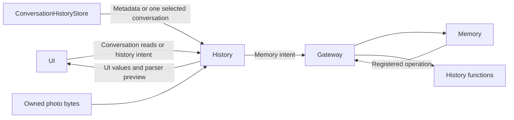

# Canonical Conversation Record Adaptation

## Summary

Reads Assistant conversation files, adapts immutable UI values and transports authorized Assistant-history operations to Memory.

## Ownership and boundaries

✅ Canonical record boundary: Settings has one Assistant conversation destination inside the Agent records hub. History does not aggregate a second task-history collection. Foreground Task sources and terminal compressions belong to canonical conversations; background task execution state belongs to Agents and the separate execution diagnostics. No runtime task state is deleted.

## External relationships and data flow

## Interfaces and projection

✅ Implemented: HistoryPresentationAdapter retains presentationSnapshot/listPresentation/conversation/showHistory only. There is no second task-history projection. ConversationHistoryWorkflow is one root-owned Assistant load/mutation slot; no agents array or fake read-only task workflow. Lists read index metadata, selected details load one file, and archive titles never reload all bodies. Current and one selected conversation remain separate UI caches. Save failures remain lastCheckpointError.

HistoryIntentRuntime admits one Memory operation, consumes bound outputs and awaits correlated business completion with a 120-second watchdog. Cancellation joins dispatch and retirement. Archive/delete/title remain canonical store transactions; starting a new conversation cancels a waiting Task through its existing control route first. Busy generation rejects archiving explicitly.

## Images and parser previews

Image reads validate the selected conversation/request and exact producing input before CapturedPhotoStore access. At most four reads run, each at most4 MiB; missing photos remain absent and failures explicit. HistoryAgentAdapter previews the exact recorded catalog/output without execution. Conversation Task summaries expand original requests by exact historyTaskID and indexed source references, including after live TaskRecord retirement.

✅ Regressions: canonical selected-conversation coverage across archive/reopen/Task retirement and multiple Tasks in one input replaces duplicate task-projection tests. Native Agent hub/navigation and real-model/physical acceptance remain separate.

[Parent design](../README.md)

✅ Required conversation reader: selected-conversation reads are required at construction and reject a mismatched returned identity before replacing the selected cache. Tests inject explicit readers/failures; no optional/default read path remains.
