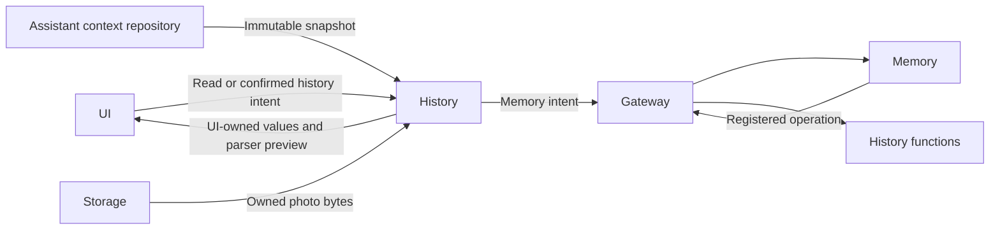

# Conversation and Task History Adaptation

## Summary

Reads the Assistant repository, adapts immutable UI values and transports Assistant-history operations directly to Memory.

## Ownership and boundaries

Assistant, Photographer, Memory and ApplicationControl own distinct contexts. History never copies a writable archive or starts a model for reads. Task history projects Assistant-owned foreground and background records; Assistant archive/delete/title uses Memory with trusted confirmation.

## External relationships and data flow

Runtime arrows show data or capability calls; dashed arrows show injection.

## Interfaces and projection

ConversationHistoryWorkflow owns one load/operation task per destination. HistoryPresentationAdapter copies metadata-only list snapshots and selected conversation values into UI-owned values and projects foreground input membership from AgentTaskSkillState.tasks and background state from the Assistant task registry/taskViews. Goals supply titles; ReACT and later inputs stay together across archives. Missing dates remain empty.

HistoryIntentRuntime admits one Memory operation, consumes bound outputs and awaits correlated business completion with a 120-second watchdog. Cancellation joins dispatch and retirement; loading/mutation does not create an Assistant delegation task. Producer execution and later delivery failures remain distinct.

## Images and parser previews

Image references contain ID/MIME/byte count, not bytes. Reads validate selected Agent/archive/turn association and the exact producing input/owner before accessing CapturedPhotoStore. At most four image reads run; oversized or unassociated references fail. Missing photos do not become synthetic images.

HistoryAgentAdapter uses the exact persisted Assistant request catalog and shared segmentation. Parsing preview reports valid/rejected calls and wait boundaries without executing them. Model request rows preserve input, output, timing, usage and metadata-only context; observation continuations are presented as ReACT.

✅ Assistant conversation/task projections, scoped image loading and Memory mutation transport are implemented.

## Related design

[Parent design](../README.md)

## Skill/task-mode contract

✅ HistoryPresentationAdapter provides complete Assistant conversations, an additional foreground/background task grouping. Task membership is persisted, not inferred from current mode. Task grouping is presentation-only; mutation/export still use canonical Context transactions and active-task protection.

## Task/history regression correction

✅ 本次修复：Assistant 对话页展示完整持久化输入/回复（含 Task），任务页仍提供分组投影。开始新对话先通过现有 Task 控制取消等待任务，再交 Memory 归档；生成期间拒绝归档，不撤销设备效果。

✅ 忙碌归档在页面显示“正在回复或处理输入，请结束后再开始新对话”，不向用户暴露 scopeClosed。

## 历史记录收敛（2026-10-13）

✅ 已实现：HistoryPresentationAdapter.assistantTasks 使用 Assistant 的 TaskRecord.inputIDs 关联前台请求，使用 registry/taskViews 展示后台任务。删除 specialist 旧聊天投影和未关联输入伪任务；保留 Memory 事务、取消和照片读取权限。

❌ 历史记录页面板块重新设计及原生 UI/真机验收。

## Task history indexing and in-place compression

✅ Implemented: HistoryPresentationAdapter projects request historyTaskID and indexed Task compressions. Task rows filter exact request membership and retain ended Tasks from archived compression records even after live TaskRecord retirement. ConversationHistoryWorkflow validates image reads against original raw requests, including collapsed Task details.

## 会话存储性能重构 v3

✅ 已实现：历史列表适配元数据占位会话，详情通过 loadConversation(id) 获取单文件；任务页显式按需读取归档任务证据。选择详情后照片验证仍使用真实原始请求。JSON桥接只处理所选/当前会话，不在列表加载所有正文。

✅ 归档任务改为按会话进入后加载；当前任务列表不遍历归档正文。历史UI只缓存当前会话及一个已选归档，页面值自持所选不可变快照。

✅ 列表与所选正文分离缓存；标题完成刷新元数据时不清除所选详情。保存失败由 lastCheckpointError 显示，不把内存终态伪装成已保存。
