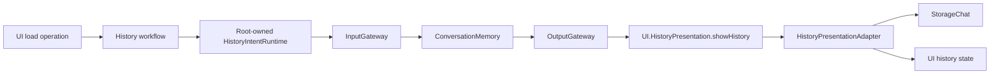

# AppHistoryWorkflow

Purpose: connect history intents and presentation while retaining staged legacy mutations. Design goals: page-independent Agent lifetime, explicit injected effects, bounded admission and joined cancellation.

✅ `ConversationHistoryWorkflow.load` obtains the shared journal through existing preparation, then invokes an injected refresh operation. `HistoryIntentRuntime` owns one active operation with no backlog; overlap fails explicitly. It lazily registers/starts ConversationMemory, sends its typed input through InputGateway and executes the correlated envelope through OutputGateway. No voice session or model inference is required.

✅ The admitted Agent synchronously buffers its output. A joined cancellation-independent reader consumes that envelope even if the caller cancels, preserving the shared stream for retry; cancelled requests cannot apply presentation. Execution retains the operation slot until Tool cleanup joins. `HistoryPresentationAdapter` validates root session/source, reads the raw snapshot and updates MainActor state. Completion means accepted state, not rendering or navigation.

✅ Independent target dependencies: UI, StorageChat, AgentCore, Agents, Gateway, Actions, FunctionContracts, ExecutionRuntime and CallRuntime. App composes the root session, Agent and adapter; UI imports none of these services. The AppWorkflows facade retains no state. Archive/reset commits before title inference; cancellation retains archived data and retry state.

❌ Archive/title and preview remain existing feature operations. This dependency exception is transitional: moving remaining mutation policy into ConversationMemory and exposing navigation/model intent remains pending. No durable execution, background retry or new journal instance is added.

✅ Confirmed deletion now invokes the required typed deleteArchive operation; the feature facade performs no journal deletion or snapshot refresh itself. Root transport executes at most two Agent-selected business calls, accepting the follow-up only after successful correlated Tool feedback. On failure/cancellation it sends a fresh cancel intent through InputGateway, joins cleanup and drains at most8 envelopes until the non-business acknowledgment crosses OutputGateway. Cancelled UI calls are explicitly retired; no device calls use this transport. Committed data is never rolled back.

❌ This is deterministic continuation only; no model replanning, deletion retry or navigation is added. Remaining title/archive operations retain the legacy journal dependency.

✅ ADR0157: canonical executable definitions and shared outcomes replace duplicate protocol metadata; consumers import Actions/FunctionContracts. Protocol request views remain adapters, and production permission/resource boundaries are preserved.

❌ Physical acceptance and additional business capability exposure are not established by this migration.

✅ ADR0159 — Unified invocation: all business functions, injected capabilities and registered handlers receive FunctionInput with ActionExecutionContext. Native request/result normalization stays in Runtime/Gateway; no protocol-specific implementation signature remains.

✅ ADR0160: callable functions and shared producer failures are independent of call protocols. This directory consumes the appropriate pure function/shared invocation or registration adapter at its existing boundary; host profiles own protocol selection. ❌ Broader feature Signal migration and physical acceptance remain separate.

✅ ADR0161: standard callable inputs use FunctionInput/FunctionContracts; common execution and call protocols belong to independent Gateway targets. This directory retains its existing ownership, resource/permission and lifecycle boundaries. ❌ Remaining feature Signal/continuation and physical acceptance are separate work.
