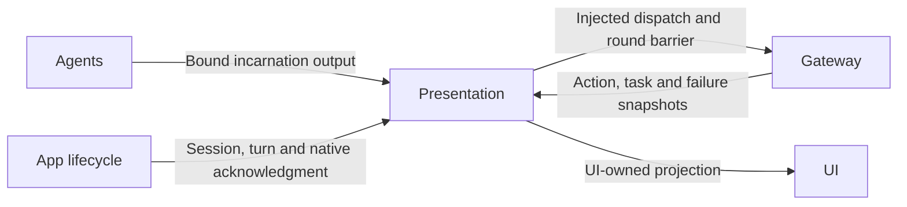

# Output Consumption and Runtime Presentation

## Summary

Provides bounded output transport, caption acceptance and Action/Task/Agent observation projections without owning business decisions.

## Ownership and boundaries

The target depends on UI, AgentCore and FunctionContracts. Lifecycle owners inject dispatch and retain cancellation/join ownership. Domain decoding is injected by composition; native Bluetooth diagnostics are separate.

## External relationships and data flow

Runtime arrows show data or capability calls; dashed arrows show injection.

## Independent protocol consumers

IndependentOutputWorkflow.consumeGeneration creates per-round Tool and Action/control consumers. Tools retain 16 envelopes with four concurrent executions; Actions retain 256 envelopes and ordered admission. Overflow rejects without eviction/replay. One pending stream read and four Tool executions share a task group so a failed execution wakes the owner even when no next envelope arrives. Native total stays at 16 per input across rounds.

roundFinished seals/drains both consumers before the merge barrier; final completion does the same. assistant.error cancels/joins only that input and preserves admission of future inputs. Unexpected closure, caller cancellation or dispatch failure cancels/joins accepted work and the reader. Resource waiting remains the execution runtime's responsibility.

## Caption and playback acceptance

ConversationPresentation checks source/session/turn/sequence before UI commitment. New recognized turns reset captions; same-turn previews preserve them and finalization promotes text. Recognition turn and task/reply identity are independent. Presentation focus never cancels authorized speech; playback additionally checks active session and explicit task cancellation.

## Runtime observations

ActionActivityWorkflow maps scheduler snapshots, task-only Gateway snapshots, independent failures and sampled Agent lifecycle to Action / Task / Agent tabs. No ordinary Signal subscription invalidates home state. Each task retains 32 events; at most 100 tasks and 100 lifecycle/late-error entries retain counted oldest eviction. Lifecycle is sampled once per second and logs changes only. Observations never alter processing or acknowledge publication.

Delivery receipt means admission; task completion requires explicit accepted result. runtime.replyFinished does not replace waitingUser or cancellation progress. Unknown producer codes retain generic captured failure text; a shared description is not assigned to unrelated child outcomes.

## Vision replacement

CameraVisionRestartWorkflow owns one worker, one retiring/current pipeline and one latest pending intent. replace cancels old admission and returns; the worker joins cleanup before starting the newest pipeline. stop invalidates and joins it. Native lens acknowledgment is independent of this replacement barrier.

✅ Independent consumers, fenced presentation and bounded passive observations are implemented.

❌ Durable execution-log storage is not implemented.

## Related design

[Parent design](../README.md)
