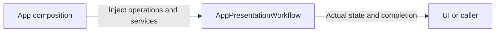
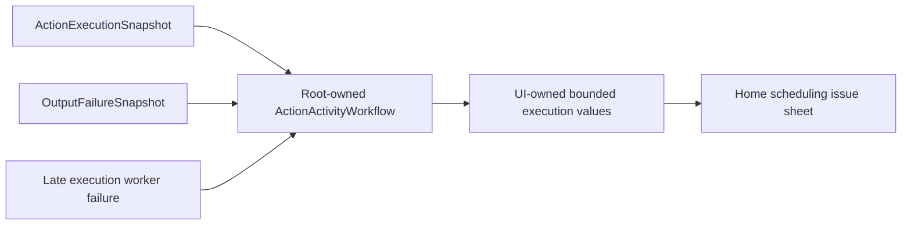

# AppPresentationWorkflow

Purpose: own presentation application operations in an independent compilation boundary. Design goals: explicit injected effects and unchanged business lifetimes. Direct dependencies: UI, AgentCore, FunctionContracts.

✅ ConversationPresentation preserves turn/sequence acceptance. ActionActivityWorkflow preserves one root-owned bounded snapshot subscription and display mapping. Page lifetime does not own runtime work; parent README retains observation algorithms.

❌ No device effects, synthetic progress or durable execution history.

✅ IndependentOutputWorkflow consumes an optional subscriber sequentially through an injected Gateway dispatch. Ordinary failures are reported per envelope and consumption continues; cancellation propagates. It adds no queue or device ownership.

✅ For a single handlerFailed report entry, ActionActivityPresentation displays the already-bounded captured failureDescription. Multi-child results keep their individual mapped codes; one shared description is not assigned to unrelated leaves.

✅ ConversationPresentation keeps its Assistant/SpeechPerception source-selection policy locally using raw names. AgentCore provides generic identity/turn values only.

✅ ActionActivityPresentation interprets opaque report codes through FunctionContracts and producer-owned detail keys locally. Unknown codes retain general failure presentation and captured handler description; Core/Gateway contain no motor-field presentation. ❌ No schema inference for unknown providers.

✅ ADR0122: presentation maps producer-owned report raw identifiers to existing UI text and handles unknown codes with the generic failure description. No concrete Actions dependency is added. ❌ Execution Runtime does not own these localized mappings.

✅ ADR0131: ActionActivityWorkflow independently consumes scheduled execution and Output failure snapshots for the home scheduling issue list. It maps only generic values and retains100 bounded late worker errors with eviction counts. Tool failures do not fabricate Action rows or alter completed Tool results. ❌ Native visual acceptance remains pending.

Native Bluetooth diagnostics have a different subscriber/cache in AppBluetoothWorkflow and cannot enter this projection. Page dismissal does not stop either root subscription.

✅ ADR0132: Home issue presentation preserves generic failure codes and optional App worker/source call provenance. Motor admission/read errors have stage-specific labels; device diagnostics remain absent.

❌ Sustained physical-device acceptance and durable error history remain pending.

✅ ADR0157: canonical executable definitions and shared outcomes replace duplicate protocol metadata; consumers import Actions/FunctionContracts. Protocol request views remain adapters, and production permission/resource boundaries are preserved.

❌ Physical acceptance and additional business capability exposure are not established by this migration.

✅ ADR0159 — Unified invocation: all business functions, injected capabilities and registered handlers receive FunctionInput with ActionExecutionContext. Native request/result normalization stays in Runtime/Gateway; no protocol-specific implementation signature remains.

✅ ADR0160: callable functions and shared producer failures are independent of call protocols. This directory consumes the appropriate pure function/shared invocation or registration adapter at its existing boundary; host profiles own protocol selection. ❌ Broader feature Signal migration and physical acceptance remain separate.

✅ ADR0161: standard callable inputs use FunctionInput/FunctionContracts; common execution and call protocols belong to independent Gateway targets. This directory retains its existing ownership, resource/permission and lifecycle boundaries. ❌ Remaining feature Signal/continuation and physical acceptance are separate work.
