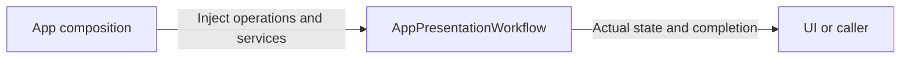

# AppPresentationWorkflow

Purpose: own presentation application operations in an independent compilation boundary. Design goals: explicit injected effects and unchanged business lifetimes. Direct dependencies: UI, AgentCore, ActionRuntime and ToolRuntime.

✅ ConversationPresentation preserves turn/sequence acceptance. ActionActivityWorkflow preserves one root-owned bounded snapshot subscription and display mapping. Page lifetime does not own runtime work; parent README retains observation algorithms.

❌ No device effects, synthetic progress or durable execution history.

✅ IndependentOutputWorkflow consumes an optional subscriber sequentially through an injected Gateway dispatch. Ordinary failures are reported per envelope and consumption continues; cancellation propagates. It adds no queue or device ownership.

✅ For a single handlerFailed report entry, ActionActivityPresentation displays the already-bounded captured failureDescription. Multi-child results keep their individual mapped codes; one shared description is not assigned to unrelated leaves.
