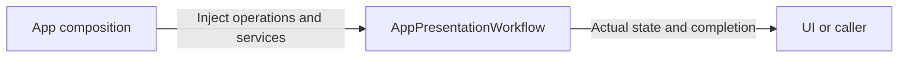
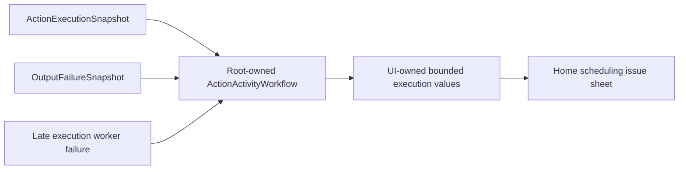

# AppPresentationWorkflow

Purpose: own presentation application operations in an independent compilation boundary. Design goals: explicit injected effects and unchanged business lifetimes. Direct dependencies: UI, AgentCore, FunctionContracts.

✅ ConversationPresentation preserves turn/sequence acceptance. ActionActivityWorkflow preserves one root-owned bounded snapshot subscription and display mapping. Page lifetime does not own runtime work; parent README retains observation algorithms.

❌ No device effects, synthetic progress or durable execution history.

✅ IndependentOutputWorkflow.consume handles deterministic optional subscribers sequentially through injected Gateway dispatch. Ordinary failures are reported per envelope and consumption continues; cancellation propagates. Generation uses the separate bounded protocol consumers described below. Neither entry owns device behavior.

✅ For a single handlerFailed report entry, ActionActivityPresentation displays the already-bounded captured failureDescription. Multi-child results keep their individual mapped codes; one shared description is not assigned to unrelated leaves.

✅ ConversationPresentation keeps its Assistant/SpeechPerception source-selection policy locally using raw names. AgentCore provides generic identity/turn values only.

✅ ActionActivityPresentation interprets opaque report codes through FunctionContracts and producer-owned detail keys locally. Unknown codes retain general failure presentation and captured handler description; Core/Gateway contain no motor-field presentation. ❌ No schema inference for unknown providers.

✅ ADR0122: presentation maps producer-owned report raw identifiers to existing UI text and handles unknown codes with the generic failure description. No concrete Actions dependency is added. ❌ Execution Runtime does not own these localized mappings.

✅ ADR0131: ActionActivityWorkflow independently consumes scheduled execution and Output failure snapshots for the home scheduling issue list. It maps only generic values and retains100 bounded late worker errors with eviction counts. Tool failures do not fabricate Action rows or alter completed Tool results. ❌ Native visual acceptance remains pending.

Native Bluetooth diagnostics have a different subscriber/cache in AppBluetoothWorkflow and cannot enter this projection. Page dismissal does not stop either root subscription.

✅ ADR0132: Home issue presentation preserves generic failure codes and optional App worker/source call provenance. Motor admission/read errors have stage-specific labels; device diagnostics remain absent.

❌ Sustained physical-device acceptance and durable error history remain pending.

✅ ADR0157: canonical executable definitions and shared outcomes replace duplicate protocol metadata; consumers import Actions/FunctionContracts. Protocol request views remain adapters, and production permission/resource boundaries are preserved.

❌ Physical acceptance and additional business capability exposure are not established by this migration.

✅ ADR0159 — Unified invocation: all business functions, injected capabilities and registered handlers receive FunctionInput with ActionExecutionContext. Native request/result normalization stays in Runtime/Gateway; no protocol-specific implementation signature remains.

✅ ADR0160: callable functions and shared producer failures are independent of call protocols. This directory consumes the appropriate pure function/shared invocation or registration adapter at its existing boundary; host profiles own protocol selection. ❌ Broader feature Signal migration and physical acceptance remain separate.

✅ ADR0161: standard callable inputs use FunctionInput/FunctionContracts; common execution and call protocols belong to independent Gateway targets. This directory retains its existing ownership, resource/permission and lifecycle boundaries. ❌ Remaining feature Signal/continuation and physical acceptance are separate work.

## Action/Tool generation rounds — ADR0183

✅ BehaviorAssembly projects immutable host feedback policies. IndependentOutputWorkflow demultiplexes output into independent bounded consumers, admits Actions in order and executes up to four Tools concurrently; VoiceSessionCoordinator owns, cancels and joins all dispatch tasks independently of page lifetime.

❌ Live-model, native UI and physical-device acceptance remain pending; native/XML task delegation and specialist loops are implemented. See [ADR0183](../../../../docs/adr/0183-generation-round-observations.md).

✅ Recovery correction: consumeGeneration owns fresh bounded protocol consumers per round, retains native counts across all rounds of one input, and joins both at each seal. An assistant.error cancels/joins that input only and continues consuming future inputs; roundFinished joins work without ending the input or reopening voice admission.

## Independent protocol consumers — 2026-10-08

✅ Implemented: IndependentOutputWorkflow.consumeGeneration uses separate Tool (16 buffered envelopes, four concurrent executions) and Action/control (256 buffered envelopes, ordered admission) consumers per round. The producer never waits for a Tool slot or Action dispatch. Overflow rejects explicitly, without eviction/replay. Native count remains16 per input across rounds. roundFinished closes/drains both streams before dispatching the merge barrier; final completion does the same. assistant.error cancels/joins both workers before dispatching the error and accepting the next input. Unexpected stream closure and caller cancellation cancel/join accepted work. Dispatch failure wakes the owner and cancels/joins both consumers and the transport reader even while model output is open. A shared resource conflict remains legitimate execution waiting.

✅ Tool consumption observes incoming envelopes and execution completions in the same structured task group. At most one pending read and four executions exist; a failed execution wakes the owner without requiring another envelope. The private stream reader preserves single-consumer iterator isolation.

✅ Failure propagation verified during photo validation: native worker failure must wake the Tool consumer even while the producer remains open. Use one cancellable stream reader plus four dispatch workers, joined in the same task group; await reader/worker completions together rather than blocking the owner on a stream next. Preserve16 queued envelopes and independent Action admission.

## Lens switch latency correction

✅ CameraVisionRestartWorkflow.swift owns one root-owned retiring/current pipeline Task, one worker and one latest pending intent; replace cancels old admission and returns immediately, worker joins cleanup before starting newest intent, stop invalidates and joins both. No native or model dependency; injected start owns actual pipeline effect.

❌ Physical-device switch latency, repeated flips during inference and camera/voice coexistence remain unverified.

## Agent composition — ADR0187

✅ Agent 自有预处理、版本化结构化 Context 和 Builder 已接入；共享机制在现有 Agents/Support/Core 与 Agents 目录中。业务职责保持当前分界。函数结果按运行时捕获的执行所有者定向返回，通信投递回执只表示接纳；模型续轮不订阅自身广播。

✅ 上下文采用有界原子提交，重启将未完成工作标为中断，不重放设备动作。普通输入、反馈和控制分别接纳；所有容量或持久化失败显式返回。音视频和原生会话保持有界临时状态。

✅ 第二阶段已实现独立摄影 LLM、正式任务委派及任务定向后续输入。❌ 真实模型、原生 UI、真机语音验收仍待完成。

运输生命周期独立于页面。函数、通信、模型输出分支有界并在 round/terminal 屏障加入；生产输出在订阅时绑定真实 Agent 实例。ConversationPresentation 分开识别语句与回复身份（source/task/decision/turn）；后来的识别清理上一轮可见字幕，但不取消正在回复的任务或改变其执行身份。播放授权由真实输出源、活跃任务/会话和函数注册共同验证；SpeechPerception 在最终 ASR 发布前及交互回复占用期间暂停新语句识别，覆盖模型等待、ReACT 和受委派任务的回复；完成及350ms播放尾音屏障后恢复。用户关闭停止物理录音，暂停保持采集会话但不接纳识别帧。

设计与阶段边界见 [ADR0187](../../../../docs/adr/0187-agent-composition-and-react.md)；验证见 [Validation-History](../../../../docs/Validation-History.md)。

## Phase two implementation contract - ADR0188

✅ Implemented. Assistant is the persistent default user-entry Agent and delegates photography, history and application operations through authorized communication Actions and existing task Signals. Typed UI inputs use deterministic routing; model requests use the same output and function execution path. Execution results return to the real task executor.

Support owns the reusable one-round Chat worker, native/XML communication adaptation and reply mapping, with injected identity, context and policies. Each business Agent owns independent durable history, preprocessing, capabilities and task completion. No new directory, target, dependency, Core role policy or delegation runtime is introduced.

App owns registration, transport, stable interaction lifetime and native presentation authorization. Microphone capture is a separate lifetime. Delivery acceptance, child completion and native effects remain distinct. Pending questions and artifact references are bounded and task-scoped; deletion retains existing trusted UI confirmation. Storage failures terminate dependent processing, cancellation joins owned workers, and restart interrupts without replay.

See `docs/adr/0188-specialist-task-ownership.md` for migration, capacity and validation contracts.

## One-way publication and listening admission correction

✅ Implemented: Frontend failures receive independent Gateway diagnostics and correlated agent.error. Presentation does not control listening: Assistant policy, owned speech admission and actual playback/tail barriers determine it.

✅ Execution-log tabs: ActionActivityWorkflow owns the task-only snapshot subscription and maps public reports to a bounded timeline. Each task retains32 events and the latest state; up to100 tasks are retained with counted oldest eviction. Successful delivery means admission; completion requires an accepted explicit result. Action failures stay in Action, independent errors and lifecycle changes in Agent. Model requests remain in conversation history.

✅ Runtime observation: root workflow samples registered Agent lifecycle once per second through an injected status provider, logs only lifecycle changes (100 entries), and joins no business tasks. Cancellation stops observation. Detailed queued/processed counts are not history events. Domain task text/stage decoding is injected by Composition, preserving Presentation target dependencies.

✅ Report distinction: runtime.replyFinished is excluded from task presentation and cannot replace waitingUser or cancellation progress. Runtime taskTermination may supply a terminal result. Timeline titles and Agent lifecycle labels use human-readable wording.

✅ Home-log simplification: retain Action / Task / Agent only. Removed the Signal UI model, collection and subscription. InputGateway exposes independently bounded task-only snapshots (256 records, shared eight-observer limit, latest-one buffering), updated only for task protocol events; media and ordinary Signals never invalidate home state or evict task traces. Presentation retains task admission/completion semantics, related Action/history identities, Agent lifecycle and independent errors. General Signal diagnostics remain available outside the home UI. Native performance acceptance is separate.

✅ Recognition-caption projection: the MainActor accept(context,update,state) overload applies existing source/turn/sequence fences before resetting ConversationState captions on a changed recognition turn. New onset or first transcript begins in the lower slot; same-turn previews preserve text and finishTranscript promotes it. Recognition and reply/task identities remain independent; clearing visible text never cancels Agent work.

✅ Reply/lifecycle regression correction: caption focus is presentation only and cannot cancel an authorized queued/playing reply from another Agent. Playback checks active session and explicit task cancellation, retaining Gateway owner/task/function authorization and the shared serialized Speech Channel. ApplicationControl accepts environment facts and correlated feedback while paused; fresh business commands still require running. Assistant delegation prompts emit send without redundant spoken acknowledgments and leave specialist speech to its executor. Scope/result delivery failures retain actual evidence; no silent error suppression or action replay is added. Add owner-switch playback admission and paused environment regressions.
