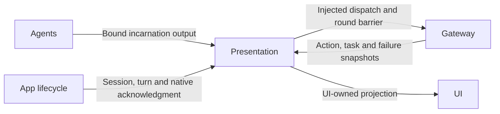

# Output Consumption and Runtime Presentation

## Summary

Provides bounded output transport, caption acceptance and Action/Task/Agent observation projections without owning business decisions.

## Ownership and boundaries

The target depends on UI, AgentCore and FunctionContracts. Speech activation composition belongs to ../Speech, not this generic transport/display directory. Lifecycle owners inject dispatch and retain cancellation/join ownership. Domain decoding is injected by composition; native Bluetooth diagnostics are separate.

## External relationships and data flow

Runtime arrows show data or capability calls; dashed arrows show injection.

## Independent protocol consumers

IndependentOutputWorkflow.consumeGeneration creates per-round Tool and Action/control consumers. Tools retain 128 envelopes with four concurrent executions; Actions retain 256 envelopes and ordered admission. Overflow rejects without eviction/replay. One pending stream read and four Tool executions share a task group so a failed execution wakes the owner even when no next envelope arrives. There is no cumulative per-input native-call cap; Chat owns finite generation admission.

roundFinished seals/drains both consumers before the merge barrier; final completion does the same. assistant.error, agent.error and agent.cancelled cancel/join only that input and preserves admission of future inputs. Unexpected closure, caller cancellation or dispatch failure cancels/joins accepted work and the reader. Resource waiting remains the execution runtime's responsibility.

## Caption and playback acceptance

ConversationPresentation checks source/session/turn/sequence before UI commitment. New recognized turns reset captions; same-turn previews preserve them and finalization promotes text. Recognition turn and task/reply identity are independent. Presentation focus never cancels authorized speech; playback additionally checks active session and explicit task cancellation.

## Runtime observations

ActionActivityWorkflow maps scheduler snapshots, task-only Gateway snapshots, independent failures and sampled Agent lifecycle to Action / Task / Agent tabs. No ordinary Signal subscription invalidates home state. Each task retains 32 events; at most 100 tasks and 100 lifecycle/late-error entries retain counted oldest eviction. Lifecycle is sampled once per second and logs changes only. Observations never alter processing or acknowledge publication.

Delivery receipt means admission; task completion requires explicit accepted result. runtime.replyFinished does not replace waitingUser or cancellation progress. Unknown producer codes retain generic captured failure text; a shared description is not assigned to unrelated child outcomes.

## Vision replacement

CameraVisionRestartWorkflow owns one worker, one retiring/current pipeline and one latest pending intent. replace cancels old admission and returns; the worker joins cleanup before starting the newest pipeline. stop invalidates and joins it. Native lens acknowledgment is independent of this replacement barrier.

✅ Independent consumers, fenced presentation and bounded passive observations are implemented.

❌ Durable execution-log storage is not implemented.

## Related design

[Parent design](../README.md)

✅ 泛化任务投影：展示 execution 与 request goal/Skill；后台终态来自 task.result，进度不能抢占前台。首页后台入口复用 UI 本地执行记录 sheet。

✅ Implemented: ListeningCaptureWorkflow.swift serializes injected native capture start/stop, joins cancelled startup before replacement, reports actual start failures, and never starts a superseded pending intent. ConversationPresentation.suspendReplies records at most 32 cancelled turn IDs and rejects late captions/expressions/playback while retaining visible text. IndependentOutputWorkflow treats agent.cancelled as a cancel/join terminal boundary rather than a transport error.

✅ Implemented: identical simultaneous capture requests coalesce into the same desired-state revision; a reply-policy pause and playback pause must join each other rather than cancel one another. Only a changed desired state supersedes the preceding caller. Disabled-state joins ignore a previous startup failure; explicit enabled retry retains it until a new request.

✅ Listening activation composition belongs to [Speech](../Speech/README.md). This target retains generic presentation and the injected ListeningCaptureWorkflow state machine; it owns no cue synthesis or feedback composition.

✅ Implemented: PhotoDispositionWorkflow.run checks cancellation, joins injected commit, then runs renderer/sound concurrently. Successful commit always owns final removal even if later feedback fails/cancels. A commit failure starts no feedback and performs no removal. Ordinary effect failures return up to two bounded issues; cancellation joins both children and propagates. Domain Action selection, album import and UUID cleanup stay in CameraCoordinator.

✅ Removed per-input cumulative native-call accounting from OutputStreamReader. Each generation is already bounded by Chat; its tool delivery queue admits 128 envelopes, retains four concurrent executions and joins before sealing. Accepted work is never evicted or replayed.

✅ Implemented (2026-10-13): UI.Notice.showNotice/dismissNotice and UI.Light.updateLight are canonical presentation Actions for trusted business calls, currently registered by no Skill. Neutral Actions values cross RuntimePresentation into root-owned HomeEffectsWorkflow, which retains one replaceable notice expiry and one light expiry, UUID-fenced cleanup, and explicit stop. Notices remain separate from factual ExecutionIssue history; actual upper-layer errors have display priority and Action failures remain panel-only. Decorative light accepts normalized origin, initial opacity/intensity and duration; it never changes consent, microphone or eyes. Native renderer separates light generations from listening eye generations and preserves existing exit fade. RuntimePresentation adapts Action requests into UI-owned values; AppPresentationWorkflow keeps its existing UI/AgentCore/FunctionContracts boundary. No UI project dependencies or new directories.

✅ Implemented (2026-10-13 caption/error lifecycle): mask bottom ASR and reply/status immediately while a notice is visible, restore retained text after dismissal, and preserve pinned Task/promoted ASR layout. Consent-off clears both captions; root HomeEffectsWorkflow owns one UUID/text-fenced350ms reply fade/removal task, cancelled by new text/turn/off/shutdown, scheduled only after reply-policy/playback/native-resume barriers. Agent errors stay in factual root failure notices, not persistent voiceStatus copies. App root contexts explicitly choose afterFirstUnlock file protection, including their directory; repository persistent factory accepts protection while its SDK default remains whileUnlocked. This mitigates lock-boundary writes, without claiming the screenshot proves that cause or hiding other storage failures.

✅ ActionActivityWorkflow 在日志→展示边界为 speechPerception 的 recognition 错误设置用户文案“我没听清”；原始消息、来源、输入关联仍原样保存在日志。recordFailure 和 startFailures 快照使用同一映射，其他错误不改文案。

✅ ActionActivityMapping keeps cancelled phase as normal completion history; cancelled leaves/execution markers do not become issue descriptions. Independent real failed leaves remain visible. Input output ownership/terminal cancellation remains in IndependentOutputWorkflow and Gateway.
