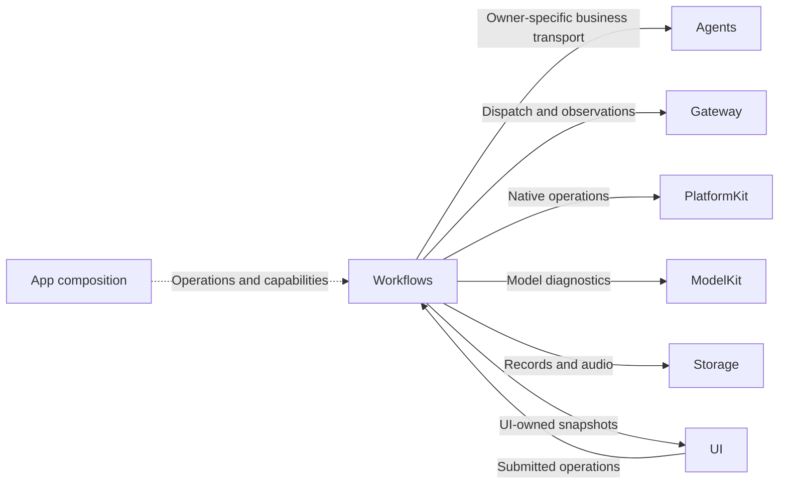
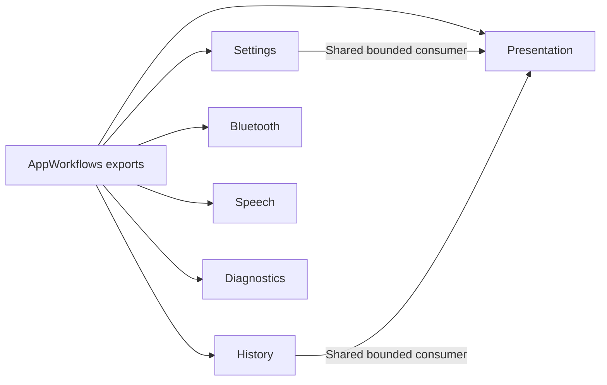

# Application Feature Workflows

## Summary

State-free AppWorkflows facade over six independent feature targets, with operation owners independent of UI pages.

## Ownership and boundaries

Each feature target owns its injected operation lifetime. Settings transports typed business intent; Bluetooth hosts native recovery/manual work; History adapts read-only snapshots and Memory intent; Presentation projects observations; Speech owns PCM checkout/playback and canonical activation composition; Diagnostics owns explicit diagnostic attempts.

## External relationships and data flow

Runtime arrows show data or capability calls; dashed arrows show injection.

## Internal structure

## Compilation and data ownership

The facade re-exports Settings, History, Bluetooth, Speech, Presentation and Diagnostics targets. Their dependency sets differ; importing AppWorkflows does not create a shared business coordinator. UI has no cross-module dependencies. Workflow adapters localize technical results without moving business transactions into UI state.

## Lifetime and completion

Page cancellation retires unsubmitted presentation/discovery work; admitted business operations retain their owners and explicit cancellation contracts. Newer native/manual intent replaces stale pending intent through joined cleanup. Native safety/page cleanup is immediate. Business success means the owning function/task completed; command submission alone is not physical arrival.

Output generation uses independent bounded Action and Tool consumers, joined at round sealing. Observation streams use latest snapshots; device actions and business requests reject overflow explicitly. Failures stay with their producing feature and retain primary plus cleanup/delivery causes.

Independent feature compilation, explicit controls and joined operation ownership are implemented.

## Related design

[Parent design](../README.md) · [Bluetooth](Bluetooth/README.md) · [Diagnostics](Diagnostics/README.md) · [History](History/README.md) · [Presentation](Presentation/README.md) · [Settings](Settings/README.md) · [Speech](Speech/README.md)

Listening-feedback composition is owned by Speech and original cue PCM by Actions/UI. Presentation retains output/state projection and the generic injected native-transition worker. The facade re-exports the existing feature targets.

Presentation adds ListeningCaptureWorkflow for one cancellable native-start operation, one transition worker and one latest desired state. Settings entry transport exposes a trusted session interruption operation; ownership remains root-owned.

Speech owns bounded canonical activation composition; AppSpeechPlayback additionally depends on Actions and ExecutionRuntime. Presentation retains its generic transport/display boundary. App owns activation order/report gating; UI and PlatformKit retain rendering/native primitives respectively.

Presentation adds an injected PhotoDispositionWorkflow for commit-before-effects, joined visual/sound acknowledgment and identity-owned cleanup. It has no domain/native dependencies or queued work.

HomeEffectsWorkflow 归 [Presentation](Presentation/README.md) 所有，管理 notice/light 的替换、到期及关闭；工作流不改变麦克风同意或听写状态。

## Streaming TTS latency

Speech owns PCM checkout/playback and activation composition. Physical listening restoration stays with Lifecycle; no post-playback timer or idle-task owner is provided.

History exports canonical conversation metadata/detail adaptation and Memory intent transport only, without a duplicate task aggregation API or placeholder destination.

## 待实现

- 暂无本目录独立的实现待办；跨模块及实际模型/设备验收见所属模块说明。
