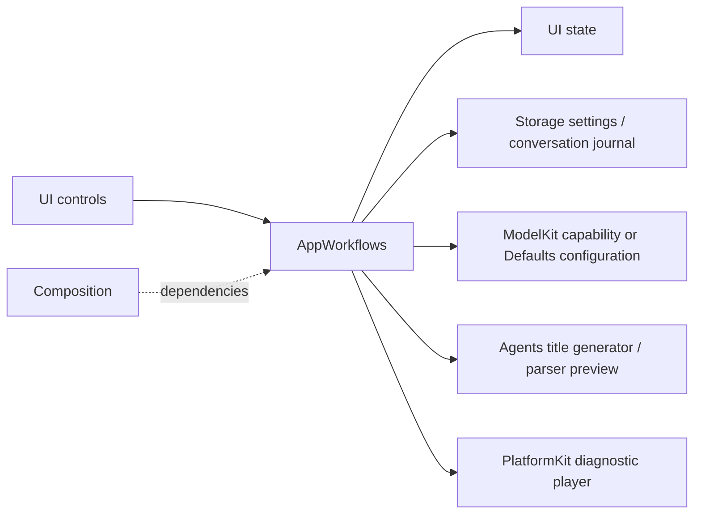
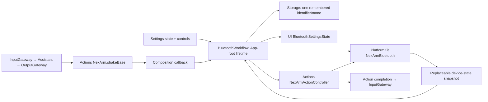
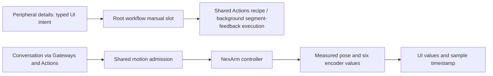
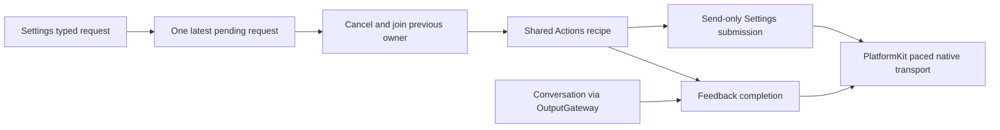
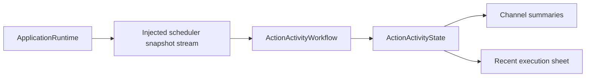

# App Workflows

> Current outbound contract (ADR0090): all arm actions and home write only explicitly listed motors1–5. Older CMD8/CMD54 descriptions below are historical; geometry intents must be compiled before transport. The gripper is excluded from both commands and completion.

> Current status (2026-09-30): user confirmed iPhone LLM conversation control. Broad BLE discovery and foreground recovery are implemented; acceptance of these latest UX changes remains pending.

Purpose: implement cross-module application operations, independently of SwiftUI rendering. Design goals: explicit side effects, bounded operation admission, durable failure handling and injected dependencies. Root Package.swift compiles Settings, History, Bluetooth, Speech, Presentation and Diagnostics as independent feature targets. AppWorkflows is a state-free re-export facade; production code is compiled once in its owning feature target.

✅ `BluetoothWorkflow.aim` keeps only the latest base, shoulder-lift, elbow and wrist-pitch target; wrist roll and the gripper are not retargeted. The manual-control loop sends jerk-limited single-motor steps without waiting for each acknowledgment, and returns as soon as that target is stored. Aim speed follows the remaining count, and a direction change stops for one step before reversing. A newer aim replaces the previous one. ❌ It does not wait for the joints, and physical tracking acceptance remains pending.

## Upstream and downstream

| Workflow | Ownership and bound | Completion / cancellation |
| --- | --- | --- |
| SettingsWorkflow | Coalesced restore; one configuration mutation, reject overlapping save; model discovery bounded by provider adapter | Join App-injected change barrier, persist config, apply chat binding; restore prior config on application failure; credentials remain in Keychain via CloudSettingsStore |
| ConversationHistoryWorkflow | One load or mutation operation; no backlog; shared journal is injected | Archive/reset commits before title inference; cancellation/failure retains archived data and retry state; cancelled operation retains admission until cleanup |
| SpeechDiagnosticWorkflow | One synthesis/playback operation and one stop sequence; reject starts while active/stopping | Stop producer, join task, unload model, deactivate audio session; view never owns inference/player objects |
| ChatDiagnosticWorkflow | Debug-only stateless operation, awaited by the diagnostic page task; no internal queue | Prepare injected ASR/chat capabilities, request a 32-token synthetic reply, cancel the inference session on exit; model residency stays with ModelManager |

CloudSettingsStore.swift is the settings persistence adapter in this directory: current settings use a Storage document plus a Keychain credential reference. Its legacy reader is still required to migrate an existing all-in-Keychain record, verify the new document/credential and only then remove the old record. No code writes new records in the legacy format. The unused legacy writer and unused invalidURL case are removed.

History output remains raw stored data. Preview uses the existing Agent configuration/parser but never dispatches Actions. Settings/history pages receive operation interfaces and state, not model managers or store instances. Diagnostic operations are explicitly selected test flows, not production Agent output. Chat diagnostics use the selected chat binding, which may be local or cloud; the historical launch flag/log markers remain compatible and do not prove which model was selected.

✅ Shared history, protected settings persistence, unchanged title limits and model-switch rollback. Tests control title completion/cancellation and verify archive durability and operation admission.

❌ Cross-device sync, atomic Keychain-plus-file transactions, automatic orphan-credential collection, live-provider/title-quality acceptance and physical-device diagnostic acceptance.

## Storage domain organization

✅ ConversationHistoryWorkflow uses StorageChat; settings still use core LocalDocumentStore. AppWorkflows depends on both targets for their distinct roles.

❌ Image/video/semantic-memory stores remain planned; this migration adds no storage behavior.

## BluetoothWorkflow

✅ App-root-owned MainActor workflow maps PlatformKit snapshots into UI values, loads/saves one remembered device with a 4096-byte Storage document, and performs explicit scan/connect/passive refresh/disconnect/forget operations. Restoration coalesces; one connection operation, one motion and one joined cleanup slot, no physical command queue. Scan/stop intent coalesces into one worker; newest presentation snapshots replace older ones. Persistence errors are visible and cannot produce a ready connection.

Connection uses native BLE subscription completion and passive feedback (ADR0130). It has no voice/session cleanup or scheduler callback. Actions and Settings share the root connection/controller; explicit gestures prepare their own Actions-owned plans when needed. Missing feedback is diagnostic rather than a reconnect trigger.

Leaving Settings stops discovery and page-owned motor intent; connection/recovery lifetime belongs to App. Disconnect immediately fences native I/O, clears transport/manual intents and joins native/manual workers. Finite Agent operations fail naturally through their results. Explicit application background policy still cancels the foreground motion task. Background joins control suspension while retaining a healthy native link, or cancels pending setup/recovery. Foreground checks current native status after cleanup before reuse/reconnect and starts a fresh eligible retry episode; success clears attempts immediately. Manual disconnect/forget disables the saved reconnect preference. A missing native disconnection acknowledgment stops recovery before any new connection. Already accepted physical motion may finish; host cleanup is not physical-stop proof.

✅ Simulation tests cover Assistant/Gateway/Action dispatch, navigation, restoration/forget, incompatible devices, background cancellation, failed writes, query/feedback loss, retries and old-session fencing. Current behavior and exact bounds are owned by [Bluetooth/README.md](Bluetooth/README.md).

✅ Bluetooth recovery is independent of voice/session lifetime and Channel scheduling. It does not cancel accepted Agent Actions or wait for business result publication; ordinary failures retain motor reports and subsequent queued Actions execute normally. ❌ Hardware suspension/disconnect/watchdog and iPhone camera/audio recovery remain separate acceptance work.

## Current foreground recovery contract

✅ [Bluetooth](Bluetooth/README.md) owns the ADR0125 recovery state machine for physical disconnection, blocked sends and query quarantine. Passive feedback silence is diagnostic (ADR0130). One worker fences/clears transport-local intent, closes and joins native/manual workers, confirms native disconnect and performs at most three actual connection attempts per episode with 1/2/4-second backoff. Success clears the episode immediately; every eligible actual foreground return grants a new episode, while transient inactive changes do not. Manual disconnect/forget/background can cancel it; restored devices and radio power recovery share this path. Page lifetime does not own recovery, and old physical commands are never replayed.

❌ Physical-device endurance and emergency-stop proof remain outside host recovery.

## NexArm entertainment skills (2026-09-30)

✅ Agent-selected base sweeps and entertainment presets share one runMotion lifecycle: foreground/connection validation, capacity-one admission, execution status, cancellation join, fault latching and reconnect policy. No page-owned motion work or separate gesture queue. ❌ Newly added gesture sequences await iPhone physical acceptance.

## Peripheral detail operations

✅ BluetoothControlling exposes measured refresh, typed preset/reset requests and individual motor adjustments. Manual requests use a capacity-one latest slot with explicit replacement, shared Actions recipes and background segment-feedback execution outside Gateway locks. Conversation Actions retain runMotion and feedback completion. Read refresh reserves the connection-operation slot; it cannot interleave with motion. Commands survive page navigation, while disconnect/background fences admission and joins committed work. Successful connect/motion refreshes measured UI values; disconnect clears them. No command queue or replay is added.

Manual operations are explicit host device controls, like connection/reset, not Agent outputs; conversation inputs and Agent outputs retain their Gateway route. ❌ Real-device slider/reset acceptance remains pending. See ADR 0073.

## Peripheral cleanup and exceptional recovery

✅ ADR0125 recovery is refined by ADR0129/0130: native sending failure, query quarantine and actual disconnect request bounded transport cleanup/reconnect without scheduler coupling. Passive feedback silence does not trigger reconnect; finite feedback/arrival failures remain Action outcomes. Connection sends no indication motion.

✅ Forget clears native/saved selection after joined cleanup and disables automatic reconnect. Interrupted Actions terminate and preserve diagnostics; only new input after native connectivity may issue another command. Latest-intent replacement and PlatformKit pacing remain separate from connection recovery.

❌ Hardware and native UI acceptance remain pending; [Bluetooth's current contract](Bluetooth/README.md) owns the complete algorithm and bounds.

## Continuous manual control and reset priority

✅ Root-owned liveTask consumes six replaceable normalized intent slots at 30 ms deadline cadence; there is no physical-command backlog. Wire targets advance only when the native no-response transport admits a packet; fractional planner state can advance without a duplicate write. Elapsed time is capped, and I/O time is included in the tick deadline. Congestion does not accumulate elapsed travel or old finger positions; two seconds without admission fails visibly. Release/page exit clears intent; background/disconnect cancels the worker. Play admission remains separate and completion-based.

✅ Manual takeover cancels the current preset owner, changes a revision fence, then opens a native streaming session before sending. Native fencing prevents future writes by the old owner; its existing request is retired, so waiting for an old response cannot prevent reset or close a live stream. Old task/refresh completions cannot overwrite current UI. Reset has priority over the next jog frame and sends CMD54 without waiting for old physical settlement; old task cleanup remains joined. Repeated pending reset taps coalesce as the same desired state. No old motion is replayed.

✅ Jog starts from latest measured/commanded targets, without requesting fresh telemetry. After explicit reset the planner uses the vendor's nominal home targets as estimates, never reported measurements. Only sampled values populate UI positions. Presets still recover and verify telemetry when subsequently invoked. ❌ A final accepted finite target can finish after release; iOS suspension/link close are not an emergency-stop guarantee.

✅ Preset failure details now distinguish command delivery, missing position feedback and joints short of target. The manual-action wrapper preserves those details instead of overwriting them with a generic message. Reset is a priority background request; its worker observes motor arrival and can be replaced before completion. ❌ Physical replacement-preset acceptance remains pending.

✅ Phone UI and conversational shakeBase now bind the same fixed `.baseSway` performance (±30°,800ms body legs); neither calls the retained ±2° USB diagnostic. All presets use physical pose completion and remain interruptible by live reset. ❌ Physical acceptance remains pending.

✅ Explicit NexArm preset requests are independent of prior unconfirmed motion: no recovery/stationary-feedback gate before an already validated connection starts its feedback-driven motion. Segment outcomes remain collected; ordinary target failures do not implicitly cancel later segments. Subsequent user requests can replace the invocation. Current-request completion feedback, exclusive ownership, reset preemption and connection validation remain. Regression tests cover missing old feedback and a later successful request. ❌ No claim that ignoring an old result physically stops servo holding or repairs transport loss.

## Settings device control (current)

✅ ADR0127 restores Settings manual takeover: presets/reset replace one latest request, cancel and join the previous software writer, then submit the shared Actions recipe without resource admission; its background child observes completion for each segment. Sliders use the same latest-intent jog planner without Agent locks. Buttons/sliders require native connectivity and no active recovery, but remain available during motion/jog/reset/refresh. Native sending/feedback failure still enters ADR0125 cleanup/reconnect without old request replay.

✅ Channel completion reports distinct no-feedback and total-deadline failures. Motor inputs use the separate latest-intent live loop; disconnect/background clears both intent types. ❌ Local admission or host timeout does not imply physical arrival/stop; hardware acceptance remains pending.

## Unified Action presentation

✅ `ActionActivityWorkflow` owns one root-lifetime subscription injected by composition, projects AgentCore execution observations into UI-owned display values, and never imports Gateway. It consumes full versioned snapshots; UI ignores stale revisions. Display names are presentation metadata; failure text is the captured thrown error description, not a duplicate error catalog. ActionActivityPresentation maps finite/state/activity semantics and bounded report details into UI display fields. BluetoothWorkflow exposes bounded failure reasons through the shared protocol. Direct Settings controls remain outside Channel execution history; submission is immediate and manual execution failures are ignored rather than published as Bluetooth state or home issues.

❌ No synthetic progress percentages, device-specific stage callbacks, durable execution history or automatic action retry. Stream subscription failures appear as unavailable presentation without stopping Actions.

✅ Product execution history projects every scheduled Action without module/source filtering. Fixed presentation updates execute as immediate Tools and never enter scheduler observation; model expression remains a visible Action.

## Action and Tool presentation boundary

✅ ActionActivityWorkflow forwards every scheduled Action without module/source filtering; UI displays its captured failureDescription directly. Unknown errors use Swift localizedDescription; App adapts neutral speech storage/producer failures after playback cleanup, while other domain LocalizedError values retain their wording. Conversation history dry-run output labels Tool events explicitly. ❌ No duplicate error-message table is maintained.

## Head gestures

✅ Settings exposes nod and shakeHead through the existing latest-only send path; Action history uses 点头/摇头 names. Channel execution still awaits completion; Settings still does not. ❌ No old command is replayed on reconnection.

✅ Action titles come from registration metadata carried in execution records, including unfamiliar paths; there is no Workflow title fallback table.

## Observation ownership

✅ ActionActivityWorkflow owns only subscription lifetime, forwarding and observation-unavailable handling. It does not inspect ActionPath, translate Channels, infer failure codes or format statuses. Deinitialization cancels its retained task; page lifetime never owns this observation. UI receives its own display values without importing Actions/Gateway. ❌ This stream is not a new OutputGateway command or Agent message; see ADR 0086.

## Arm-only NexArm dispatch

✅ Connection verification prepares the bounded Actions-owned IK table before enabling control. Settings tests and reset compile geometry with the same `NexArmArmPlan` used by Channel Actions; only motors1–5 are written. Command estimates update addressed arm joints after admission and preserve motor6, including interrupted tests and return home. Disconnect/reconnect discards the table. Explicit manual motor6 control remains independent.

❌ BLE endurance remains separate from supervised USB acceptance. See [ADR0090](../../../docs/adr/0090-nexarm-arm-only-motion-packets.md); never restore CMD54 or send geometry intents as raw CMD8.

## NexArm feedback execution — 2026-10-01

✅ Conversation uses feedback execution; ADR0128 Settings uses the shared recipe with background segment-feedback execution. Settings pending capacity is one with explicit replacement; cancellation joins the previous software owner before replacement, without waiting for physical completion. Idle/active feedback loss surfaces diagnostics while manual controls remain enabled; restored feedback never replays motion. `resetArm` resets1–5 only.

❌ Sustained real-device acceptance remains pending.

## Atomic composition — ADR0092

✅ BluetoothWorkflow uses invocation-private structured motor reports and configurable single-motor execution. Agent motion/aim uses injected resource fences; already-owned Channel calls inherit the fence. Settings presets/reset/jog bypass those fences through manual takeover. Native current state remains separate from collected Action outcomes.

❌ Sustained real-device acceptance and durable result delivery remain outstanding.

✅ ADR0093: BluetoothWorkflow imports Actions and owns one Actions.NexArmActionController per connection. Settings and conversation share domain gesture geometry/options with separate submission and feedback-completion policies; PlatformKit owns transport only. Workflow duplicates neither geometry nor either completion algorithm.

✅ BluetoothPresentation owns NexArm display-name fallback/filtering, preferred device ordering and localized failure text. PlatformKit now returns typed NexArmBluetoothFailure values with step/native diagnostic data. BluetoothWorkflow maps those values to UI while preserving connection recovery and Settings behavior. Manual jog planning comes from Actions/NexArm/Support.

✅ NexArm motor movement timeout maps to `timedOut`, separately from stable `targetNotReached`; reports preserve both. Default arrival tolerances and deadline calculations remain in Actions/NexArm for feedback-completed Channel behavior; Settings uses only bounded local submission.

✅ NexArm presentation handles only currently produced motion-failure cases; obsolete pose/query failure branches were removed with the retired diagnostic APIs.

✅ SpeechPlayback adapts stored-audio ownership; ConversationPresentation owns Agent-specific turn acceptance. ActionActivityPresentation maps execution observations into UI-owned ActionActivityItem values, including all bounded failure details.

✅ SpeechPlayback passes ActionExecutionContext.source directly into StorageAudio; no AgentID conversion or AgentCore import is required in that playback adapter.

✅ Settings depends only on UI/Storage and History on UI/StorageChat plus AgentCore/Agents/Gateway/Tools/ToolRuntime for its staged intent transport. Concrete provider and Agent parsing/title bindings live in App/Adapters. SpeechPlayback imports ActionRuntime and StorageAudio; presentation imports only execution/shared/UI values. Existing bounded operation policies and cancellation are unchanged.

❌ The facade is not a service locator and owns no runtime state; independent multi-window arbitration remains future work.

✅ Presentation provides a state-free independent subscriber consumer for tracking failure reporting. Vision frame processing remains lifecycle-owned and does not depend on robot availability.

## Local model resources — current contract

✅ ModelResourcesWorkflow is compiled inside existing AppSettingsWorkflow, with injected resource operations and source persistence; no seventh feature target or facade-owned runtime state was added.

❌ Full device/background acceptance and remaining enhancement items are tracked in [Management](../../ModelKit/Management/README.md).

✅ Single-leaf handler failure details now preserve the captured domain error even when the completion also contains a generic report. No error catalog is duplicated in presentation.

✅ ADR0123: BLE live/observed/query writes now share PlatformKit pacing with no streaming packet backlog. Aim iteration keeps a fixed start index per pass for fair motor admission. Existing latest-intent replacement, resource ownership and feedback-loss protection remain in force. ❌ Physical endurance and rate calibration remain pending.

✅ Diagnostics additionally owns AudioDetectionWorkflow: one active endpoint operation, one deadline/freshness monitor and no pending queue. App injects the complete capture/Agent session; the independent feature target gains no Agents/Gateway dependency. Detection finishes after 10 seconds of received PCM, joins cleanup before restart and fences stale callbacks.

## Passive BLE connection — ADR0130

✅ Native connection/subscription completion makes Settings controls available immediately. App performs no connection pose/version/IK probe, stationary validation or indication movement. It listens to unsolicited position packets and publishes measured state; refresh reads the latest received packet only. Feedback silence remains visible but does not disable manual commands, disconnect or start recovery. Native write/connection failures remain explicit. Actions uses passive BLE compatibility for this App connection; recipe IK resolution is deferred to an explicit preset request, not connection verification. Manual jog can start from the existing configured reference when no sample has arrived; that reference is not measured telemetry. Segment arrival observation and cancellable replacement remain in Actions/App.

❌ Physical feedback cadence, preset IK availability and sustained manual takeover require real-device acceptance. Passive connection does not establish physical clearance or target arrival.

✅ ADR0129: Bluetooth owns transport/manual worker cleanup and recovery independently of Agent scheduling. It neither removes accepted Actions nor suspends resource admission; existing results report device failures.

✅ Passive aim startup shares the same Actions-owned configured reference as manual jog when no measurement has arrived; this seeds the planner only and never fabricates UI telemetry. Existing resource/session admission remains mandatory.

✅ ADR0134: Bluetooth exception history is removed at SDK/App/UI layers. Latest native connection, communication issue and recovery state alone appear in Settings; healthy snapshots/new connections replace prior faults. ADR0138 uses one row to connect while unconnected or open detail when already connected; connection success stays on the list, disconnect appears only when connected, and remembered devices remain forgettable; an already-open disconnected detail disables actions/motor gestures. Execution results/home issues and bounded automatic recovery remain independently owned. ❌ Physical BLE/navigation/touch acceptance remains pending.

✅ ADR0139: tracking checks the injected Photographer pose freshness and joins/releases its motor use after a one-second gap. Assistant uses configured shared-writer takeover; old targets are cleared and later accepted Channel Actions are retained. No Bluetooth recovery or whole-Agent stop is involved.

✅ ADR0141: AppBluetoothWorkflow validates execution permits at Agent motion/continuous-write entries, independently of Settings manual takeover and native connection recovery. ❌ Resource ownership does not establish physical device health or arrival.

❌ Background Bluetooth execution/state restoration and physical scene-lifetime acceptance remain outside the current [Bluetooth](Bluetooth/README.md) implementation.

✅ History load/refresh crosses InputGateway → ConversationMemory → OutputGateway → UI.showHistory. Its root-owned slot rejects overlap and joins cancelled Tool cleanup before retry. ❌ Archive/delete/title migration remains pending; this is a documented History feature dependency exception.
