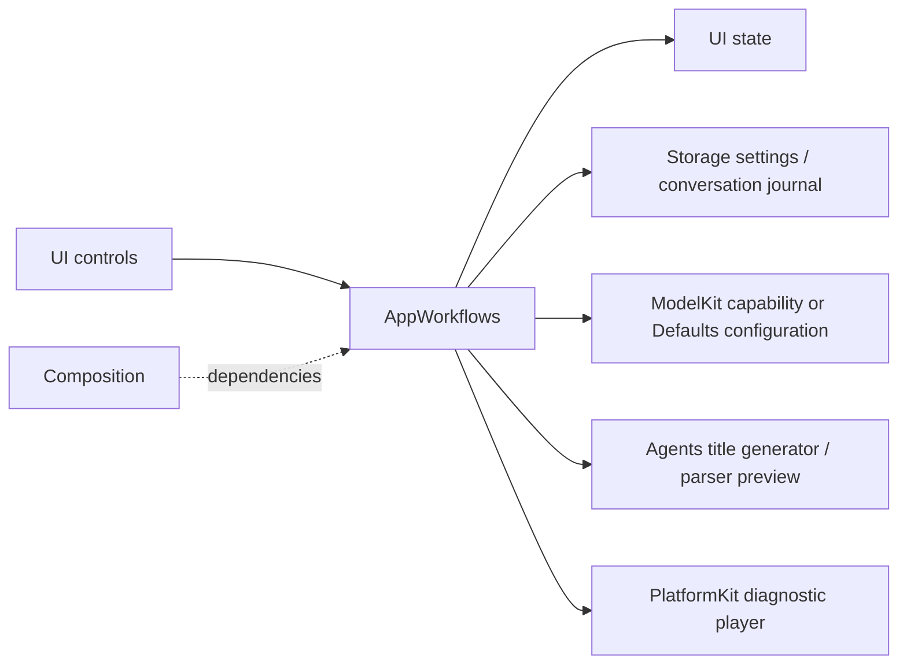
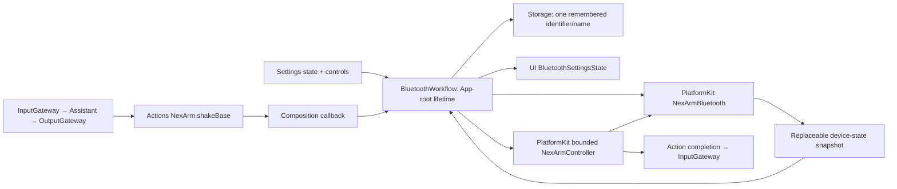

# App Workflows

> Current status (2026-09-30): user confirmed iPhone LLM conversation control. Broad BLE discovery and foreground recovery are implemented; acceptance of these latest UX changes remains pending.

Purpose: implement cross-module application operations, independently of SwiftUI rendering. Design goals: explicit side effects, bounded operation admission, durable failure handling and injected dependencies. Root Package.swift compiles this directory once as AppWorkflows; the App executable imports it through HarnessKit.

## Upstream and downstream

| Workflow | Ownership and bound | Completion / cancellation |
| --- | --- | --- |
| SettingsWorkflow | Coalesced restore; one configuration mutation, reject overlapping save; model discovery bounded by provider adapter | Join App-injected change barrier, persist config, apply chat binding; restore prior config on application failure; credentials remain in Keychain via CloudSettingsStore |
| ConversationHistoryWorkflow | One load or mutation operation; no backlog; shared journal is injected | Archive/reset commits before title inference; cancellation/failure retains archived data and retry state; cancelled operation retains admission until cleanup |
| SpeechDiagnosticWorkflow | One synthesis/playback operation and one stop sequence; reject starts while active/stopping | Stop producer, join task, unload model, deactivate audio session; view never owns inference/player objects |
| ChatDiagnosticWorkflow | Debug-only stateless operation, awaited by the diagnostic page task; no internal queue | Prepare injected ASR/chat capabilities, request a 32-token synthetic reply, cancel the inference session on exit; model residency stays with ModelManager |

CloudSettingsStore.swift is the settings persistence adapter in this directory: current settings use a Storage document plus a Keychain credential reference. Its legacy reader is still required to migrate an existing all-in-Keychain record, verify the new document/credential and only then remove the old record. No code writes new records in the legacy format. The unused legacy writer and unused invalidURL case are removed.

History output remains raw stored data. Preview uses the existing Agent configuration/parser but never dispatches Actions. Settings/history pages receive operation interfaces and state, not model managers or store instances. Diagnostic operations are explicitly selected test flows, not production Agent output. Chat diagnostics use the selected chat binding, which may be local or cloud; the historical launch flag/log markers remain compatible and do not prove which model was selected.

✅ Shared history, protected settings persistence, unchanged title limits and model-switch rollback. Tests control title completion/cancellation and verify archive durability and operation admission.

❌ Cross-device sync, atomic Keychain-plus-file transactions, automatic orphan-credential collection, live-provider/title-quality acceptance and physical-device diagnostic acceptance.

## Storage domain organization

✅ ConversationHistoryWorkflow uses StorageChat; settings still use core LocalDocumentStore. AppWorkflows depends on both targets for their distinct roles.

❌ Image/video/semantic-memory stores remain planned; this migration adds no storage behavior.

## BluetoothWorkflow

✅ App-root-owned MainActor workflow maps PlatformKit snapshots into UI values, loads/saves one remembered device with a 4096-byte Storage document, and performs explicit scan/connect/verify/disconnect/forget operations. Restoration coalesces; one connection operation, one motion and one joined cleanup slot, no physical command queue. Scan/stop intent coalesces into one worker; newest presentation snapshots replace older ones. Persistence errors are visible and cannot produce a ready connection.

Connection waits for App-injected voice/session quiescence before arming a new controller, so queued work from an earlier connection cannot move a replacement. FFE0/FFE1/FFE2 discovery is followed by version and pose queries; only observed ESP32/AT32 1.0.2 is accepted. Readiness is checked again after persistence. Controller admission additionally enforces existing posture and movement bounds. Action and settings share the same root instance.

Leaving settings only stops scans. Disconnect/background closes admission immediately, cancels connection/motion, joins the current bounded controller leg, then closes BLE. No next leg or automatic resume/reconnect is issued. A missing CoreBluetooth disconnection acknowledgment stays visible as disconnecting. Physical movement already accepted may finish even if iOS suspends; safety never relies on background execution or a false physical-stop ACK. Uncertain completion faults the current controller until explicit reconnection after inspection. Forget joins disconnection before removing the record.

✅ Tests cover actual Assistant/parser/Gateway/Action dispatch through this workflow with a declared simulated BLE fixture, navigation persistence, remembered-device restoration/forget, wrong firmware, background during connection/motion, uncertain writes and the old-session barrier. ❌ Hardware suspension, disconnect timing and physical-stop/watchdog acceptance remain separate.

✅ Bluetooth disconnect/background cleanup no longer invokes the global voice/settings barrier. It closes robot admission and joins only robot work; explicit reconnection still joins prior voice/session work before arming a new controller. This prevents a disconnected Bluetooth owner from stopping unrelated microphone use during permission/lifecycle transitions. ❌ iPhone camera/audio recovery remains a separate acceptance check.

✅ BLE readiness uses the same NexArmController that later executes Actions. It verifies actual firmware once per live connection with bounded read-only handling of missing AT32 information; missing version and unsupported version have distinct errors. Disconnection discards that controller. ❌ Full iPhone physical acceptance remains pending.

✅ Missing AT32 version retains the live BLE connection with control admission closed. An explicit capacity-one verification retry reuses that controller; version, pose, persistence, the requested first connection indication and generation/native-state checks must pass before readiness. Version queries remain read-only. Rejected Actions never replay. Disconnect/background cancels verification and clears readiness. ❌ Persistent device-side version read failure and full iPhone motion acceptance remain unresolved.

✅ After version/pose/persistence validation, explicit connection performs one reset + ID5 indication through the same controller, in a separate visible indicating phase. The retained motion task shares disconnect/background joining with Actions; control readiness is published only after indication and a fresh generation/native-link check. Missing firmware keeps the connection without motion; a later successful explicit verification triggers the first indication. No repeated indication on page navigation or ready-state retry. ❌ Physical iPhone acceptance pending.

## Current NexArm BLE admission

✅ App explicitly selects `nexArm102BLE` compatibility policy for the known version-query defect, following physical USB/BLE comparison and user-observed motion. Exact ESP32 1.0.2 + missing AT32 can proceed only after bounded stationary pose checks and the complete reset/ID5 indication. The state continues to show “AT32 版本暂不可读”; it never fabricates 1.0.2. Actual nonzero unsupported firmware remains rejected. This supersedes the earlier missing-version-always-blocked policy. Indication is now ID5 ±8° then center, once per connection. ❌ iPhone physical acceptance remains pending.

## Current foreground recovery contract

✅ User confirmed the iPhone LLM → Action → real-arm path. Firmware-version display/admission has been removed from normal BLE connections: validate the pose protocol and the requested manual connection gesture, then mark `controlValidated`. App never calls the failing version query or displays an AT32 warning.

✅ Remember the verified peripheral UUID/name plus a backward-compatible optional auto-reconnect preference. One bounded recovery attempt per foreground activation (including cold start) joins background cleanup, initializes the radio if needed, retrieves that UUID, verifies services and stationary telemetry, and restores control. Recovery is independent of Settings page lifetime and sends no reset, gesture or earlier Action. There is no retry timer or physical-command backlog. Manual connect still joins old voice/session work and performs the gesture. Manual disconnect, forget and uncertain motion disable recovery; manual disconnect during an already-running background cleanup persists that intent. Storage failures stay visible.

```mermaid
stateDiagram-v2
    [*] --> Disconnected
    Disconnected --> Verifying: explicit device selection
    Verifying --> Indicating: services + stationary pose valid
    Indicating --> Ready: reset + ID5 feedback complete
    Ready --> Cleanup: background / lock
    Cleanup --> Disconnected: cancel future legs and join committed leg
    Disconnected --> Recovering: active + saved auto-reconnect
    Recovering --> Ready: read-only service / pose validation
    Recovering --> Disconnected: failed attempt; wait for next activation
    Ready --> Disconnected: manual disconnect disables recovery
```

❌ No guaranteed background connection/control, automatic retry after physical uncertainty, queued-motion replay or OS-level headset pairing integration. Updated real-device lock/unlock acceptance remains pending.
