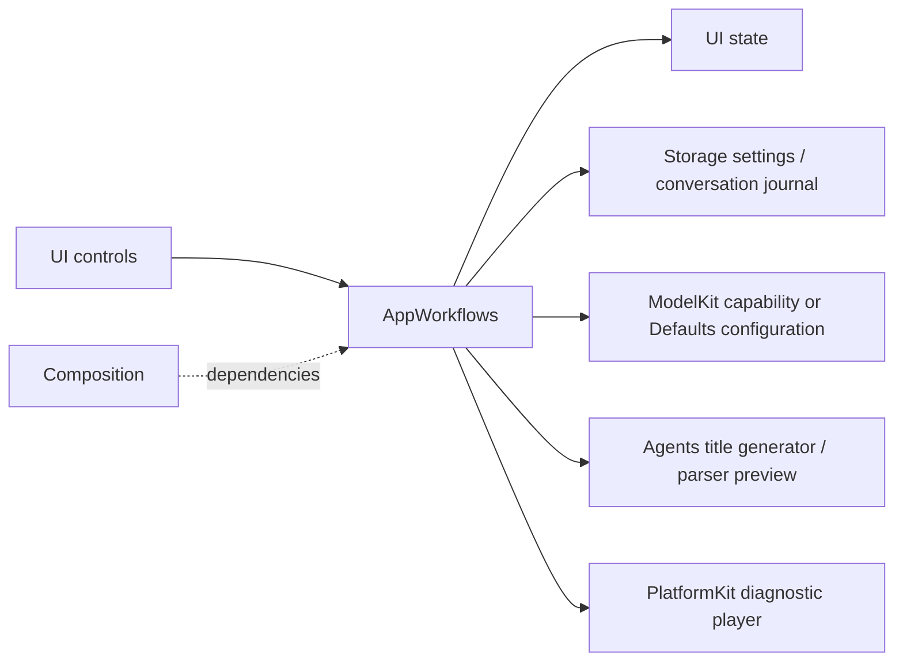

# App Workflows

Purpose: implement cross-module application operations, independently of SwiftUI rendering. Design goals: explicit side effects, bounded operation admission, durable failure handling and injected dependencies. Root Package.swift compiles this directory once as AppWorkflows; the App executable imports it through HarnessKit.

## Upstream and downstream

| Workflow | Ownership and bound | Completion / cancellation |
| --- | --- | --- |
| SettingsWorkflow | Coalesced restore; one configuration mutation, reject overlapping save; model discovery bounded by provider adapter | Join App-injected change barrier, persist config, apply chat binding; restore prior config on application failure; credentials remain in Keychain via CloudSettingsStore |
| ConversationHistoryWorkflow | One load or mutation operation; no backlog; shared journal is injected | Archive/reset commits before title inference; cancellation/failure retains archived data and retry state; cancelled operation retains admission until cleanup |
| SpeechDiagnosticWorkflow | One synthesis/playback operation and one stop sequence; reject starts while active/stopping | Stop producer, join task, unload model, deactivate audio session; view never owns inference/player objects |
| ChatDiagnosticWorkflow | Debug-only stateless operation, awaited by the diagnostic page task; no internal queue | Prepare injected ASR/chat capabilities, request a 32-token synthetic reply, cancel the inference session on exit; model residency stays with ModelManager |

CloudSettingsStore.swift is the settings persistence adapter in this directory: current settings use a Storage document plus a Keychain credential reference. Its legacy reader is still required to migrate an existing all-in-Keychain record, verify the new document/credential and only then remove the old record. No code writes new records in the legacy format. The unused legacy writer and unused invalidURL case are removed.

History output remains raw stored data. Preview uses the existing Agent configuration/parser but never dispatches Actions. Settings/history pages receive operation interfaces and state, not model managers or store instances. Diagnostic operations are explicitly selected test flows, not production Agent output. Chat diagnostics use the selected chat binding, which may be local or cloud; the historical launch flag/log markers remain compatible and do not prove which model was selected.

✅ Shared history, protected settings persistence, unchanged title limits and model-switch rollback. Tests control title completion/cancellation and verify archive durability and operation admission.

❌ Cross-device sync, atomic Keychain-plus-file transactions, automatic orphan-credential collection, live-provider/title-quality acceptance and physical-device diagnostic acceptance.

## Storage domain organization

✅ ConversationHistoryWorkflow uses StorageChat; settings still use core LocalDocumentStore. AppWorkflows depends on both targets for their distinct roles.

❌ Image/video/semantic-memory stores remain planned; this migration adds no storage behavior.
