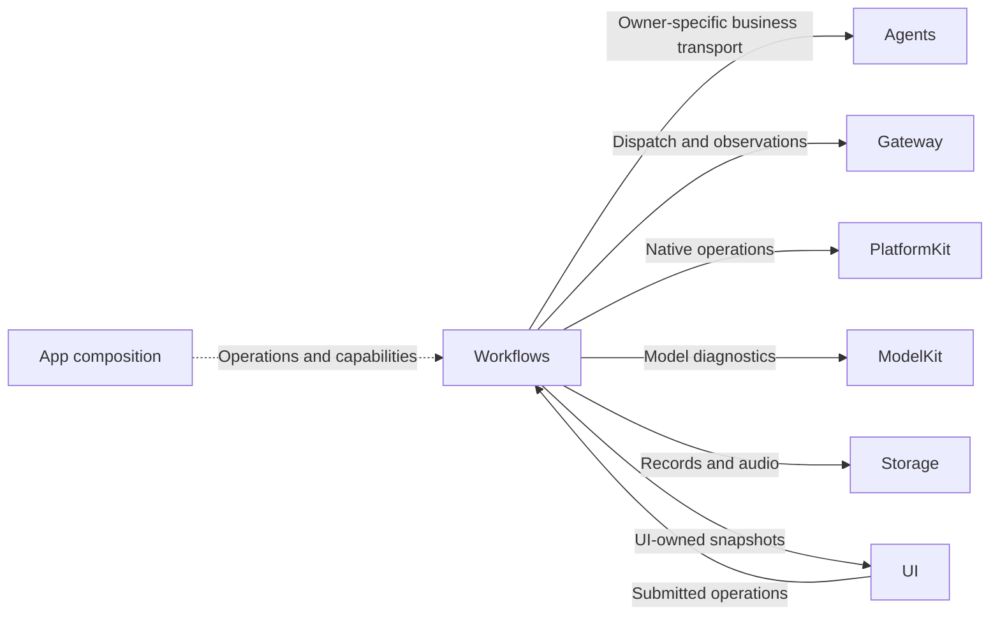
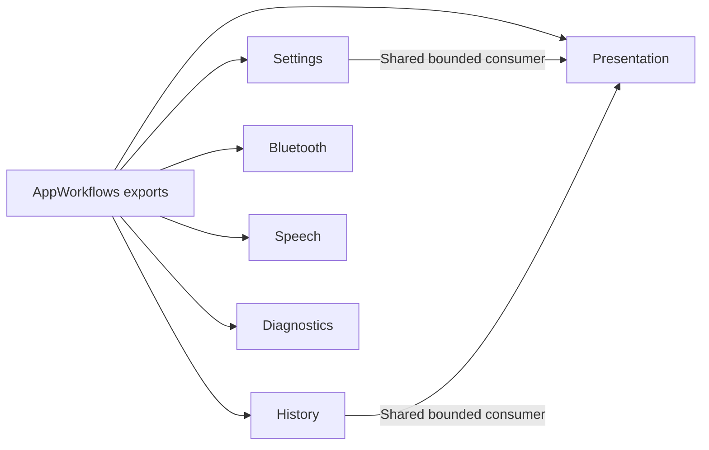

# Application Feature Workflows

## Summary

State-free AppWorkflows facade over six independent feature targets, with operation owners independent of UI pages.

## Ownership and boundaries

Each feature target owns its injected operation lifetime. Settings transports typed business intent; Bluetooth hosts native recovery/manual work; History adapts read-only snapshots and Memory intent; Presentation projects observations; Speech owns PCM checkout/playback; Diagnostics owns explicit diagnostic attempts.

## External relationships and data flow

Runtime arrows show data or capability calls; dashed arrows show injection.

## Internal structure

## Compilation and data ownership

The facade re-exports Settings, History, Bluetooth, Speech, Presentation and Diagnostics targets. Their dependency sets differ; importing AppWorkflows does not create a shared business coordinator. UI has no project dependencies. Workflow adapters localize technical results without moving business transactions into UI state.

## Lifetime and completion

Page cancellation retires unsubmitted presentation/discovery work; admitted business operations retain their owners and explicit cancellation contracts. Newer native/manual intent replaces stale pending intent through joined cleanup. Native safety/page cleanup is immediate. Business success means the owning function/task completed; command submission alone is not physical arrival.

Output generation uses independent bounded Action and Tool consumers, joined at round sealing. Observation streams use latest snapshots; device actions and business requests reject overflow explicitly. Failures stay with their producing feature and retain primary plus cleanup/delivery causes.

✅ Independent feature compilation, explicit controls and joined operation ownership are implemented.

## Related design

[Parent design](../README.md) · [Bluetooth](Bluetooth/README.md) · [Diagnostics](Diagnostics/README.md) · [History](History/README.md) · [Presentation](Presentation/README.md) · [Settings](Settings/README.md) · [Speech](Speech/README.md)
