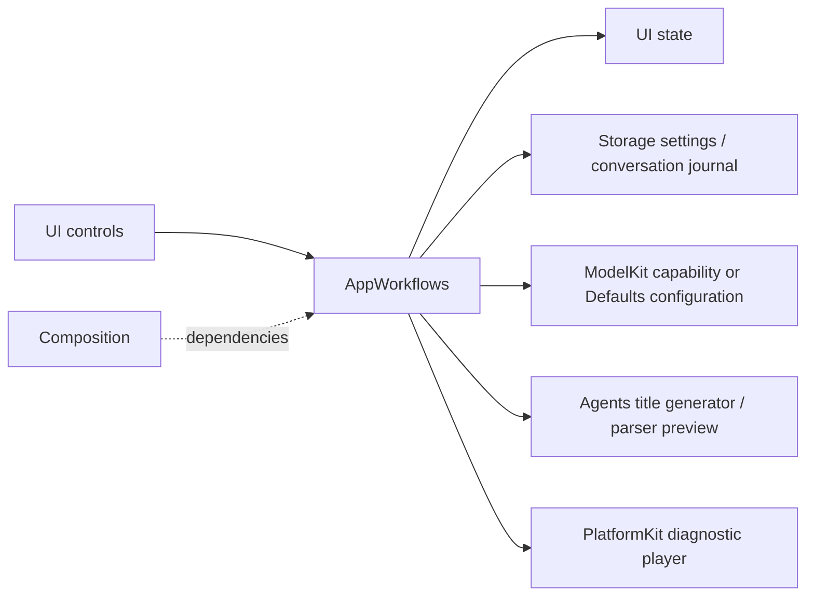
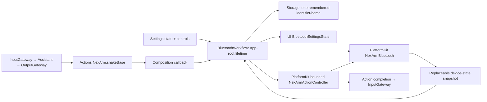
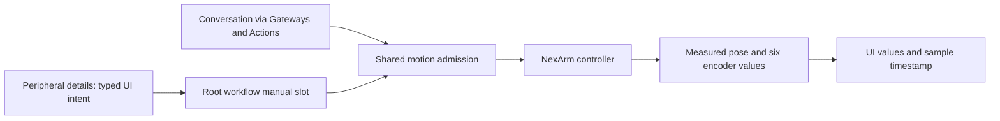
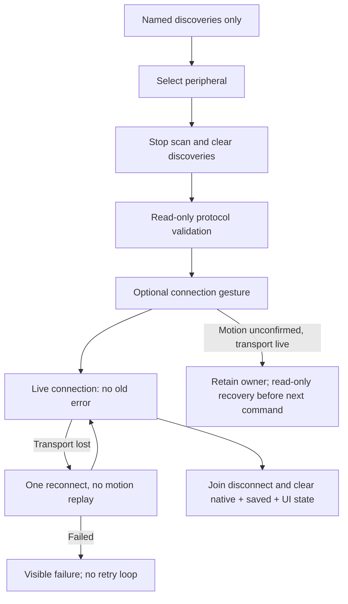
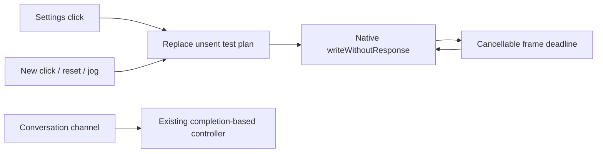
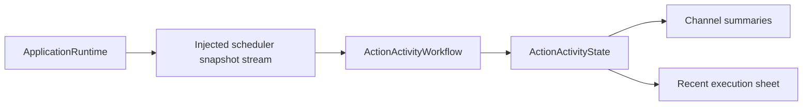

# App Workflows

> Current outbound contract (ADR0090): all arm actions and home write only explicitly listed motors1–5. Older CMD8/CMD54 descriptions below are historical; geometry intents must be compiled before transport. The gripper is excluded from both commands and completion.

> Current status (2026-09-30): user confirmed iPhone LLM conversation control. Broad BLE discovery and foreground recovery are implemented; acceptance of these latest UX changes remains pending.

Purpose: implement cross-module application operations, independently of SwiftUI rendering. Design goals: explicit side effects, bounded operation admission, durable failure handling and injected dependencies. Root Package.swift compiles Settings, History, Bluetooth, Speech, Presentation and Diagnostics as independent feature targets. AppWorkflows is a state-free re-export facade; production code is compiled once in its owning feature target.

✅ `BluetoothWorkflow.aim` keeps only the latest base, shoulder-lift, elbow and wrist-pitch target; wrist roll and the gripper are not retargeted. The manual-control loop sends jerk-limited single-motor steps without waiting for each acknowledgment, and returns as soon as that target is stored. Aim speed follows the remaining count, and a direction change stops for one step before reversing. A newer aim replaces the previous one. ❌ It does not wait for the joints, and physical tracking acceptance remains pending.

## Upstream and downstream

| Workflow | Ownership and bound | Completion / cancellation |
| --- | --- | --- |
| SettingsWorkflow | Coalesced restore; one configuration mutation, reject overlapping save; model discovery bounded by provider adapter | Join App-injected change barrier, persist config, apply chat binding; restore prior config on application failure; credentials remain in Keychain via CloudSettingsStore |
| ConversationHistoryWorkflow | One load or mutation operation; no backlog; shared journal is injected | Archive/reset commits before title inference; cancellation/failure retains archived data and retry state; cancelled operation retains admission until cleanup |
| SpeechDiagnosticWorkflow | One synthesis/playback operation and one stop sequence; reject starts while active/stopping | Stop producer, join task, unload model, deactivate audio session; view never owns inference/player objects |
| ChatDiagnosticWorkflow | Debug-only stateless operation, awaited by the diagnostic page task; no internal queue | Prepare injected ASR/chat capabilities, request a 32-token synthetic reply, cancel the inference session on exit; model residency stays with ModelManager |

CloudSettingsStore.swift is the settings persistence adapter in this directory: current settings use a Storage document plus a Keychain credential reference. Its legacy reader is still required to migrate an existing all-in-Keychain record, verify the new document/credential and only then remove the old record. No code writes new records in the legacy format. The unused legacy writer and unused invalidURL case are removed.

History output remains raw stored data. Preview uses the existing Agent configuration/parser but never dispatches Actions. Settings/history pages receive operation interfaces and state, not model managers or store instances. Diagnostic operations are explicitly selected test flows, not production Agent output. Chat diagnostics use the selected chat binding, which may be local or cloud; the historical launch flag/log markers remain compatible and do not prove which model was selected.

✅ Shared history, protected settings persistence, unchanged title limits and model-switch rollback. Tests control title completion/cancellation and verify archive durability and operation admission.

❌ Cross-device sync, atomic Keychain-plus-file transactions, automatic orphan-credential collection, live-provider/title-quality acceptance and physical-device diagnostic acceptance.

## Storage domain organization

✅ ConversationHistoryWorkflow uses StorageChat; settings still use core LocalDocumentStore. AppWorkflows depends on both targets for their distinct roles.

❌ Image/video/semantic-memory stores remain planned; this migration adds no storage behavior.

## BluetoothWorkflow

✅ App-root-owned MainActor workflow maps PlatformKit snapshots into UI values, loads/saves one remembered device with a 4096-byte Storage document, and performs explicit scan/connect/verify/disconnect/forget operations. Restoration coalesces; one connection operation, one motion and one joined cleanup slot, no physical command queue. Scan/stop intent coalesces into one worker; newest presentation snapshots replace older ones. Persistence errors are visible and cannot produce a ready connection.

Connection waits for App-injected voice/session quiescence before arming a new controller, so queued work from an earlier connection cannot move a replacement. FFE0/FFE1/FFE2 discovery is followed by version and pose queries; only observed ESP32/AT32 1.0.2 is accepted. Readiness is checked again after persistence. Controller admission additionally enforces existing posture and movement bounds. Action and settings share the same root instance.

Leaving settings only stops scans. Disconnect/background closes admission immediately, cancels connection/motion, joins the current bounded controller leg, then closes BLE. No next leg or automatic resume/reconnect is issued. A missing CoreBluetooth disconnection acknowledgment stays visible as disconnecting. Physical movement already accepted may finish even if iOS suspends; safety never relies on background execution or a false physical-stop ACK. Uncertain completion faults the current controller until explicit reconnection after inspection. Forget joins disconnection before removing the record.

✅ Tests cover actual Assistant/parser/Gateway/Action dispatch through this workflow with a declared simulated BLE fixture, navigation persistence, remembered-device restoration/forget, wrong firmware, background during connection/motion, uncertain writes and the old-session barrier. ❌ Hardware suspension, disconnect timing and physical-stop/watchdog acceptance remain separate.

✅ Bluetooth disconnect/background cleanup no longer invokes the global voice/settings barrier. It closes robot admission and joins only robot work; explicit reconnection still joins prior voice/session work before arming a new controller. This prevents a disconnected Bluetooth owner from stopping unrelated microphone use during permission/lifecycle transitions. ❌ iPhone camera/audio recovery remains a separate acceptance check.

✅ BLE readiness uses the same NexArmActionController that later executes Actions. It verifies actual firmware once per live connection with bounded read-only handling of missing AT32 information; missing version and unsupported version have distinct errors. Disconnection discards that controller. ❌ Full iPhone physical acceptance remains pending.

✅ Missing AT32 version retains the live BLE connection with control admission closed. An explicit capacity-one verification retry reuses that controller; version, pose, persistence, the requested first connection indication and generation/native-state checks must pass before readiness. Version queries remain read-only. Rejected Actions never replay. Disconnect/background cancels verification and clears readiness. ❌ Persistent device-side version read failure and full iPhone motion acceptance remain unresolved.

✅ After version/pose/persistence validation, explicit connection performs one reset + ID5 indication through the same controller, in a separate visible indicating phase. The retained motion task shares disconnect/background joining with Actions; control readiness is published only after indication and a fresh generation/native-link check. Missing firmware keeps the connection without motion; a later successful explicit verification triggers the first indication. No repeated indication on page navigation or ready-state retry. ❌ Physical iPhone acceptance pending.

## Current NexArm BLE admission

✅ App explicitly selects `nexArm102BLE` compatibility policy for the known version-query defect, following physical USB/BLE comparison and user-observed motion. Exact ESP32 1.0.2 + missing AT32 can proceed only after bounded stationary pose checks and the complete reset/ID5 indication. The state continues to show “AT32 版本暂不可读”; it never fabricates 1.0.2. Actual nonzero unsupported firmware remains rejected. This supersedes the earlier missing-version-always-blocked policy. Indication is now ID5 ±8° then center, once per connection. ❌ iPhone physical acceptance remains pending.

## Current foreground recovery contract

✅ User confirmed the iPhone LLM → Action → real-arm path. Firmware-version display/admission has been removed from normal BLE connections: validate the pose protocol and the requested manual connection gesture, then mark `controlValidated`. App never calls the failing version query or displays an AT32 warning.

✅ Remember the verified peripheral UUID/name plus a backward-compatible optional auto-reconnect preference. One bounded recovery attempt per foreground activation (including cold start) joins background cleanup, initializes the radio if needed, retrieves that UUID, verifies services and stationary telemetry, and restores control. Recovery is independent of Settings page lifetime and sends no reset, gesture or earlier Action. There is no retry timer or physical-command backlog. Manual connect still joins old voice/session work and performs the gesture. Manual disconnect, forget and uncertain motion disable recovery; manual disconnect during an already-running background cleanup persists that intent. Storage failures stay visible.

```mermaid
stateDiagram-v2
    [*] --> Disconnected
    Disconnected --> Verifying: explicit device selection
    Verifying --> Indicating: services + stationary pose valid
    Indicating --> Ready: reset + ID5 feedback complete
    Ready --> Cleanup: background / lock
    Cleanup --> Disconnected: cancel future legs and join committed leg
    Disconnected --> Recovering: active + saved auto-reconnect
    Recovering --> Ready: read-only service / pose validation
    Recovering --> Disconnected: failed attempt; wait for next activation
    Ready --> Disconnected: manual disconnect disables recovery
```

❌ No guaranteed background connection/control, automatic retry after physical uncertainty, queued-motion replay or OS-level headset pairing integration. Updated real-device lock/unlock acceptance remains pending.

## NexArm entertainment skills (2026-09-30)

✅ BluetoothWorkflow shares one runMotion lifecycle for base sweeps and all entertainment presets: foreground/connection validation, capacity-one admission, execution status, cancellation join, fault latching and reconnect policy. No page-owned motion work or separate gesture queue. ❌ Newly added gesture sequences await iPhone physical acceptance.

## Peripheral detail operations

✅ BluetoothControlling exposes measured refresh, typed preset/reset requests and individual motor adjustments. Manual requests use a capacity-one retained task with explicit busy rejection, sharing runMotion and the same controller with conversation Actions. Read refresh reserves the connection-operation slot; it cannot interleave with motion. Commands survive page navigation, while disconnect/background fences admission and joins committed work. Successful connect/motion refreshes measured UI values; disconnect clears them. No command queue or replay is added.

Manual operations are explicit host device controls, like connection/reset, not Agent outputs; conversation inputs and Agent outputs retain their Gateway route. ❌ Real-device slider/reset acceptance remains pending. See ADR 0073.

## Unconfirmed motion recovery (current)

✅ An unconfirmed Action/manual movement releases the busy state but retains the connected controller and reconnect preference. It reports “动作未确认完成，可刷新状态或继续操作”. Refresh or the next explicit operation invokes read-only recovery; no old Action or remaining gesture legs are replayed. Actual transport disconnect still follows native link state. This supersedes the earlier workflow policy of discarding the controller and requiring reconnection after every uncertain completion.

❌ An arm still moving or unreadable cannot accept another motor write; the request returns an error and remains retryable on the same connection. Physical acceptance remains separate.

## Complete peripheral cleanup and transport recovery

✅ Connecting clears visible discovery immediately; only a fresh explicit scan can repopulate rows after connect/forget/disconnect. The selected retry target remains available even after a failed connection clears discovery. Forget joins cleanup, clears native discovery/selection/failure, saves an empty device record with reconnect disabled, and clears UI identity, telemetry, motion text and errors. Failed cleanup/persistence stays visible. Delayed snapshots cannot repopulate a retired scan.

✅ Connection protocol validation and the feedback gesture are separate. A motion-level indication failure retains the live verified connection and controller; the next explicit operation/read recovers stationary telemetry without repeating reset. If the verified connection is actually lost (including request timeout), one foreground read-only reconnect attempt joins previous work. Failure does not loop; no reset, gesture or pending command is replayed. Manual disconnect/forget/background fence this recovery. Successful connection clears old errors. This supersedes the earlier once-per-foreground-only recovery and gesture-required-for-readiness policies.

❌ New physical BLE timeout/recovery and forget acceptance remain pending. App-owned cleanup is distinct from system pairing/unpairing.

## Continuous manual control and reset priority

✅ Root-owned liveTask consumes six replaceable normalized intent slots at 30 ms deadline cadence; there is no physical-command backlog. Wire targets advance only when the native no-response transport admits a packet; fractional planner state can advance without a duplicate write. Elapsed time is capped, and I/O time is included in the tick deadline. Congestion does not accumulate elapsed travel or old finger positions; two seconds without admission fails visibly. Release/page exit clears intent; background/disconnect cancels the worker. Play admission remains separate and completion-based.

✅ Manual takeover cancels the current preset owner, changes a revision fence, then opens a native streaming session before sending. Native fencing prevents future writes by the old owner; its existing request is retired, so waiting for an old response cannot prevent reset or close a live stream. Old task/refresh completions cannot overwrite current UI. Reset has priority over the next jog frame and sends CMD54 without waiting for old physical settlement; old task cleanup remains joined. Repeated pending reset taps coalesce as the same desired state. No old motion is replayed.

✅ Jog starts from latest measured/commanded targets, without requesting fresh telemetry. After explicit reset the planner uses the vendor's nominal home targets as estimates, never reported measurements. Only sampled values populate UI positions. Presets still recover and verify telemetry when subsequently invoked. ❌ A final accepted finite target can finish after release; iOS suspension/link close are not an emergency-stop guarantee.

✅ Preset failure details now distinguish command delivery, missing position feedback and joints short of target. The manual-action wrapper preserves those details instead of overwriting them with a generic message. Reset remains a priority fire-and-observe-later command; no reset completion ACK is required. ❌ Physical replacement-preset acceptance remains pending.

✅ Phone UI and conversational shakeBase now bind the same fixed `.baseSway` performance (±30°,800ms body legs); neither calls the retained ±2° USB diagnostic. All presets use physical pose completion and remain interruptible by live reset. ❌ Physical acceptance remains pending.

✅ Explicit NexArm preset requests are independent of prior unconfirmed motion: no recovery/stationary-feedback gate before an already validated connection starts its fixed 3000ms approach. A failed segment stops only that invocation; subsequent user requests can start. Current-request completion feedback, exclusive ownership, reset preemption and connection validation remain. Regression tests cover missing old feedback and a later successful request. ❌ No claim that ignoring an old result physically stops servo holding or repairs transport loss.

## Settings test control (current)

✅ Settings Play uses native CMD8 writeWithoutResponse without telemetry/ATT completion waits. Fixed ready400ms → body800ms per frame → home600ms, maximum8 frames. These are cancellable playback deadlines, not arrival gates. One latest test slot replaces all unsent old frames; no command backlog. New Play/reset/jog can take over within the30ms worker cadence (subject to native transport admission). Buttons remain enabled while connected. Native congestion retains only the latest request, fails visibly after2s, and never replays skipped old frames. Page exit/background/disconnect discard unsent test frames. UI says sent, never physically completed. Conversation/channel performGesture retains its existing feedback-based contract.

❌ Wireless delivery and physical arrival are not established by local send admission. Optional NEXARM_SETTINGS_TEST validates the shared frame plan on USB, separate from default tests.

✅ Channel completion now reports distinct no-feedback and total-deadline failures. Completion uses the controller's last confirmed observation without a redundant status query. A failed await does not automatically replay motion; settings immediate tests keep their separate live path. ❌ Host timeout does not imply physical stop.

## Unified Action presentation

✅ `ActionActivityWorkflow` owns one root-lifetime subscription injected by composition, projects AgentCore execution observations into UI-owned display values, and never imports Gateway. It consumes full versioned snapshots; UI ignores stale revisions. Display names are presentation metadata; failure text is the captured thrown error description, not a duplicate error catalog. ActionActivityPresentation maps finite/state/activity semantics and bounded report details into UI display fields. BluetoothWorkflow exposes bounded failure reasons through the shared protocol. Settings test commands remain outside channel execution history and retain send-only acknowledgments.

❌ No synthetic progress percentages, device-specific stage callbacks, durable execution history or automatic action retry. Stream subscription failures appear as unavailable presentation without stopping Actions.

✅ Product execution history projects every scheduled Action without module/source filtering. Fixed presentation updates execute as immediate Tools and never enter scheduler observation; model expression remains a visible Action.

## Action and Tool presentation boundary

✅ ActionActivityWorkflow forwards every scheduled Action without module/source filtering; UI displays its captured failureDescription directly. Unknown errors use Swift localizedDescription; domain LocalizedError owns readable wording. Conversation history dry-run output labels Tool events explicitly. ❌ No duplicate error-message table is maintained.

## Head gestures

✅ Settings exposes nod and shakeHead through the existing latest-only send path; Action history uses 点头/摇头 names. Channel execution still awaits completion; Settings still does not. ❌ No old command is replayed on reconnection.

✅ Action titles come from registration metadata carried in execution records, including unfamiliar paths; there is no Workflow title fallback table.

## Observation ownership

✅ ActionActivityWorkflow owns only subscription lifetime, forwarding and observation-unavailable handling. It does not inspect ActionPath, translate Channels, infer failure codes or format statuses. Deinitialization cancels its retained task; page lifetime never owns this observation. UI receives its own display values without importing Actions/Gateway. ❌ This stream is not a new OutputGateway command or Agent message; see ADR 0086.

## Arm-only NexArm dispatch

✅ Connection verification prepares the bounded PlatformKit IK table before enabling control. Settings tests and reset compile geometry with the same `NexArmArmPlan` used by Channel Actions; only motors1–5 are written. Command estimates update addressed arm joints after admission and preserve motor6, including interrupted tests and return home. Disconnect/reconnect discards the table. Explicit manual motor6 control remains independent.

❌ BLE endurance remains separate from supervised USB acceptance. See [ADR0090](../../../docs/adr/0090-nexarm-arm-only-motion-packets.md); never restore CMD54 or send geometry intents as raw CMD8.

## NexArm feedback execution — 2026-10-01

✅ BluetoothWorkflow routes Settings and conversation through the same feedback executor. Settings pending capacity is one with explicit replacement; cancellation joins the previous owner before replacement. Idle/active feedback loss disables control and surfaces connection instability; restored feedback never replays motion. `resetArm` resets1–5 only.

❌ Sustained real-device acceptance remains pending.

## Atomic composition — ADR0092

✅ BluetoothWorkflow exposes the last structured motor report and configurable single-motor execution. Settings and manual streaming use injected resource fences; already-owned Channel calls inherit the fence. UI error messages remain separate from collected child outcomes.

❌ Sustained real-device acceptance and durable result delivery remain outstanding.

✅ ADR0093: BluetoothWorkflow imports Actions and owns one Actions.NexArmActionController per connection. Settings and conversation invoke the same domain gesture/execution implementation; PlatformKit owns transport only. No duplicated gesture geometry or completion algorithm in Workflow.

✅ BluetoothPresentation owns NexArm display-name fallback/filtering, preferred device ordering and localized failure text. PlatformKit now returns typed NexArmBluetoothFailure values with step/native diagnostic data. BluetoothWorkflow maps those values to UI while preserving connection recovery and Settings behavior. Manual jog planning comes from Actions/NexArm/Support.

✅ NexArm motor movement timeout maps to `timedOut`, separately from stable `targetNotReached`; reports preserve both. Default arrival tolerances and deadline calculations remain in Actions/NexArm, shared by Settings and Channel.

✅ NexArm presentation handles only currently produced motion-failure cases; obsolete pose/query failure branches were removed with the retired diagnostic APIs.

✅ SpeechPlayback adapts stored-audio ownership; ConversationPresentation owns Agent-specific turn acceptance. ActionActivityPresentation maps execution observations into UI-owned ActionActivityItem values, including all bounded failure details.

✅ SpeechPlayback passes ActionExecutionContext.source directly into StorageAudio; no AgentID conversion or AgentCore import is required in that playback adapter.

✅ Settings depends only on UI/Storage and History only on UI/StorageChat. Concrete provider and Agent parsing/title bindings live in App/Adapters. SpeechPlayback imports ActionRuntime and StorageAudio; presentation imports only execution/shared/UI values. Existing bounded operation policies and cancellation are unchanged.

❌ The facade is not a service locator and owns no runtime state; independent multi-window arbitration remains future work.

✅ Presentation provides a state-free independent subscriber consumer for tracking failure reporting. Vision frame processing remains lifecycle-owned and does not depend on robot availability.
