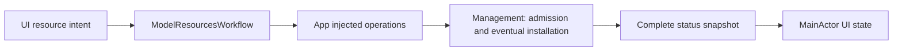

# AppSettingsWorkflow

Purpose: own settings application operations in an independent compilation boundary. Design goals: explicit injected effects and unchanged business lifetimes. Direct dependencies: UI and Storage.

✅ Settings restore/discovery/save, provider preparation and application are injected; the original begin/end barrier, credential persistence, migration and rollback order remain unchanged. One mutation rejects overlap and concurrent restore coalesces. No operation queue is added.

❌ Provider selection belongs to App/Adapters; real Keychain/provider acceptance remains separate.

✅ An internal SettingsPersistence seam retains the same production CloudSettingsStore; isolated transaction tests exercise validation-before-persistence and rollback-before-barrier-release without Keychain or network access.

## Local model resource workflow

✅ ModelResourcesWorkflow restores/saves the endpoint and migrates the former cellular restriction to unrestricted networking in a bounded LocalDocumentStore, validates before persistence and rejects overlapping source mutations. It invokes injected resource read/download/cancel/remove operations; direct dependencies remain UI and Storage. It does not decode model metadata or own download queues. App retains workflow/state across page navigation; visible Settings polls complete snapshots once per second. Source changes affect new requests; existing cloud-setting transactions retain their contract.

❌ Full iPhone acceptance remains pending. HF background task restoration, completed-file reuse and package bounds are documented in [Management](../../../ModelKit/Management/README.md#local-model-resources--current-contract).

✅ 本地模型设置的校验与存储构造回调明确隔离于 MainActor，与工作流及 App 注入环境一致；持久化 I/O 仍由 Storage actor 串行处理。❌ 真机网络下载验收需单独执行。

✅ ModelResourcesWorkflow durably saves independent useCustomRecognition/useCustomSynthesis with shared download-source preferences before applying policy. New drafts default false; legacy single-switch JSON remains readable. Restore validates installed prerequisites and persistently disables unavailable modes before applying policy. Its injected apply closure carries lifecycle effects; no concrete model dependency is introduced.

✅ Enable validation uses fresh installation snapshots before persistence: recognition needs Nemotron only, synthesis needs MOSS. Refresh/removal disables only a mode whose prerequisite vanished. Restore coalesces one migration/apply task (32 waiters; excess returns conflict). UI is not the sole guard. Shared download/storage protocols are unchanged.

✅ Restore persists network-permission normalization even when voice choices are unchanged. Source autosave keeps existing validation/revision checks and mutation admission; source edits do not change voice mode. Downloads consume the durable endpoint after UI admission validation.
