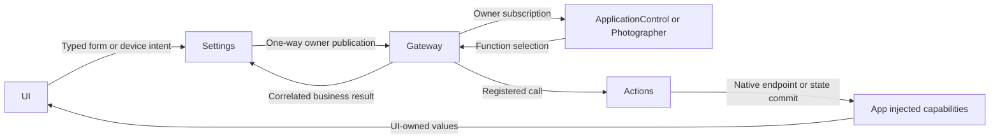

# Settings and Owner-Specific Intent Transport

## Summary

Owns settings form operations and bounded transport to ApplicationControl and Photographer, without owning their business transactions.

## Ownership and boundaries

SettingsInteractionWorkflow retains form tasks/revisions. ApplicationControlIntentRuntime and PhotographerIntentRuntime own registration, output consumption and business-result correlation. Pure page/system-settings/native stop callbacks execute immediately. UI owns passive drafts; Actions owns preferences/provider transactions.

## External relationships and data flow

Runtime arrows show data or capability calls; dashed arrows show injection.

## Internal owners and bounds

| Component | Bound and failure contract |
| --- | --- |
| AgentInteractionRuntime | Startup-aware root/specialist lifecycle and bound output consumption |
| ApplicationControlIntentRuntime | 32 request admissions, 64 output slots; per-request worker/call limit; no waiter for environment/resource facts |
| PhotographerIntentRuntime | One camera request; output 256; one tracking worker with eight queued calls; overflow reports explicitly |
| ModelResourcesWorkflow | 32 coalesced restore waiters; save excludes restore/save overlap; failed save invalidates confirmation cache |
| ModelResourceInteractionWorkflow | 32 pending operations; last-confirmed flags and accepted-snapshot lock reconciliation |
| SettingsWorkflow / SettingsInteractionWorkflow | 32 restore waiters; one discovery and one save; discovery revision fencing and page-independent save |
| BluetoothInteractionWorkflow | 16 discrete requests and six latest motor values; stop/reset priority and joined worker |
| CameraInteractionWorkflow | One command; explicit target facing/mediaID; visible overlap failure |
| ResourceObservationWorkflow | One foreground worker, no sample queue; one locally submitted fingerprint ≤64 KiB or failure ≤2048 bytes |

## Business transport and facts

Typed UI commands publish directly to the owning Agent. Publication checks its own input/admission and never returns subscriber errors. Waiters independently observe correlated business output under an owned 120-second watchdog. Never replay a lost/failed command. A rejection for unadmitted work does not publish retirement for nonexistent work.

Environment and model-resource facts have no request waiter or completion acknowledgment. Registered presentation executes under the root ApplicationControl consumer. Sampling deduplicates locally submitted native readings; a changed reading invalidates current inventory rather than carrying an inventory snapshot. Presentation failure is not a publication receipt and cannot cause a publisher retry.

Camera state publication prepares resident Photographer then sends camera.state independently of its one-slot command transaction, tracking queue or model worker. Every consumer binds the real actor/incarnation before reading output.

## Preferences and provider transactions

Preference source restore/save permits up to three returning calls: source transaction, configureSpeech and failure presentation. Ordinary resource commands/inventory allow two. Provider headless requests allow one; presentation-enabled requests allow two. Device interaction allows one; environment facts have no request call budget.

Actions owns durable schema, legacy migration, installed prerequisites, provider model eligibility, Keychain replacement and rollback sequence. App supplies native barriers and primitives. A committed preference survives later binding failure; the facade invalidates its cache and keeps last-confirmed visible flags. Explicit restore/save reconciles; polling never retries binding.

Registered presentation acknowledges committed UI state, separately from business success. A presentation failure preserves both causes, does not recursively present itself and never repeats the command. Safe producer codes select notices; text classification exists only in unavailable-transport fallback.

## Host failure and cancellation

After joining the failed original worker, eligible resource admission/dispatch failures may use one fresh model.resource.hostFailure Signal, retaining original request correlation. One diagnostic slot, no queue and one returning error-presentation call apply. Startup/closed/cancellation/capacity failure or occupied/unavailable infrastructure uses explicit local fallback; no runtime restart or recursive diagnosis.

Photographer cancellation joins the function, then asks the Agent to retire the request. Acknowledgment waits at most two seconds; unconfirmed cleanup is reported honestly. Tracking attach admits one vision scope; detach clears/joins its work without removing resident Photographer. Shutdown closes admission, cancels/joins readers and workers, then removes registrations.

Typed owner transport, independent facts, bounded waiters and revision-fenced form/result handling are implemented.

## Related design

[Parent design](../README.md)

AgentInteractionRuntime.cancelConversation delivers the trusted runtime cancelSession control to its actual resident Assistant and joins inference cancellation. It retains registration and the output consumer; unrelated sessions/Agents remain intact.

cancelConversation concurrently joins Agent cancellation and a trusted OutputGateway.cancelCalls(for:sessionID:) operation. This releases an already-blocked round seal without stopping/re-registering the output pump.

the output owner recognizes explicit cancelled seal completion while its own task is live, retains its reader, and awaits the following cancellation terminal. Owner-task cancellation still propagates and joins shutdown.

## Resource observation state

ResourceObservationWorkflow 只在 foreground 运行一个采样 worker，默认一秒一次，没有采样队列。保存一个 previous Reading，facts 指纹 ≤65,536 UTF-8 字节，failed 消息 ≤2048 字节；同一 Reading 不重复提交。foreground 切换清空 previous，background 立即 invalidate 并取消 worker；shutdown 加入清理。

每次 changed/failed 提交递增 sequence。deliver 返回 accepted 只表示本地 publication submission 成功，才更新 previous；retry 或抛出保留当前指纹可重试资格。Agent 接纳、订阅者消费和 UI 呈现不属于该确认；其后失败不会回写指纹。新原生 Reading、前台重置或显式刷新提供重新提交机会，不自动重放业务操作。

采样只发布失效/读取失败事实，不修改偏好或取消传输。通用 push 型资源状态仓库尚未实现。

## 待实现

- 暂无本目录独立的实现待办；跨模块及实际模型/设备验收见所属模块说明。
