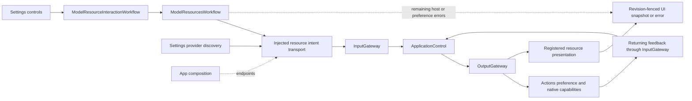
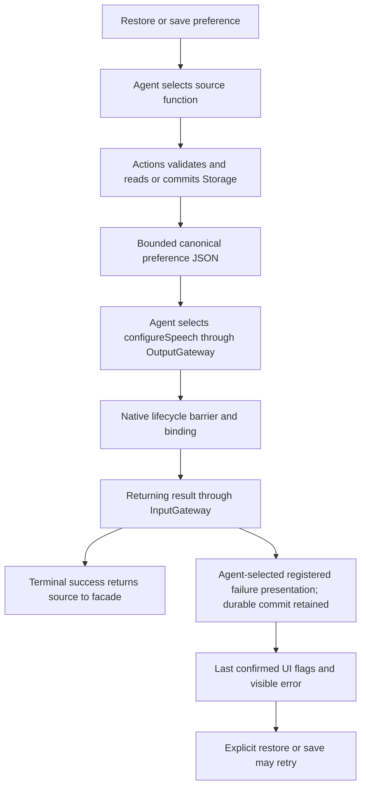
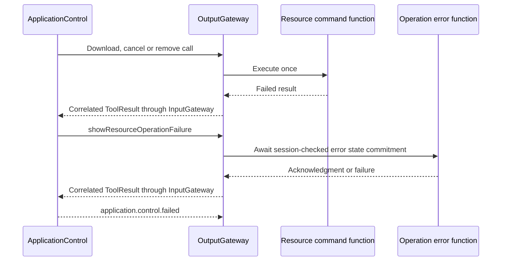
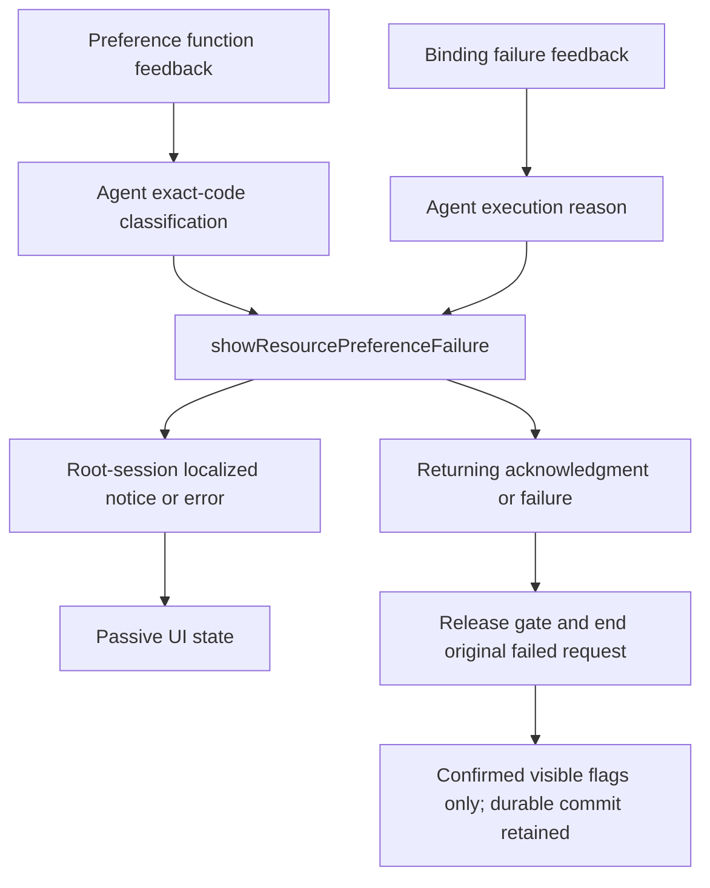
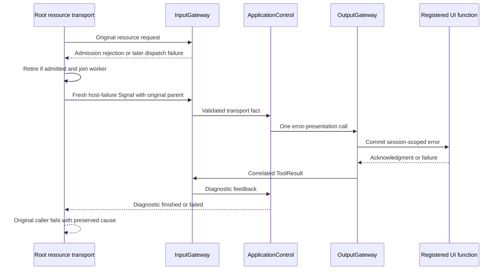

# AppSettingsWorkflow

Settings feature adapters and bounded UI request coordination. Resource business effects belong to ApplicationControl and Actions; this target imports UI and uses AgentCore/Agents/Gateway/AppPresentationWorkflow in ApplicationControlIntentRuntime for resource/provider query transport. No concrete callable or model SDK import is permitted.

## Upstream and downstream

## Internal design

| File | Responsibility | Bound / failure policy |
| --- | --- | --- |
| ModelResourcesWorkflow | Injected restore/save/read/command facade and successful view-value cache |32 coalesced restore waiters; save rejects overlap with save/restore; failures invalidate cache |
| ModelResourceInteractionWorkflow | UI request locks, draft preservation and error projection |32 pending operations; page cancellation does not revoke admission; cancel joins download admission |
| ApplicationControlIntentRuntime | Root Agent registration, bounded resource/provider call transport and terminal waiter correlation |32 requests,64 output slots; one retained current worker per request; preference maximum3 calls, provider1 or2, interaction1 and environment0, ordinary resource2; shutdown cancels/joins reader/workers |
| SettingsInteractionWorkflow | Root-owned form tasks, revisions and injected Agent operations | One discovery task and one save admission; page exit retires discovery only |
| BluetoothInteractionWorkflow | Typed device intent and immediate native fence adaptation |16 discrete requests and six latest motor values; explicit overflow and joined shutdown |
| CameraInteractionWorkflow | Typed camera command adaptation | One root-owned command; overlap rejects visibly |
| SettingsWorkflow / SettingsProviderOperations | Injected restore/discover/save form facade |32 restore waiters, save excludes overlap, failure invalidates confirmation cache |
| Provider private result adaptation | Actions-owned store/request result via App composition | No credential/schema/persistence implementation in this target |

✅ Resource validation, source persistence, legacy migration and installed prerequisites are owned by Actions. The view draft is never the durable store schema. ApplicationControl owns effect sequencing; App maps returned JSON to view values and localizes selection notices.

✅ Download source saves precede admission. Voice switches use the durable endpoint rather than an unfinished download-field edit. Refresh/removal reconcile previously successful preferences through Agent operations. Native download success means admission, not installation. Source changes affect new requests.

✅ Save failure invalidates the facade cache. The interaction adapter retains last confirmed flags without an effectful rollback read. After preference failure, polling cannot retry binding; explicit restore/save reopens reconciliation. A committed preference survives later binding failure.

✅ Transport joins the prior worker before launching the next owned call. Duplicate/over-limit calls fail the request; typed host retirement releases Agent bookkeeping without cancelling a native download. Page-independent admission and explicit cancel retain their previous behavior.

✅ Provider discovery uses the Agent route; eligible resource transport failures use typed host Signals. ✅ Registered provider UI presentation is implemented. ✅ Resource refresh snapshot/query-failure presentation is registered. Actions supplies installed eligibility; UI retains visual grouping metadata only. Physical Keychain/provider switching, native resource operations/background restoration and model switching remain unverified.

✅ ADR0169: resource queries are Agent-routed; refresh returns items plus supplied installed groups. ModelResourcePolicy is removed. Root transport allows65536-byte inventory results, separately from2048-byte preferences, and keeps invocation-local failure/cleanup.

✅ ADR0170: refresh(generation:nil) is query-only; nonnil revision requests registered presentation. Interaction starts/invalidate revisions in passive UI state. Root transport captures canonical UI snapshot values, retains primary and secondary failures, and distinguishes accepted error presentation. ADR0174 routes eligible admission/dispatch failures through Agent-selected presentation, with explicit infrastructure fallback. Registered preference failure presentation is implemented in ADR0173; no new queue. Refresh requests retain two-call bounds.

✅ ADR0170 failure refinement: transport retirement must retain the original query/presentation failure when a later dispatch or feedback delivery fails. Capture handler error before examining dispatch error; preserve both causes in the request-local terminal failure.

✅ ADR0171: root observation workflow uses injected fact sampling and delivery callbacks; one active worker and no queue. setForeground(false) cancels sampling; a cancelled worker is retained until joined before restart. ApplicationControlIntentRuntime observes typed native state through the existing 32-request/two-call transport. Interaction adds accepted-snapshot reconciliation using the existing admitted-ID rule.

```mermaid
flowchart LR
    Native[Injected native facts] --> Observer[Root foreground sampler]
    Observer -->|changed / failed Signal| Input[InputGateway]
    Input --> Agent[ApplicationControl]
    Agent --> Output[OutputGateway]
    Output --> Function[Registered resource presentation]
    Function -->|revision fenced snapshot / error| State[Passive UI state]
    Function -->|returned result| Input
    State -->|accepted snapshot acknowledgement| Locks[Interaction admission bookkeeping]
```

The sampler retains one acknowledged fingerprint (64 KiB) or failure (2048 UTF-8 bytes), with no sample queue. Delivery failure retries the latest reading at the next cadence; success permits deduplication. Background cancels sampling and invalidates revisions. The old worker completes before foreground restarts; accepted Gateway work and native transfers keep their own owners. Explicit shutdown joins the worker. A changed reading causes the registered function to read current facts again; the Signal is an invalidation rather than an inventory snapshot. Observation never selects preference binding.

✅ ADR0172: ApplicationControlIntentRuntime recognizes the registered operation-error function acknowledgment; error chains expose readable descriptions. Download/cancel/remove catches avoid overwriting already-presented errors and retain lock/cleanup semantics. Two-call request bound remains unchanged.

Native-command failure and error-presentation failure remain distinct causes. Error presentation never repeats the native command; the second call always ends this failed request. Already-presented failures skip duplicate local projection; unavailable admission/transport/endpoint retains explicit local error fallback. Operation errors have completion-order ownership and are not cleared by progress refresh. Preference notices also use registered presentation in ADR0173; confirmed visible rollback and durable commit remain separate.

✅ ADR0173: ApplicationControlIntentRuntime stores per-request maximumCalls (preference3, other2), recognizes preference presentation acknowledgment and preserves causes. All preference catches respect the accepted marker while keeping cache invalidation, preferenceFailed gates and visible rollback.

### Preference failure routing

| Stage / reason | Agent decision |
| --- | --- |
| Preference function: resource.selection.recognition / synthesis | Show typed missing-model notice |
| Preference function: resource.source.invalid | Show localized source guidance |
| Binding failure or unknown code | Show ordinary execution error; never infer notice from text |
| Failure-presentation result | End the original failed request; no recursion or effect retry |

| Request | Maximum returning calls |
| --- | --- |
| restoreSource / saveSource |3: preference function, binding, failure presentation |
| Commands, standalone configureSpeech, inventory/refresh and observations |2 |
| Provider discovery / restore / save |1 |

Failure presentation retains preference/configuration exclusion until its own result. A rejected/missing endpoint leaves an explicit host fallback with the original error chain. Text classification remains only in that fallback and is migration debt. No operation is implicitly retried on rollback or progress observation.

## Resource host-failure Signal — ADR0174

✅ ApplicationControlIntentRuntime distinguishes admission/dispatch failure from native function failure. After the original request and worker finish, it may send one typed external model.resource.hostFailure/1 Signal from app.resources, with a fresh root and the original request as parent. ApplicationControl chooses the existing operation, preference (execution reason) or generation-fenced refresh error function; acknowledgment completes diagnostic handling while the original caller still fails with an accepted-presentation marker.

One diagnostic slot, no waiting queue, one returning call and the existing 32-request/64-output limits apply. Never replay an operation, restart a closed runtime or recursively diagnose failed error presentation. Startup, cancellation, capacity exhaustion, an occupied diagnostic/error-presentation slot and unavailable Gateway/presentation retain explicit local fallback with the original cause. The original worker must join before diagnostic admission to avoid output-pump deadlock. Native Action algorithms and business failure classification stay unchanged.

Diagnostic acknowledgment describes handling only, not success of the original operation. Diagnostic failure appends its cause and exits. Rejected overlap can present independently without releasing an active preference/binding gate. Startup and closed-runtime failures never start diagnostic work. A failure-presentation attempt is recorded before dispatch, so a missing or non-returning error endpoint cannot create a recursive host Signal.

Diagnostic completion may fail after the UI endpoint has acknowledged its commit. The accepted-presentation marker must survive that later transport failure, alongside both causes, to suppress duplicate local projection.

## Provider discovery

✅ Implemented: ApplicationControlIntentRuntime.discoverProvider transports typed provider.discovery/1, grants one returning call, captures at most65536-byte canonical model-list JSON and converts private transport failures to explicit public query failures. It never uses the model-resource error UI for provider errors. Existing worker joining,32 request admissions, cancellation and shutdown ownership remain. SettingsWorkflow maps form results/errors through injected operations; provider transactions are Actions-owned and registered provider UI presentation remains subsequent work.

## Provider configuration transactions

✅ CloudSettingsStore.swift is removed; schema/persistence/migration belong to Actions. SettingsProviderOperations exposes injected restore/discover/save, not preparation. SettingsWorkflow owns only32 coalesced restore waiters, form cache/model-label presentation and save overlap guards. ApplicationControlIntentRuntime transports provider settings intents with one returning call and typed ProviderIntentFailure for queries and transactions, with no compatibility alias; it forwards safe producer failureCode without interpreting policy. The AppSettingsWorkflow target drops Storage. No UI page owns admitted transaction cancellation.

A failed save invalidates the facade restore cache without replacing its last-confirmed label. Explicit restore reconciles the Actions value after an ambiguous feedback failure; it does not replay save.

Resource facade overlap errors now use the owning facade/transport error instead of Storage.DocumentStorageError.conflict. This removes its incidental Storage import without changing admission guards or invoking persistence.

## Completion batch — provider presentation and capability policy

✅ Implemented: provider discovery model-family eligibility belongs to Actions ProviderModelList; ModelKit validates/decodes raw IDs only. Preserve filtering/dedup/order and bounds at the app boundary. SettingsState becomes a passive editable snapshot, with no tasks or injected execution; SettingsInteractionWorkflow in the existing Settings directory owns bounded form admission, revision and page-independent saves. UI forwards edits/discovery/cancellation/save through SettingsControlling.

✅ Implemented: presentation-enabled provider intents select a second registered UI.ResourcePresentation.showProviderResult call after the business call, on success or failure. Headless requests retain one call. Private result lookup and revision/session fences prevent credentials in protocol payloads and stale form updates. One attempt only, no recursive presentation/replay; producer and presentation failure chains remain distinct. App injects the native UI endpoint; business functions remain independent of UI and call protocols.

## Typed device, navigation and environment entry points

✅ Implemented: app.interaction/1 maps explicit device commands and navigation destinations to fixed registered functions through ApplicationControl and the shared root transport. This Agent now coordinates native resource interactions as well as model resources; it performs no native I/O. UI controls emit typed intent through a root-owned BluetoothInteractionWorkflow; native BluetoothWorkflow remains the injected connection/recovery/manual worker host. Existing arrival tolerance, timeouts, pacing and takeover algorithms stay unchanged.

✅ Implemented: System.Device.control validates bounded string arguments and invokes neutral DeviceControlCapability; successful submission reports acceptance, not physical arrival. Read-only status and selected connection commands are explicitly model-granted. UI.Navigation.open commits native route state; manual taps and model requests share that function. A bounded latest motor-intent worker sends only changed values, with reset/stop priority and explicit failure display. No queued motion replay.

✅ Implemented: app.environment/1 stores latest sequenced scene/device/capability facts in the root Agent, with finite categories and bounded data. App still performs synchronous background/native safety fencing before reporting facts; physical safety cannot wait on Agent admission or iOS background execution. Native back navigation remains platform-owned and reports a fact, rather than replaying navigation effects. Photo-library creation and physical acceptance are feature/acceptance boundaries, not implied by navigation support.

## Camera command entry

✅ Implemented: CameraInteractionWorkflow emits typed open/close/flip/retry intents through Photographer and existing Camera functions. Root presentation accepts Photographer in the stable root session or validated active task scope; Assistant delegates through task communication; Photographer executes under its actual identity. Native capture, permission, lifecycle fences and joined cleanup remain CameraCoordinator responsibilities. Retry uses a canonical callable and the native explicit settings/permission request. UI receives controls and passive camera state, not the native coordinator. One command slot rejects overlap, no replay.

✅ Implemented validation fix: environment/interaction public entry points expose ApplicationControlIntentFailure for transport rejection instead of leaking the private TransportFailure. Environment bounds are validated before admission, preserving CommunicationError for malformed facts.

## Photographer transport — ADR0181

✅ PhotographerIntentRuntime lazily registers one root-owned Photographer, consumes its stream once and dispatches camera and tracking independently. One camera request rejects overlap; output256 plus one tracking worker and8 queued tracking calls are bounded. Tracking overflow rejects the excess call with an explicit report callback; detach intentionally cancels/joins all work for the retired vision scope. Camera cancellation cancels/joins its function before an admitted root cancel Signal retires business state. No accepted command replay. Shutdown joins camera/tracking/pump before registration removal.

CameraInteractionWorkflow forwards typed operations. Root UI requests use InputGateway; delegated model calls use the live, bound Assistant messaging authority through OutputGateway. Returning camera failures retain OutputExecutionResult and complete producer reports. Error paths release the request slot and leave later commands and perception admissible. ApplicationControlIntentRuntime retains device/navigation only.

Camera transport errors expose bounded producer descriptions for UI while retaining the complete execution outcome/report for callers. Closing transport cancels accepted work; it admits no new dispatch.

✅ Interaction refinement: Manual switch resolves the opposite of current facing before admission; PhotographerIntentRuntime carries that explicit facing through the existing bounded request slot.

## Photo save and ignore — ADR0185

✅ PhotographerIntentRuntime transports optional photoID and returns the actual bounded native value after execution and terminal acknowledgment. CameraInteractionWorkflow supplies save/ignore intents in its existing single command slot, rejects overlap and retains failures in photoMessage even with the camera off. It reports a committed album write honestly if later request completion fails. No UI page owns these operations.

✅ ADR0187: bind every output consumer to the registered Agent actor and its incarnation before reading output. Stopped or replaced producers cannot execute using a new registration.

## Phase two implementation contract - ADR0188

✅ Implemented. Assistant is the persistent default user-entry Agent and delegates photography, history and application operations through authorized communication Actions and existing task Signals. Typed UI inputs use deterministic routing; model requests use the same output and function execution path. Execution results return to the real task executor.

Support owns the reusable one-round Chat worker, native/XML communication adaptation and reply mapping, with injected identity, context and policies. Each business Agent owns independent durable history, preprocessing, capabilities and task completion. No new directory, target, dependency, Core role policy or delegation runtime is introduced.

App owns registration, transport, stable interaction lifetime and native presentation authorization. Microphone capture is a separate lifetime. Delivery acceptance, child completion and native effects remain distinct. Pending questions and artifact references are bounded and task-scoped; deletion retains existing trusted UI confirmation. Storage failures terminate dependent processing, cancellation joins owned workers, and restart interrupts without replay.

See `docs/adr/0188-specialist-task-ownership.md` for migration, capacity and validation contracts.

The existing AppPresentationWorkflow dependency supplies the shared bounded independent output consumer to AgentInteractionRuntime and the specialist transports; it owns transport mechanics, not settings decisions. No new target or third-party dependency.

## One-way publication and listening admission correction

✅ Implemented: UI intents publish externally, then await independent business outputs. Loss is bounded by owned120-second result watchdogs; canceled camera requests wait at most2seconds for acknowledgment and explicitly report unconfirmed cleanup. No effect is retried or fabricated.

✅ Implemented: one-way external intent loss is bounded by a 120-second business-result watchdog, owned and joined by the existing operation. Camera cancellation acknowledgment waits at most two seconds and reports unconfirmed cleanup; it never fabricates device stop or replays work. Listening Action completion means policy accepted; microphone model preparation remains the owned startup task and is cancellable by user-off.

✅ Implemented: correlated admission errors finish the rejected UI request without publishing retirement for work that was never accepted; this prevents housekeeping from contending with the next real request. Actual execution failures retain retirement cleanup.

✅ Device regression fix: AgentInteractionRuntime owns startup-aware interactive lifecycle transitions. It awaits child preparation, then pauses/resumes the registered interactive roles; startup errors propagate without manufacturing unknownAgent failures.

✅ Frontend/backend separation: ApplicationControlIntentRuntime and PhotographerIntentRuntime publish typed data commands directly to production owner subscriptions. Removed userEntry relay hooks; fixed operation bounds, business-result watchdogs and error handling remain. Pure page operations use immediate host callbacks.

✅ Immediate page cleanup: BluetoothInteractionWorkflow invokes injected page visibility/system-settings callbacks synchronously, outside its bounded business command queue. stopMotorControl uses the existing immediate native stop fence and sends no redundant backend request; scanning/connect/disconnect/device data operations retain direct ApplicationControl transport.

✅ Publication audit correction: publish validates its own payload/source and submits bounded one-way work, never awaiting subscriber or App observer completion and never returning recipient errors. Observer work shares bounded Gateway publication lifetime; overflow is diagnostic loss without publisher acknowledgment. Environment facts bypass request/result waiters and emit no completion acknowledgment; ApplicationControl errors still flow through its independent output consumer. Directed send retains correlated admission receipt (not task completion). Explicit UI data-operation result waits remain business completion contracts, not publish receipts.

✅ Resource-fact extension of the same audit: model-resource observations are also one-way facts. Their registered presentation functions and runtime feedback execute under the root-owned ApplicationControl consumer independently of request slots. Sampling never retries because the subscriber rejected or its presentation failed. Tests await observable business state, not a publication receipt.

✅ Camera perception/context change (2026-10-10): PhotographerIntentRuntime.observeCamera prepares the resident Photographer then publishes camera.state without a request waiter or completion acknowledgment. Camera facts do not use the one-slot UI command transaction, tracking queue or model worker.
