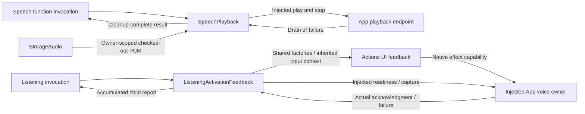

# Owned Speech Playback and Activation

## Summary

Checks out owner-scoped PCM and awaits injected playback, and composes native listening activation with joined cleanup.

## Ownership and boundaries

AppSpeechPlayback depends on FunctionContracts, StorageAudio, Actions and ExecutionRuntime. SpeechPlayback owns one checked-out playback operation; ListeningActivationFeedback owns bounded activation composition. Synthesis, native device work and listening policy remain injected/owned elsewhere.

## External relationships and data flow

Runtime arrows show data or capability calls; dashed arrows show injection.

## Checkout and completion

Validate the audio handle and trusted execution ownership, check out the producer's stream, await native drain, then release it. Cancellation joins playback/stream cleanup before propagating. Producer/storage failures retain their underlying cause; App adaptation supplies localized wording after cleanup. There is no playback queue, synthesis, retry, replay or audio mixing in this directory.

✅ Owner-scoped checkout, cancellation cleanup and actual playback completion are implemented.

## Related design

[Parent design](../README.md)

## Lifecycle-owned conversation and audio (2026-10-12)

✅ 已移除对话生成、ReACT、收件箱排队、结果屏障、ASR 收尾、TTS 合成及回复占用租约的计时终止。Signal 默认无过期时间，框架不再按通信契约附加 TTL。保留显式实时感知数据的新鲜度和网络传输自身超时；它们不作为对话/语音缓存生命周期。Action 自身超时通过原始执行者的 ActionResult 返回。请求/调用数及队列/PCM 容量仍有界，不以计时自动删除已接纳输入。语音句柄无读等待或错误记录 TTL，按播放完成、输入/会话正常结束、异常或显式取消清理；取消加入生成和播放工作。

✅ Implemented: ListeningActivationFeedback.swift owns bounded staged canonical Action composition for speech activation. Readiness and native-start-synchronized cue/haptic run together; all children and the acoustic tail join successfully before capture. AppSpeechPlayback imports Actions and ExecutionRuntime, while UI rendering/transport Presentation keeps its existing independent dependencies. Speech policy and native implementation remain injected.

## Activation composition and failure contract

ListeningActivationFeedback.run accepts the trusted parent FunctionInput, validated ListeningFeedback, UIFeedbackCapability and injected async prepare/capture operations. It resolves canonical UIModule.feedbackDefinitions before effects. Child invocations inherit the parent causal/session/producer context and receive separate execution identities and result stores; no private Action implementation or second Gateway admission is used.

Three bounded stages execute in order: parallel readiness/canonical cue/haptic activation; a 120 ms tail (configurable only by the host, 0…1 second); native capture admission. Each stage joins its children before the next stage is admitted. This explicit gate is required because the shared sequence tree retains ordinary failures rather than implicitly stopping all later leaves. Readiness/capture each use the 30-second default and canonical feedback each has 5 seconds; the owning Listening Action declares 90 seconds.

At most four executed leaves produce one aggregate report with activation/tail/capture path prefixes. Real partial outcomes remain available after a failure. A failed prerequisite prevents capture, records the report once and throws an ActionReportProviding failure. Cancellation joins children, records cancellation and propagates CancellationError. Native cleanup remains with the root VoiceSessionCoordinator and its startup-ID/generation fences. No activation queue, audio sample asset, retry or fabricated success is owned here.

✅ Implemented: one activation stage admits readiness and canonical cue/haptic children together, so model loading does not delay intent feedback. Native-start-gated haptic and cue start together. All three children join successfully before the existing 120 ms tail and capture. Add a single-waiter MainActor ListeningFeedbackStart gate: native playback-start acknowledgment releases the matching haptic child, actual cue failure/cancellation wakes the waiter with that failure. No timers, extra Action admission or queue. Child partial reports remain real; a failed preparation prevents capture while retaining any feedback that actually occurred.

## Streaming TTS latency

✅ Owner-scoped playback completes after native drain and lease cleanup. No post-playback timer or replacement task is owned here. App Lifecycle restores listening immediately when policy/session/native barriers permit.
