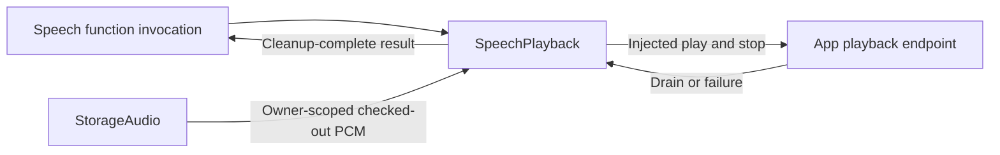

# Owned Speech Playback

## Summary

Checks out owner-scoped PCM and awaits injected playback with joined cleanup.

## Ownership and boundaries

SpeechPlayback is an actor in AppSpeechPlayback, depending only on FunctionContracts and StorageAudio. It owns one admitted playback operation; synthesis, device implementation and speech policy are injected/owned elsewhere.

## External relationships and data flow

Runtime arrows show data or capability calls; dashed arrows show injection.

## Checkout and completion

Validate the audio handle and trusted execution ownership, check out the producer's stream, await native drain, then release it. Cancellation joins playback/stream cleanup before propagating. Producer/storage failures retain their underlying cause; App adaptation supplies localized wording after cleanup. There is no playback queue, synthesis, retry, replay or audio mixing in this directory.

✅ Owner-scoped checkout, cancellation cleanup and actual playback completion are implemented.

## Related design

[Parent design](../README.md)
