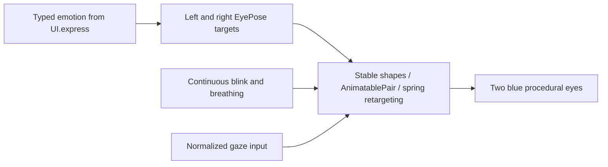

# Components · 呈现组件

用途：无业务副作用的 SwiftUI 程序绘制。设计目标：纯色、低噪声、真实频谱驱动；不启动模型、网关或设备。

- ✅ `VoiceOrb.swift` 保留现有工程文件引用，内容替换为 `CompanionEyes`、可插值的 `EyeSilhouette` 和 `VoiceBars`，不再绘制圆环或 emoji 图片。
- ✅ 眼睛以纯科技蓝路径绘制，支持眨眼、轻微呼吸、微笑/生气轮廓；UI.express 的类型化情绪直接映射到姿态，不经过 emoji。
- ✅ `gaze` 接受归一化方向并连续插值；生产默认居中。生产表情包含 angry/scared/playful。
- ✅ 两端均为 32 个真实 FFT 频段；底边青蓝光柱朝上，顶部短紫色光柱朝下。Canvas 不包含时间振荡或随机起伏，由新频谱值触发绘制。
- ✅ Reduce Motion 禁止眨眼/呼吸/音量跳动，保留静态活动指示与字幕。装饰内容不拦截触摸、不进入 VoiceOver。
- ✅ `FadingCaption.swift` 保留稳定前缀、后缀淡入、最近 320 字符和 VoiceOver 完整文本。
- ❌ 人脸/手势识别到 gaze 的生产通路；更多独立表情轮廓和真机光效/功耗验收。
- ❌ 独立通用呈现状态类型：仍沿用 AppLifecycleCoordinator.VoicePhase。

双眼各占 faceWidth 的 21%，眼间净距 19%，高度 25%；所有表情保留相同宽度，避免微笑时改变眼距。眼线在内容高度 40% 处。屏幕较宽时 faceWidth 上限 600 pt。

顶部光柱在估算的灵动岛下边缘起绘（安全区顶端上方约 12 pt），绘制边界为 166 × 62 pt（内部岛底轮廓宽 126 pt），不环绕或修改系统灵动岛。不同设备与系统展开活动的遮挡仍需验收。

## Continuous expression design

✅ `EyePose` defines each eye's smile curvature, lid slant, openness, width, tilt and offset. `EyeSilhouette` interpolates smile/slant as AnimatablePair; SwiftUI interpolates transforms. Both eyes keep stable identity and identical path topology across all states. No image swaps, glyphs, .id resets, transition queues or per-expression tasks.

✅ Neutral, smile, happy, laugh, thinking, surprised, sad, love, angry, scared and playful have distinct parameter presets. New emotion targets retarget the current rendered pose with a critically damped 0.65-second response spring. Clearing also morphs back to neutral. Blink closure uses a cosine envelope with smooth endpoints, sampled at up to 60 Hz; inactive scenes pause. Reduce Motion disables repeating movements and uses a short 0.2-second interpolation.

To add an emotion: extend the Action semantic domain, document it in Assistant JSON, add an exhaustive EyePose preset and extend the action/configuration test. No new asset or third-party dependency is needed for this parameterized design. ❌ Authored multi-stage performance choreography, actual face/hand tracking and measured device frame-time acceptance remain future work.

✅ Reply spectrum attachment: the lower capsule contour overlaps the estimated cutout edge by 1 pt; the ends taper down in length. Uses public safe-area geometry, not private hardware APIs. ❌ Expanded-island and per-device pixel alignment still require physical validation.

✅ Bowl refinement: the reply spectrum now uses a 166 × 62 pt padded Canvas; a 126 pt lower capsule contour sits inside it. Baseline is 24 pt below the canvas top, preventing the lifted corners from clipping. Bars follow outward normals on both lower rounded corners, taper near the ends, and join a faint violet open rim. No upper capsule edge or full ring is drawn; frequency energy remains real FFT data. Geometry remains a safe-area estimate pending newer API support.
