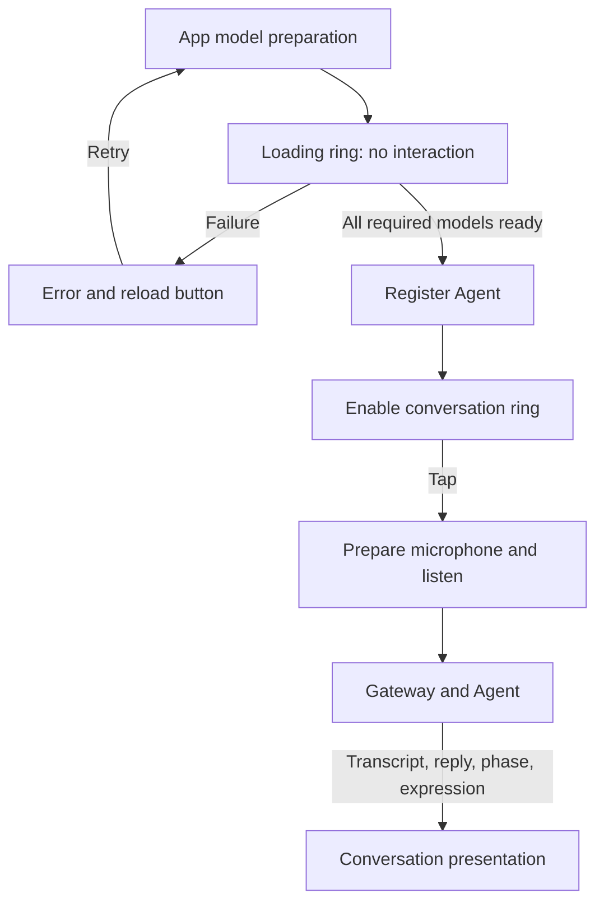

# Conversation presentation

Purpose: present a black voice interface with an interactive ring, live transcript and Assistant captions. Design goals: observable readiness, accessible controls and no model or device logic in views.

## Files and interaction

- ✅ ConversationView.swift contains the startup presentation and the ready conversation page. Startup displays a noninteractive loading ring, current model stage and progress indicator. Failure exposes an explicit reload button; the ring remains inactive.
- ✅ ConversationViewModel.swift forwards lifecycle state and user intent without owning concrete models or audio processing.
- ✅ Once model preparation and Agent registration finish, the whole circle, including its center, starts conversation. No microphone recording starts automatically.
- ✅ Active conversation can be stopped by tapping again. Background transitions, interruptions and route changes stop the voice session. Conversation errors appear below the ring.

## Rendering and data flow

Listening uses microphone RMS; speaking uses playback PCM amplitude. Loading rotates and breathes. The ring updates at most 30 times per second and pauses while idle; Reduce Motion disables time-based movement. Expressions appear at the center and clear on new speech or stop.

Captions preserve stable recognition prefixes and fade revised suffixes over about 400 ms. The view retains a 320-character display window; Gateway retains complete results. Assistant replies replace transcripts in the same area. No synthetic partial transcription is introduced.

VoiceOver, Dynamic Type and Reduce Motion are supported. SwiftUI remains MainActor-isolated. Views forward intents through the lifecycle coordinator and never call models or devices directly.

- ❌ Camera/character pages and independent page-subscription lifetimes.
- ❌ Physical-device startup latency and visual acceptance require device testing.
