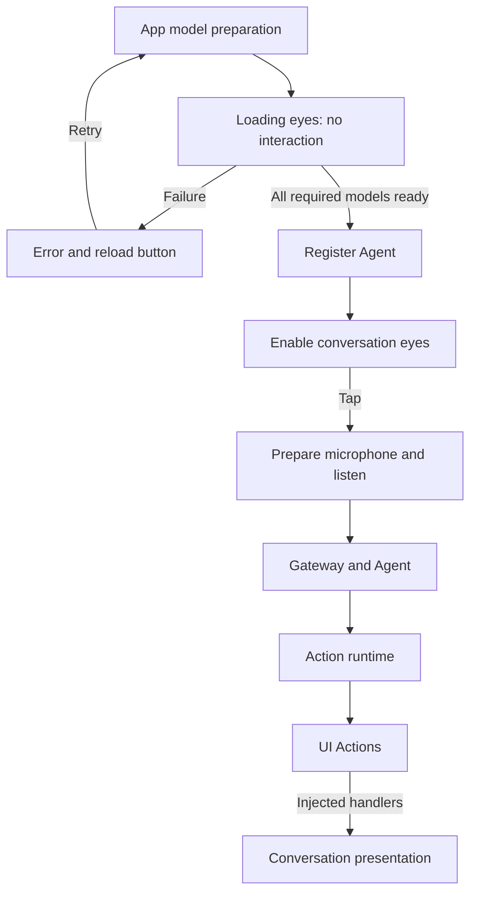

# Conversation presentation

Purpose: present a black voice interface with an interactive blue eyes, live transcript and Assistant captions. Design goals: observable readiness, accessible controls and no model or device logic in views.

## Files and interaction

- ✅ ConversationView.swift contains the startup presentation and the ready conversation page. Startup displays a noninteractive breathing eyes, current model stage and progress indicator. Failure exposes an explicit reload button; the eyes remain inactive.
- ✅ ConversationViewModel.swift forwards lifecycle state and user intent without owning concrete models or audio processing.
- ✅ Once model preparation and Agent registration finish, the central eye region, starts conversation. No microphone recording starts automatically.
- ✅ Active conversation can be stopped by tapping again. Background transitions, interruptions and route changes stop the voice session. Conversation errors appear above the bottom waveform.

## Rendering and data flow

Listening uses microphone PCM frequency bands; speaking analyzes the played PCM window at the player render cursor. Eyes blink and breathe with continuous expression interpolation. Bottom cyan bars show microphone frequency bands; a compact violet spectrum sits below the island. Eye timelines are capped at 60 fps and spectrum telemetry at approximately 30 fps; Reduce Motion disables time-based movement and meter jumps. Expressions clear on new speech or stop.

Captions preserve stable recognition prefixes and fade revised suffixes over about 400 ms. The view retains a 320-character display window; Gateway retains complete results. ✅ SpeechPerception sends UI.setTranscript Actions for recognition previews and a finishTranscript Action after recognition finishes. The App handler replaces the live transcript for the active session; the processing hint appears until Assistant reply captions arrive in the same area. Signal observers do not update these captions. No synthetic partial transcription is introduced.

VoiceOver, Dynamic Type and Reduce Motion are supported. SwiftUI remains MainActor-isolated. Views forward intents through the lifecycle coordinator and never call models or devices directly.

- ❌ Character pages and independent page-subscription lifetimes.
- ❌ Physical-device startup latency and visual acceptance require device testing.

✅ Startup and conversation now have transparent content backgrounds inside CameraConversationSurface; eyes, microphone tap target and low captions remain above the dimmed preview. ❌ Visual/audio coexistence acceptance requires a physical device.

✅ Recognition phase, transcript, Assistant reply clearing and expression clearing are UI Actions. Speech Signal observation changes no view state. Initial/failed/stopped views follow local runtime lifecycle; microphone/playback meters reflect device telemetry, not Agent commands.

✅ Turn behavior: onset clears the previous reply/expression once; VAD silence retains the last recognition preview until final; final closes recognition; completed replies and expressions remain visible until the next onset. Actual playback controls the speaking projection, independently of caption arrival.

## Product visual pass (2026-09-27)

✅ Navy translucent atmosphere preserves camera visibility and existing controls. Central pure blue eyes replace the ring. The entire central tap area retains start/stop behavior; startup is noninteractive. ASR/reply share the lower caption slot with unchanged priority and fade behavior; bottom bars extend through the bottom safe area. Reply bars trace only the estimated island lower edge inside a padded 166 × 62 pt canvas, descending from it with tapered corners; no upper/side corona is drawn.

✅ `ConversationVisualPreview` and Xcode Preview provide explicitly labeled a synthesized test tone spectrum with a frequency slider, listening/reply switching and smile/anger/neutral controls. Debug launch argument `-conversation-preview` opens it without camera, microphone or model startup; Release ignores this argument.

❌ Physical-device top-area layout (including expanded system activities), landscape/accessibility visual acceptance, and actual face/hand gaze delivery remain pending. No runtime contract, perception pipeline or production expression registrations changed.

验证：`scripts/check.sh` 通过（含 86 个 IntegrationTests；可选真实模型测试未启用）。模拟器实际启动并检查聆听/回应视觉预览；顶部光柱按可用空间限高。预览增加 `-preview-speaking` 可直接打开回应状态。真机音视频与精确岛位置验收未执行。

✅ 2026-09-27 refinement: larger face-proportioned eyes (21% width each, 19% gap), 40% eye line, 32 measured bands, blue input/violet reply. Preview tone remains steady at fixed frequency; the slider moves its spectral peak rather than triggering canned animation. See ADR 0045.

频谱改版验证：根 `scripts/check.sh` 通过（含 90 个 IntegrationTests）；四个模拟器 scheme 与签名 Release 真机构建通过。已检查模拟器双眼比例与下置紫色频谱布局。真实麦克风频谱观感及输出路由延迟仍需用户真机体验。

✅ Eye expressions use typed semantic values with stable rendering identities; the debug preview picker exposes every implemented pose. Clear/new turn morphs to neutral. No emoji or UUID-based eye replacement remains. Eye motion samples up to 60 Hz; audio spectra remain approximately 30 Hz.

表情改版验证：根检查通过（90 个 IntegrationTests，其中表情测试遍历 11 个合法值）；四个模拟器 scheme 和签名 Release 真机构建通过，打包的 Assistant JSON 与源码一致。实际快速切换的观感和帧耗时仍需真机验收。

✅ Reply spectrum attachment: the lower capsule contour overlaps the estimated cutout edge by 1 pt; the ends taper down in length. Uses public safe-area geometry, not private hardware APIs. ❌ Expanded-island and per-device pixel alignment still require physical validation.

✅ Bowl refinement: the reply spectrum now uses a 166 × 62 pt padded Canvas; a 126 pt lower capsule contour sits inside it. Baseline is 24 pt below the canvas top, preventing the lifted corners from clipping. Bars follow outward normals on both lower rounded corners, taper near the ends, and join a faint violet open rim. No upper capsule edge or full ring is drawn; frequency energy remains real FFT data. Geometry remains a safe-area estimate pending newer API support.
