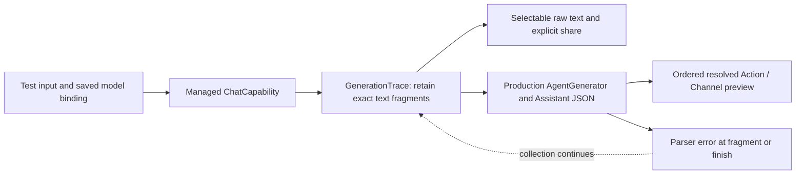

# Diagnostics — Explicit Model Validation

Purpose: provide opt-in model diagnostics separately from normal Agent conversation. Views receive injected capabilities or validation closures; AppContainer owns concrete providers.

- ✅ `MossValidationView.swift`: MOSS zh_1/en_2 synthesis (beta), load/first-chunk/total timing, playback, unloading and reports; selected with `-moss-benchmark`, optionally `-moss-autorun`.
- ✅ `Qwen35ValidationView.swift`: Debug-only `-qwen35-validation` entry. Loads ASR and Qwen together, requests a short synthetic arithmetic reply, reports completion and releases Qwen. It does not record audio or execute Actions. A completion marker verifies coexistence and generation, not general answer quality.
- ❌ Post-entitlement Qwen 4B coexistence validation on an unlocked iPhone.
- ❌ Sustained voice, memory, thermal and audio-quality acceptance.
- ❌ Separate the existing MOSS playback/measurement coordinator from its view.

Update this README when changing this directory. ✅ means implemented; ❌ means outstanding. Do not create unused placeholders.

✅ MOSS diagnostics now sends auto-locale Mandarin/English mixed text through the same default managed provider. ❌ Device acoustic quality and iOS 27 soak testing remain manual acceptance.

✅ Startup/diagnostics now perform real in-memory synthesis warmup before conversation admission or measured speech. It exercises lazy kernels using synthetic Chinese text, drains PCM without playback and propagates failures. The first device run took 10.63 s to first PCM without warmup; startup must absorb that compilation cost instead of extending StorageAudio timeouts. ❌ Warmup does not prove sustained runtime stability.

✅ MOSS audition uses the production AppleAudioIO mixer/player path, including its render telemetry callback. `-moss-autorun -moss-playback` explicitly enables automatic speaker playback and writes success only after playback drains; plain autorun remains synthesis-only.

## LLM raw output inspection

✅ Settings → LLM 原始输出测试 opens `LLMRawOutputView` in both app targets, even if unrelated voice startup failed. App injects the saved chat binding from the process-wide manager after joining voice cleanup. Simulator local chat remains unavailable; configured cloud capability is real, not a stub. Each run is a new single-turn request with the shared Assistant system prompt and packaged JSON registry, no history, temperature 0.7 and a selectable 64–2048 output-token budget (default 256).

The MainActor view owns one task, one session and one `GenerationTrace`. It consumes model events serially, retains exact text and fragment boundaries before parsing, and shows resolved Actions/Channels without invoking an Agent, Gateway, TTS or device handler. This is an explicit model-capability diagnostic, not an alternate business-input route. The diagnostic reuses the production Assistant prompt and interprets the same resolved output protocol without executing it.

There is no pending run queue. Start is disabled until the current task exits; Stop, navigation away and scene inactivity cancel it. Session cancellation runs in a cancellation handler and defer; the shared model lease remains authoritative until adapter cleanup completes (overlap can report busy). A separate 120-second consumption deadline cancels a stalled session; acquisition uses ModelKit/provider limits. Raw retention is bounded to 256 KiB and 8192 fragments, failing explicitly on excess without evicting earlier text. `GenerationTrace` uses the production parser's own limits, including 120 calls. Parser failure preserves prior successfully returned calls and records its location while raw collection continues. Normal stream termination requires a finish event; cancellation/transport failure does not flush incomplete parser state. A token-length finish remains visibly distinguished from stop.

The screen and share report expose request text, system prompt, saved model label, request ID, generation budget, raw text, escaped fragments, finish reason and parser outcome. XML/whitespace are preserved and never rendered as Markdown. The report flags output beyond the production Assistant's 2000-byte bound; diagnostic retention/deadline intentionally exceed production limits to inspect failure tails. Data stays in screen memory unless explicitly shared; no automatic disk logging, key export or clipboard reads.

❌ This does not capture tokenizer IDs, provider HTTP/SSE bytes or reasoning withheld by an adapter. It does not observe an existing voice turn or measure actual Channel admission/start/completion; call order is parser order before Assistant converts speech text into audio handles. Correct parsing narrows investigation toward downstream handling but does not prove scheduler correctness. Device UI and live-model acceptance remain manual.

✅ The parser preview/report now retains and indents begin/end wait events alongside Actions, preserving order and effective Channel after nested scope restoration. It uses the same wait-aware Assistant prompt and packaged registry. Consecutive and nested waits are visible even when empty. ❌ This remains a non-executing preview; it cannot establish physical start/completion times or scheduler correctness.
